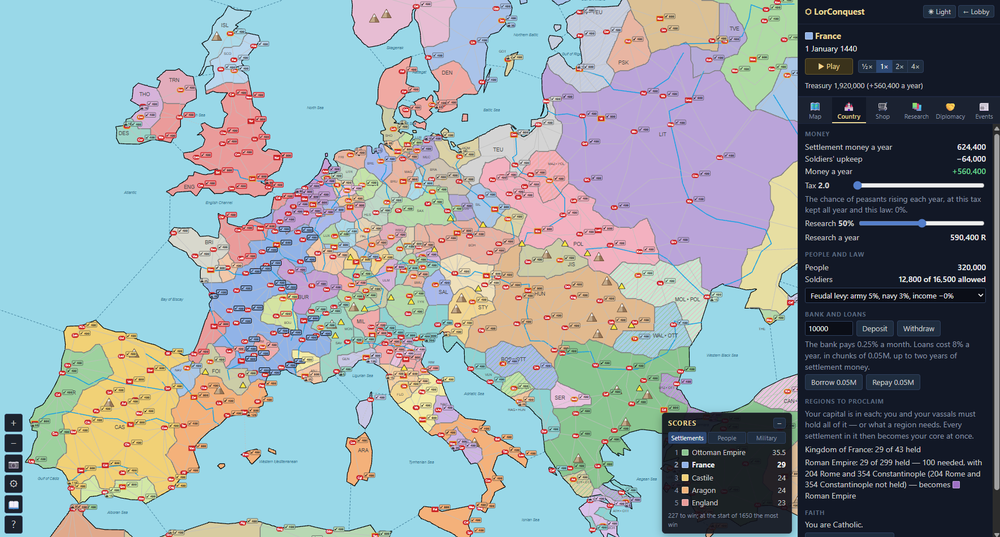

# LorConquest

A real-time grand strategy game on a map of Europe, 1440–1650: up to four people
and the computer rule its countries, one game day every tenth of a second, in
war, trade, diplomacy and the politics of the Holy Roman Empire.

**Live:** https://lorconquest.lorand77.dev



## Features

- Three maps: Mitteleuropa balanced, Mitteleuropa as it was in 1440, and all of
  Europe with 118 countries
- Armies, sieges and storms, fleets, blockades and landings by sea; mercenaries,
  research from swords to muskets, laws, taxes, loans and buildings
- Diplomacy with the computer and with people: alliances, vassals and
  protectorates, unions, coalitions against whoever grows too strong, peace terms
- The Holy Roman Empire: elections, Imperial Authority, the Diet's reforms, the
  ban; religion and the Reformation; peasant uprisings that may become states
- Rooms in the lobby, games alone or with friends, pausing by vote, a computer
  stand-in for a player who is away
- Replays that check they end exactly as the game did, timelapse videos,
  watching games live, achievements, friends and a leaderboard

## Stack

Node.js 24, Express 5 and Socket.IO on the server, with SQLite through Node's own
`node:sqlite`; vanilla JavaScript in the browser, with no framework and no build
step. The browser and the server load the same game engine (`src/engine/`), so
the server checks every order with the rules the screen shows, and a replay is
played by the very same code.

## Getting started

```sh
npm install
npm run dev    # http://localhost:3002
npm test
```

There are no native modules to build; see `docs/setup.md` for settings and
putting it online.

## Docs

- [docs/STARTER.md](docs/STARTER.md): the rules for a first game, on one page
- [docs/RULES.md](docs/RULES.md): the rules in full
- [docs/design.md](docs/design.md): architecture and the reasons behind it
- [docs/setup.md](docs/setup.md): running and deploying, backups and monitoring
- [docs/plan.md](docs/plan.md): the milestones; [TODO.md](TODO.md): what is still to do
- [CLAUDE.md](CLAUDE.md): conventions for working in the repo
- `scenarios/*/SCENARIO.md`: each map, its countries and its history

## License

MIT, see [LICENSE](LICENSE).
