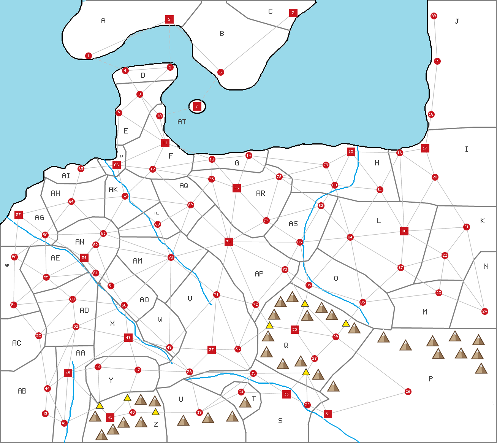

# SCENARIO: MITTELEUROPA

*Everything here is specific to this map; the general rules are in [RULES.md](RULES.md).*

This file is the **only** place the map's facts are written down. [map.png](map.png) is drawn from
it on top of the hand-drawn [map-base.png](map-base.png) (sea, coast, borders, rivers). After
changing anything here, run:

```
perl tools/map.pl              # check the data, redraw map.png, refresh the generated parts below
perl tools/map.pl mountains    # the same, but first move any mountain that touches something
```

Columns and blocks marked *generated* are rewritten by the script — edit the rest.

**x = 1** (see the scenario scaling note in RULES.md)

<!-- generated:summary -->
87 settlements (19 cities, 68 towns) · 45 countries · 1,060,000 people · 198 land routes, 4 straits, 7 mountain passes
<!-- /generated -->



## Countries

*Code and Country are data; the other columns are generated.*

| Code | Country | Settlements | Pop | Army | Ships | HRE |
|---|---|---|---|---|---|---|
| A | Norway | 1, 2 | 30K | 1,200 | 15 | — |
| B | Gothenburg | 6 | 10K | 400 | 5 | — |
| C | Stockholm | 3 | 20K | 800 | 10 | — |
| D | Upper Denmark | 4, 5 | 20K | 800 | 10 | — |
| E | Lower Denmark | 8, 9 | 20K | 800 | 10 | — |
| AT | Copenhagen | 7 | 20K | 800 | 10 | — |
| F | Schleswig | 10, 11, 12 | 40K | 1,600 | 20 | ✓ |
| G | Mecklenburg | 13, 14 | 20K | 800 | 10 | ✓ |
| H | Gdansk | 15, 79, 80, 81 | 50K | 2,000 | 25 | — |
| I | Prussia | 16, 17, 20 | 40K | 1,600 | 20 | — |
| J | Lithuania | 18, 19, 89 | 30K | 1,200 | 15 | — |
| K | Eastern Poland | 21, 22 | 20K | 800 | — | — |
| L | Warsaw | 84, 87, 88 | 40K | 1,600 | — | — |
| M | Rzeszów | 23 | 10K | 400 | — | — |
| N | Lviv | 24 | 10K | 400 | — | — |
| AS | Poznań | 82, 83 | 20K | 800 | — | — |
| O | Silesia | 85, 86 | 20K | 800 | — | part |
| P | Hungary | 26, 31 | 30K | 1,200 | — | — |
| Q | Bohemia | 28, 29, 30 | 40K | 1,600 | — | ✓ |
| S | Austria | 32, 33, 35 | 40K | 1,600 | — | ✓ |
| T | Salzburg | 34 | 10K | 400 | — | ✓ |
| U | Tyrol | 39 | 10K | 400 | — | ✓ |
| V | Bavaria | 36, 37, 38, 71 | 50K | 2,000 | — | ✓ |
| W | Ulm | 48 | 10K | 400 | — | ✓ |
| X | Stuttgart | 49 | 20K | 800 | — | ✓ |
| Y | Lower Germany | 46, 47 | 20K | 800 | — | ✓ |
| Z | Switzerland | 40, 41 | 30K | 1,200 | — | ✓ |
| AA | Elsass-Lothringen | 42, 45 | 30K | 1,200 | — | ✓ |
| AB | Nancy | 43, 44 | 20K | 800 | — | part |
| AC | Luxemburg | 53 | 10K | 400 | — | ✓ |
| AD | Trier | 52, 60 | 20K | 800 | — | ✓ |
| AE | Liège | 55 | 10K | 400 | — | ✓ |
| AF | Belgium | 54, 56 | 20K | 800 | — | ✓ |
| AG | Netherlands | 57, 58 | 30K | 1,200 | 15 | ✓ |
| AH | Münster | 64 | 10K | 400 | — | ✓ |
| AI | Bremen | 65 | 10K | 400 | 5 | ✓ |
| AJ | Hamburg | 66 | 20K | 800 | 10 | ✓ |
| AK | Hanover | 67 | 10K | 400 | — | ✓ |
| AL | Wolfsburg | 68 | 10K | 400 | — | ✓ |
| AM | Jena | 70 | 10K | 400 | — | ✓ |
| AN | Ruhr | 59, 61, 62, 63 | 50K | 2,000 | — | ✓ |
| AO | Frankfurt | 50, 51 | 20K | 800 | — | ✓ |
| AP | Saxony | 72, 73, 74 | 40K | 1,600 | — | ✓ |
| AQ | Magdeburg | 69 | 10K | 400 | — | ✓ |
| AR | Brandenburg | 75, 76, 77, 78 | 50K | 2,000 | — | ✓ |

## Settlements

- **Type** — `town` (red circle, 10,000 pop) or `city` (red square, 20,000 pop).
- **Port** — the settlement sits on the coast. 65 Bremen and 66 Hamburg are ports **by ruling**,
  though the map does not draw them on the coastline.
- **HRE** — inside the Holy Roman Empire.
- **X, Y** — marker centre in pixels on the map.
- **Borders** — settlements an army can march to in one step (every route is listed under both
  ends). Routes through a mountain pass are listed here too; the pass itself is in
  *Mountain passes*.
- **Straits** — crossings by sea (dashed lines, RULES.md §8).

Settlements 25 and 27 were deleted from the map.

| ID | Name | Country | Type | Port | HRE | X | Y | Borders | Straits |
|---|---|---|---|---|---|---|---|---|---|
| 1 | Kristiansand | A | town | port |  | 233 | 147 | 2 | 4 |
| 2 | Oslo | A | city | port |  | 446 | 51 | 1, 6 | 5 |
| 3 | Stockholm | C | city | port |  | 772 | 34 | 6 |  |
| 4 | Thisted | D | town | port |  | 330 | 186 | 5, 8 | 1 |
| 5 | Skagen | D | town | port |  | 448 | 177 | 4, 8 | 2 |
| 6 | Gothenburg | B | town | port |  | 581 | 190 | 2, 3 | 7 |
| 7 | Copenhagen | AT | city | port |  | 519 | 280 |  | 6, 10 |
| 8 | Herning | E | town |  |  | 368 | 248 | 4, 5, 9, 10, 11 |  |
| 9 | Esbjerg | E | town | port |  | 313 | 297 | 8, 11, 66 |  |
| 10 | Flensburg | F | town | port | HRE | 420 | 305 | 8, 11 | 7 |
| 11 | Kiel | F | city | port | HRE | 435 | 376 | 8, 9, 10, 12, 13, 66 |  |
| 12 | Luneburg | F | town |  | HRE | 402 | 445 | 11, 13, 66, 67, 69, 75 |  |
| 13 | Rostock | G | town | port | HRE | 558 | 419 | 11, 12, 14, 75, 76 |  |
| 14 | Stettin | G | town | port | HRE | 655 | 409 | 13, 76, 78, 79 |  |
| 15 | Gdynia | H | city | port |  | 924 | 399 | 16, 79, 80, 81 |  |
| 16 | Danzig | I | town | port |  | 1052 | 402 | 15, 17, 20, 81, 88 |  |
| 17 | Konigsberg | I | city | port |  | 1119 | 390 | 16, 18, 20 |  |
| 18 | Rusne | J | town | port |  | 1135 | 301 | 17, 19 |  |
| 19 | Klaipeda | J | town | port |  | 1151 | 161 | 18, 89 |  |
| 20 | Olsztyn | I | town |  |  | 1145 | 466 | 16, 17, 21, 88 |  |
| 21 | Brest | K | town |  |  | 1228 | 597 | 20, 22, 24, 88 |  |
| 22 | Lublin | K | town |  |  | 1171 | 672 | 21, 23, 24, 87, 88 |  |
| 23 | Rzeszow | M | town |  |  | 1155 | 770 | 22, 24, 86, 87 |  |
| 24 | Lviv | N | town |  |  | 1276 | 819 | 21, 22, 23 |  |
| 26 | Kassa | P | town |  |  | 1074 | 1030 | 29, 31 |  |
| 28 | Brno | Q | town |  | HRE | 828 | 943 | 29, 30, 31, 32, 33, 35 |  |
| 29 | Ostrava | Q | town |  | HRE | 884 | 886 | 26, 28, 30, 85, 86 |  |
| 30 | Prague | Q | city |  | HRE | 776 | 867 | 28, 29, 36, 72, 73, 85 |  |
| 31 | Bratislava | P | city |  |  | 863 | 1089 | 26, 28, 32 |  |
| 32 | Hainburg | S | town |  | HRE | 809 | 1065 | 28, 31, 33 |  |
| 33 | Vienna | S | city |  | HRE | 754 | 1037 | 28, 32, 34, 35 |  |
| 34 | Salzburg | T | town |  | HRE | 635 | 1031 | 33, 35, 39 |  |
| 35 | Linz | S | town |  | HRE | 667 | 982 | 28, 33, 34, 36, 37, 38, 39 |  |
| 36 | Passau | V | town |  | HRE | 626 | 918 | 30, 35, 37, 71, 72 |  |
| 37 | Munich | V | city |  | HRE | 557 | 920 | 35, 36, 38, 48, 71 |  |
| 38 | Memmingen | V | town |  | HRE | 499 | 978 | 35, 37, 39, 47, 48, 49 |  |
| 39 | Innsbruck | U | town |  | HRE | 525 | 1085 | 34, 35, 38, 40 |  |
| 40 | Zurich | Z | town |  | HRE | 349 | 1085 | 39, 41, 47 |  |
| 41 | Bern | Z | city |  | HRE | 290 | 1098 | 40, 42, 45, 46, 47 |  |
| 42 | Geneva | AA | town |  | HRE | 169 | 1113 | 41, 43, 44, 45 |  |
| 43 | Lyon | AB | town |  |  | 119 | 1088 | 42, 44 |  |
| 44 | Nancy | AB | town |  | HRE | 125 | 1022 | 42, 43, 45, 52, 53 |  |
| 45 | Strassburg | AA | city |  | HRE | 179 | 981 | 41, 42, 44, 46, 49, 52 |  |
| 46 | Basel | Y | town |  | HRE | 258 | 965 | 41, 45, 47, 49 |  |
| 47 | Konstanz | Y | town |  | HRE | 363 | 973 | 38, 40, 41, 46, 49 |  |
| 48 | Ulm | W | town |  | HRE | 446 | 914 | 37, 38, 49, 50, 70, 71 |  |
| 49 | Stuttgart | X | city |  | HRE | 338 | 888 | 38, 45, 46, 47, 48, 50, 52 |  |
| 50 | Frankfurt | AO | town |  | HRE | 327 | 803 | 48, 49, 51, 52, 60, 70 |  |
| 51 | Bonn | AO | town |  | HRE | 292 | 752 | 50, 59, 61, 62, 70 |  |
| 52 | Trier | AD | town |  | HRE | 200 | 859 | 44, 45, 49, 50, 53, 60 |  |
| 53 | Luxemburg | AC | town |  | HRE | 102 | 883 | 44, 52, 54, 60 |  |
| 54 | Brussels | AF | town |  | HRE | 36 | 802 | 53, 55, 56, 60 |  |
| 55 | Liege | AE | town |  | HRE | 122 | 729 | 54, 56, 58, 59, 60, 61 |  |
| 56 | Antwerp | AF | town |  | HRE | 38 | 676 | 54, 55, 57, 58 |  |
| 57 | Rotterdam | AG | city | port | HRE | 49 | 565 | 56, 58, 64 |  |
| 58 | Utrecht | AG | town |  | HRE | 119 | 618 | 55, 56, 57, 59, 63, 64 |  |
| 59 | Dusseldorf | AN | city |  | HRE | 222 | 678 | 51, 55, 58, 61, 62, 63 |  |
| 60 | Duren | AD | town |  | HRE | 191 | 787 | 50, 52, 53, 54, 55, 61 |  |
| 61 | Cologne | AN | town |  | HRE | 252 | 718 | 51, 55, 59, 60 |  |
| 62 | Essen | AN | town |  | HRE | 252 | 644 | 51, 59, 63, 70 |  |
| 63 | Dortmund | AN | town |  | HRE | 272 | 614 | 58, 59, 62, 64, 67, 68, 70 |  |
| 64 | Munster | AH | town |  | HRE | 188 | 530 | 57, 58, 63, 65, 67 |  |
| 65 | Bremen | AI | town | port | HRE | 213 | 444 | 64, 66 |  |
| 66 | Hamburg | AJ | city | port | HRE | 307 | 434 | 9, 11, 12, 65, 67 |  |
| 67 | Hanover | AK | town |  | HRE | 329 | 516 | 12, 63, 64, 66, 68, 69 |  |
| 68 | Wolfsburg | AL | town |  | HRE | 415 | 590 | 63, 67, 69, 70 |  |
| 69 | Magdeburg | AQ | town |  | HRE | 502 | 539 | 12, 67, 68, 70, 74, 75 |  |
| 70 | Jena | AM | town |  | HRE | 450 | 677 | 48, 50, 51, 62, 63, 68, 69, 71, 74 |  |
| 71 | Bamberg | V | town |  | HRE | 570 | 775 | 36, 37, 48, 70, 72, 74 |  |
| 72 | Chemnitz | AP | town |  | HRE | 673 | 801 | 30, 36, 71, 73, 74 |  |
| 73 | Dresden | AP | town |  | HRE | 750 | 709 | 30, 72, 74, 83, 85 |  |
| 74 | Leipzig | AP | city |  | HRE | 602 | 636 | 69, 70, 71, 72, 73, 75, 76, 77, 83 |  |
| 75 | Schwerin | AR | town |  | HRE | 557 | 471 | 12, 13, 69, 74, 76 |  |
| 76 | Berlin | AR | city |  | HRE | 623 | 495 | 13, 14, 74, 75, 77, 78 |  |
| 77 | Cottbus | AR | town |  | HRE | 701 | 580 | 74, 76, 78, 82, 83 |  |
| 78 | Seelow Heights | AR | town |  | HRE | 735 | 465 | 14, 76, 77, 79, 80, 82 |  |
| 79 | Szczecinek | H | town |  |  | 858 | 434 | 14, 15, 78, 80 |  |
| 80 | Bydgoszcz | H | town |  |  | 881 | 487 | 15, 78, 79, 81, 82, 84 |  |
| 81 | Plock | H | town |  |  | 1000 | 499 | 15, 16, 80, 84, 88 |  |
| 82 | Pila | AS | town |  |  | 845 | 541 | 77, 78, 80, 83, 84 |  |
| 83 | Poznan | AS | town |  |  | 789 | 637 | 73, 74, 77, 82, 84, 85 |  |
| 84 | Lodz | L | town |  |  | 922 | 624 | 80, 81, 82, 83, 85, 86, 87, 88 |  |
| 85 | Breslau | O | town |  | HRE | 813 | 750 | 29, 30, 73, 83, 84, 86 |  |
| 86 | Krakow | O | town |  |  | 955 | 795 | 23, 29, 84, 85, 87 |  |
| 87 | Radom | L | town |  |  | 1055 | 704 | 22, 23, 84, 86, 88 |  |
| 88 | Warsaw | L | city |  |  | 1064 | 608 | 16, 20, 21, 22, 81, 84, 87 |  |
| 89 | Palanga | J | town | port |  | 1142 | 42 | 19 |  |

## Mountain passes

Yellow triangles on the map, numbered west to east. Every route listed runs settlement → pass →
settlement. A pass belongs to whoever owns the settlement whose land it lies in (RULES.md §8).
*Pass, X, Y and Routes are data; the other columns are generated from where the pass lies.*

| Pass | X | Y | Routes | In the land of | Owner at start |
|---|---|---|---|---|---|
| P1 | 262 | 1068 | 41-42, 41-45, 41-46 | 41 Bern | Z Switzerland |
| P2 | 335 | 1048 | 41-47, 40-47 | 40 Zurich | Z Switzerland |
| P3 | 409 | 1085 | 39-40 | 40 Zurich | Z Switzerland |
| P4 | 709 | 857 | 30-36, 30-72 | 30 Prague | Q Bohemia |
| P5 | 802 | 800 | 30-73, 30-85, 29-85 | 30 Prague | Q Bohemia |
| P6 | 805 | 980 | 28-35, 28-33, 28-31, 28-32 | 28 Brno | Q Bohemia |
| P7 | 910 | 852 | 29-86 | 29 Ostrava | Q Bohemia |

## Mountains

Decoration only — mountains have no rules effect outside the passes. Apex positions (x,y in
pixels); `perl tools/map.pl mountains` moves any that touch something else.

```
769,767  738,780  846,795  721,813  873,814  808,816  932,849  705,870
1197,870  1009,873  1259,880  1138,883  1067,894  701,912  1213,915  1153,916
1256,917  791,936  744,943  1266,955  837,971  877,1002  370,1037  407,1041
645,1044  250,1081  611,1081  547,1085  482,1092  371,1096  325,1097  297,1115
267,1130
```

## Overview

<!-- generated:overview -->
**Cities (20K):** 2, 3, 7, 11, 15, 17, 30, 31, 33, 37, 41, 45, 49, 57, 59, 66, 74, 76, 88 — all other settlements are towns (10K).

**HRE settlements (55):** 10–14, 28–30, 32–42, 44–78, 85 — held by 30 of the 45 countries.

**Ports (21):** 1, 2, 3, 4, 5, 6, 7, 9, 10, 11, 13, 14, 15, 16, 17, 18, 19, 57, 65, 66, 89

| Pop | Countries |
|---|---|
| 50K | 4: H Gdansk · V Bavaria · AN Ruhr · AR Brandenburg |
| 40K | 6: F Schleswig · I Prussia · L Warsaw · Q Bohemia · S Austria · AP Saxony |
| 30K | 6: A Norway · J Lithuania · P Hungary · Z Switzerland · AA Elsass-Lothringen · AG Netherlands |
| 20K | 15: C Stockholm · D Upper Denmark · E Lower Denmark · AT Copenhagen · G Mecklenburg · K Eastern Poland · AS Poznań · O Silesia · X Stuttgart · Y Lower Germany · AB Nancy · AD Trier · AF Belgium · AJ Hamburg · AO Frankfurt |
| 10K | 14: B Gothenburg · M Rzeszów · N Lviv · T Salzburg · U Tyrol · W Ulm · AC Luxemburg · AE Liège · AH Münster · AI Bremen · AK Hanover · AL Wolfsburg · AM Jena · AQ Magdeburg |

**Naval powers:** 14 countries, 180 ships. Crossing a strait needs 10 ships (RULES.md §8).

| Country | Ports held | Ships | Can cross straits? |
|---|---|---|---|
| H Gdansk | 15 | 25 | yes |
| F Schleswig | 10, 11 | 20 | yes |
| I Prussia | 16, 17 | 20 | yes |
| A Norway | 1, 2 | 15 | yes |
| J Lithuania | 18, 19, 89 | 15 | yes |
| AG Netherlands | 57 | 15 | yes |
| C Stockholm | 3 | 10 | **exactly** |
| D Upper Denmark | 4, 5 | 10 | **exactly** |
| E Lower Denmark | 9 | 10 | **exactly** |
| AT Copenhagen | 7 | 10 | **exactly** |
| G Mecklenburg | 13, 14 | 10 | **exactly** |
| AJ Hamburg | 66 | 10 | **exactly** |
| B Gothenburg | 6 | 5 | no |
| AI Bremen | 65 | 5 | no |
<!-- /generated -->

## Special coring
*(no Courthouse and no 20-year wait)*

You may proclaim a region when **both** are true:

1. Your **capital** lies within the region.
2. You control **100%** of its settlements.

Every settlement in the region becomes core immediately. If you later lose one and retake it, it
is core again on capture.

| Formable | Settlements | Count |
|---|---|---|
| **Unite Austria** | 32, 33, 34, 35, 39 | 5 |
| **Unite Czechoslovakia** | 26, 28, 29, 30, 31 | 5 |
| **Unite the Benelux** | 53, 54, 55, 56, 57, 58 | 6 |
| **Unite French-speaking people** | 41, 42, 43, 44, 45, 53, 54, 55 | 8 |
| **Unite Scandinavia** | 1–9 | 9 |
| **Old Poland** | 22, 23, 80, 81, 83, 84, 85, 86, 87, 88 | 10 |
| **AustroHungary** | 23, 24, 26, 28–35, 39, 86 | 13 |
| **Modern Poland** | 14, 15, 16, 20, 22, 23, 79–88 | 16 |
| **Polish–Lithuanian Commonwealth** | Modern Poland + 17, 18, 19, 21, 24, 89 | 22 |
| **Germany** (1990) | 10–13, 36–38, 47–52, 59–78 | 33 |
| **Post Germany** (1930) | Germany + 14, 17, 20, 79, 85 | 38 |
| **Greater Germany** (Kaiser 1880) | Post Germany + 16, 19, 45, 80, 82, 83 | 44 |
| **Greater German Reich** (all German-speaking) | Greater Germany + 28, 29, 30, 32–35, 39, 40, 46, 53 | 55 |

## Sea zones

**North Sea · Skagerrak–Kattegat · Baltic.** A fleet operates in one zone at a time.

## The Holy Roman Empire

The Empire is every settlement marked **HRE** above (listed in the *Overview*).

Demand to become leader of the Empire under your hegemony. You must control **at least 10
settlements inside the HRE**, and may propose **only once, ever**.

```
chance each German state joins = your soldiers ÷ their soldiers × 10 %
0% if you do not have more soldiers than they do
```

Protectorates pay you **10%** of their income.

## Victory

> **Control or vassalize 45 settlements.** Protectorates count as half — unless you demand one
> become a vassal and it agrees.

There is **no end date**. The game ends only when a player reaches 45.

---

## Design notes

*Hand-written analysis of the starting position. Unlike everything above it is not checked by the
script, so re-read it after changing countries or borders.*

### The four great powers

Each 50K country starts with 4 settlements and 2,000 men. V Bavaria and AN Ruhr border none
of the others, so each has its own zone to grow into. **AR Brandenburg and H Gdansk share a
border** — AR's eastern edge runs along H's western edge, between G Mecklenburg and AS Poznań —
so those two can collide from the first year.

- **H Gdansk** — 25 ships, the largest navy on the map. Sits on the Vistula mouth between
  Prussia and Poland, with AR Brandenburg on its western flank. Outside the HRE, so its path
  runs through Poland.
- **V Bavaria** — ringed by the small Swabian states (W Ulm, X Stuttgart, Y Lower Germany,
  T Salzburg, U Tyrol, AM Jena). The best expansion position on the map.
- **AN Ruhr** — the densest cluster in the west, with five 10K neighbours.
- **AR Brandenburg** — open ground, flanked by AP Saxony (40K), AS Poznań and H Gdansk (50K).
  The most exposed of the four — the only one that borders another great power.

### The race for the Empire

| Power | Starts with | Shortest path to 10 HRE settlements |
|---|---|---|
| **V Bavaria** | 4 | + W Ulm, X Stuttgart, Y Lower Germany, AM Jena, T Salzburg = **10** |
| **AN Ruhr** | 4 | + AH Münster, AO Frankfurt, AD Trier, AE Liège = **10** |
| **AR Brandenburg** | 4 | + AQ Magdeburg, AL Wolfsburg, AK Hanover, AP Saxony = **10** |

Three great powers, all exactly ten settlements away. Bavaria needs five small conquests; Ruhr
and Brandenburg need four each — but Brandenburg's four include AP Saxony (40K, three
settlements), the hardest single target on any route, and it must watch H Gdansk at its back
while it does so. Whoever gets there first and rolls well takes the Empire — and each only gets
one attempt.

**H Gdansk cannot propose** (no HRE settlements), so its win condition runs through Poland:
L Warsaw, AS Poznań, K Eastern Poland, I Prussia.

### Map history

- Six long routes over the mountains were removed from *Borders*: 24-26, 23-26, 26-86, 33-39,
  29-31, 28-36.
- 56 Antwerp is inland, so AF Belgium has no ships.

### Notes to check

1. **Contiguity of AA and AB.** AA is Geneva (42) + Strassburg (45); AB is Lyon (43) + Nancy (44).
   On the map those pairs look far apart. Non-contiguous countries interact badly with
   "loser retreats to nearest city" and with movement — worth confirming.
2. **Sea zone transitions.** Naval movement is 3 coastal settlements per turn, but nothing says
   whether a fleet can pass between the North Sea and the Baltic without forcing the Danish
   straits. If it must, D, E, AT and F control the only gate between the two seas.
3. **Naming:** Y "Lower Germany" (46 Basel, 47 Konstanz) is the far south — "Upper Rhine" or
   "Lake Constance" fits the geography better. O "Silesia" includes 86 Kraków, which is
   Lesser Poland.
