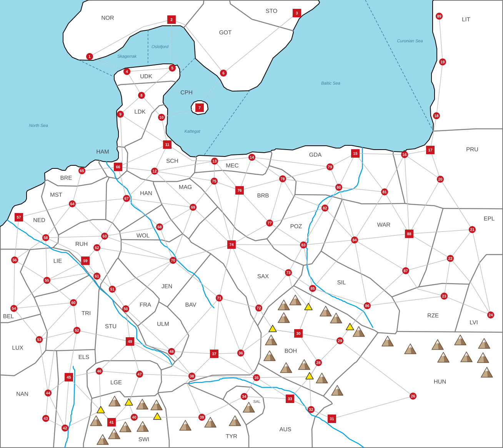

# SCENARIO: MITTELEUROPA

*Everything here is specific to this map; the general rules are in [RULES.md](RULES.md).*

This file is the **only** place the map's facts are written down. The map's shapes — one per
settlement's land, plus the rivers — are in [map-base.svg](map-base.svg) (edit it in Inkscape).
From the two, a script builds [map.svg](map.svg), the map the game shows, and
[scenario.json](scenario.json), this scenario as data for the game. After changing either, run:

```
perl tools/map.pl              # check everything, rebuild map.svg and scenario.json, refresh this file
perl tools/map.pl mountains    # the same, but first move any mountain that touches something
```

Columns and blocks marked *generated* are rewritten by the script — edit the rest.

**x = 1** (see the scenario scaling note in RULES.md)

<!-- generated:summary -->
87 settlements (19 cities, 68 towns) · 45 countries · 1,060,000 people · 190 land routes, 4 straits, 7 mountain passes
<!-- /generated -->



## Countries

*Code and Country are data; the other columns are generated.*

| Code | Country | Settlements | Pop | Army | Ships | HRE |
|---|---|---|---|---|---|---|
| NOR | Norway | 1, 2 | 30K | 1,200 | 15 | — |
| GOT | Gothenburg | 6 | 10K | 400 | 5 | — |
| STO | Stockholm | 3 | 20K | 800 | 10 | — |
| UDK | Upper Denmark | 4, 5 | 20K | 800 | 10 | — |
| LDK | Lower Denmark | 8, 9 | 20K | 800 | 10 | — |
| CPH | Copenhagen | 7 | 20K | 800 | 10 | — |
| SCH | Schleswig | 10, 11, 12 | 40K | 1,600 | 20 | ✓ |
| MEC | Mecklenburg | 13, 14 | 20K | 800 | 10 | ✓ |
| GDA | Gdansk | 15, 79, 80, 81 | 50K | 2,000 | 25 | — |
| PRU | Prussia | 16, 17, 20 | 40K | 1,600 | 20 | — |
| LIT | Lithuania | 18, 19, 89 | 30K | 1,200 | 15 | — |
| EPL | Eastern Poland | 21, 22 | 20K | 800 | — | — |
| WAR | Warsaw | 84, 87, 88 | 40K | 1,600 | — | — |
| RZE | Rzeszów | 23 | 10K | 400 | — | — |
| LVI | Lviv | 24 | 10K | 400 | — | — |
| POZ | Poznań | 82, 83 | 20K | 800 | — | — |
| SIL | Silesia | 85, 86 | 20K | 800 | — | part |
| HUN | Hungary | 26, 31 | 30K | 1,200 | — | — |
| BOH | Bohemia | 28, 29, 30 | 40K | 1,600 | — | ✓ |
| AUS | Austria | 32, 33, 35 | 40K | 1,600 | — | ✓ |
| SAL | Salzburg | 34 | 10K | 400 | — | ✓ |
| TYR | Tyrol | 39 | 10K | 400 | — | ✓ |
| BAV | Bavaria | 36, 37, 38, 71 | 50K | 2,000 | — | ✓ |
| ULM | Ulm | 48 | 10K | 400 | — | ✓ |
| STU | Stuttgart | 49 | 20K | 800 | — | ✓ |
| LGE | Lower Germany | 46, 47 | 20K | 800 | — | ✓ |
| SWI | Switzerland | 40, 41 | 30K | 1,200 | — | ✓ |
| ELS | Elsass-Lothringen | 42, 45 | 30K | 1,200 | — | ✓ |
| NAN | Nancy | 43, 44 | 20K | 800 | — | part |
| LUX | Luxemburg | 53 | 10K | 400 | — | ✓ |
| TRI | Trier | 52, 60 | 20K | 800 | — | ✓ |
| LIE | Liège | 55 | 10K | 400 | — | ✓ |
| BEL | Belgium | 54, 56 | 20K | 800 | — | ✓ |
| NED | Netherlands | 57, 58 | 30K | 1,200 | 15 | ✓ |
| MST | Münster | 64 | 10K | 400 | — | ✓ |
| BRE | Bremen | 65 | 10K | 400 | 5 | ✓ |
| HAM | Hamburg | 66 | 20K | 800 | 10 | ✓ |
| HAN | Hanover | 67 | 10K | 400 | — | ✓ |
| WOL | Wolfsburg | 68 | 10K | 400 | — | ✓ |
| JEN | Jena | 70 | 10K | 400 | — | ✓ |
| RUH | Ruhr | 59, 61, 62, 63 | 50K | 2,000 | — | ✓ |
| FRA | Frankfurt | 50, 51 | 20K | 800 | — | ✓ |
| SAX | Saxony | 72, 73, 74 | 40K | 1,600 | — | ✓ |
| MAG | Magdeburg | 69 | 10K | 400 | — | ✓ |
| BRB | Brandenburg | 75, 76, 77, 78 | 50K | 2,000 | — | ✓ |

## Settlements

- **Type** — `town` (red circle, 10,000 pop) or `city` (red square, 20,000 pop).
- **Port** — the settlement sits on the coast. 65 Bremen and 66 Hamburg are ports **by ruling**,
  though the map does not draw them on the coastline.
- **HRE** — inside the Holy Roman Empire.
- **X, Y** — marker centre, in map units (the coordinates of map.svg). The settlement's land is
  the shape `land-ID` in map-base.svg; country borders are drawn wherever two lands belong to
  different countries.
- **Borders** — settlements an army can march to in one step (every route is listed under both
  ends). Routes through a mountain pass are listed here too; the pass itself is in
  *Mountain passes*.
- **Straits** — crossings by sea (dashed lines, RULES.md §8).

Settlements 25 and 27 were deleted from the map.

| ID | Name | Country | Type | Port | HRE | X | Y | Borders | Straits |
|---|---|---|---|---|---|---|---|---|---|
| 1 | Kristiansand | NOR | town | port |  | 233 | 147 | 2 | 4 |
| 2 | Oslo | NOR | city | port |  | 446 | 51 | 1, 6 | 5 |
| 3 | Stockholm | STO | city | port |  | 772 | 34 | 6 |  |
| 4 | Thisted | UDK | town | port |  | 330 | 186 | 5, 8 | 1 |
| 5 | Skagen | UDK | town | port |  | 448 | 177 | 4, 8 | 2 |
| 6 | Gothenburg | GOT | town | port |  | 581 | 190 | 2, 3 | 7 |
| 7 | Copenhagen | CPH | city | port |  | 519 | 280 |  | 6, 10 |
| 8 | Herning | LDK | town |  |  | 368 | 248 | 4, 5, 9, 10, 11 |  |
| 9 | Esbjerg | LDK | town | port |  | 313 | 297 | 8, 11, 66 |  |
| 10 | Flensburg | SCH | town | port | HRE | 420 | 305 | 8, 11 | 7 |
| 11 | Kiel | SCH | city | port | HRE | 435 | 376 | 8, 9, 10, 12, 13, 66 |  |
| 12 | Luneburg | SCH | town |  | HRE | 402 | 445 | 11, 13, 66, 67, 69, 75 |  |
| 13 | Rostock | MEC | town | port | HRE | 558 | 419 | 11, 12, 14, 75, 76 |  |
| 14 | Stettin | MEC | town | port | HRE | 655 | 409 | 13, 76, 78, 79 |  |
| 15 | Gdynia | GDA | city | port |  | 924 | 399 | 16, 79, 80, 81 |  |
| 16 | Danzig | PRU | town | port |  | 1052 | 402 | 15, 17, 20, 81, 88 |  |
| 17 | Konigsberg | PRU | city | port |  | 1119 | 390 | 16, 18, 20 |  |
| 18 | Rusne | LIT | town | port |  | 1135 | 301 | 17, 19 |  |
| 19 | Klaipeda | LIT | town | port |  | 1151 | 161 | 18, 89 |  |
| 20 | Olsztyn | PRU | town |  |  | 1145 | 466 | 16, 17, 21, 88 |  |
| 21 | Brest | EPL | town |  |  | 1228 | 597 | 20, 22, 24, 88 |  |
| 22 | Lublin | EPL | town |  |  | 1171 | 672 | 21, 23, 24, 87, 88 |  |
| 23 | Rzeszów | RZE | town |  |  | 1155 | 770 | 22, 24, 86, 87 |  |
| 24 | Lviv | LVI | town |  |  | 1276 | 819 | 21, 22, 23 |  |
| 26 | Kassa | HUN | town |  |  | 1074 | 1030 | 29, 31 |  |
| 28 | Brno | BOH | town |  | HRE | 828 | 943 | 29, 30, 32, 33, 35 |  |
| 29 | Ostrava | BOH | town |  | HRE | 884 | 886 | 26, 28, 30, 86 |  |
| 30 | Prague | BOH | city |  | HRE | 776 | 867 | 28, 29, 36, 72, 73, 85 |  |
| 31 | Pozsony | HUN | city |  |  | 863 | 1089 | 26, 32 |  |
| 32 | Hainburg | AUS | town |  | HRE | 809 | 1065 | 28, 31, 33 |  |
| 33 | Vienna | AUS | city |  | HRE | 754 | 1037 | 28, 32, 34, 35 |  |
| 34 | Salzburg | SAL | town |  | HRE | 635 | 1031 | 33, 35, 39 |  |
| 35 | Linz | AUS | town |  | HRE | 667 | 982 | 28, 33, 34, 36, 37, 38 |  |
| 36 | Passau | BAV | town |  | HRE | 626 | 918 | 30, 35, 37, 71, 72 |  |
| 37 | Munich | BAV | city |  | HRE | 557 | 920 | 35, 36, 38, 48, 71 |  |
| 38 | Memmingen | BAV | town |  | HRE | 499 | 978 | 35, 37, 39, 47, 48, 49 |  |
| 39 | Innsbruck | TYR | town |  | HRE | 525 | 1085 | 34, 38, 40 |  |
| 40 | Zurich | SWI | town |  | HRE | 349 | 1085 | 39, 41, 47 |  |
| 41 | Bern | SWI | city |  | HRE | 290 | 1098 | 40, 42, 45, 46, 47 |  |
| 42 | Geneva | ELS | town |  | HRE | 169 | 1113 | 41, 43, 44, 45 |  |
| 43 | Lyon | NAN | town |  |  | 119 | 1088 | 42, 44 |  |
| 44 | Nancy | NAN | town |  | HRE | 125 | 1022 | 42, 43, 45, 52, 53 |  |
| 45 | Strassburg | ELS | city |  | HRE | 179 | 981 | 41, 42, 44, 46, 49, 52 |  |
| 46 | Basel | LGE | town |  | HRE | 258 | 965 | 41, 45, 47, 49 |  |
| 47 | Konstanz | LGE | town |  | HRE | 363 | 973 | 38, 40, 41, 46, 49 |  |
| 48 | Ulm | ULM | town |  | HRE | 446 | 914 | 37, 38, 49, 50, 71 |  |
| 49 | Stuttgart | STU | city |  | HRE | 338 | 888 | 38, 45, 46, 47, 48, 50, 52 |  |
| 50 | Frankfurt | FRA | town |  | HRE | 327 | 803 | 48, 49, 51, 70 |  |
| 51 | Bonn | FRA | town |  | HRE | 292 | 752 | 50, 61, 62, 70 |  |
| 52 | Trier | TRI | town |  | HRE | 200 | 859 | 44, 45, 49, 53, 60 |  |
| 53 | Luxemburg | LUX | town |  | HRE | 102 | 883 | 44, 52, 54, 60 |  |
| 54 | Brussels | BEL | town |  | HRE | 36 | 802 | 53, 55, 56, 60 |  |
| 55 | Liège | LIE | town |  | HRE | 122 | 729 | 54, 56, 58, 59, 60, 61 |  |
| 56 | Antwerp | BEL | town |  | HRE | 38 | 676 | 54, 55, 57, 58 |  |
| 57 | Rotterdam | NED | city | port | HRE | 49 | 565 | 56, 58, 64 |  |
| 58 | Utrecht | NED | town |  | HRE | 119 | 618 | 55, 56, 57, 59, 63, 64 |  |
| 59 | Dusseldorf | RUH | city |  | HRE | 222 | 678 | 55, 58, 61, 62 |  |
| 60 | Duren | TRI | town |  | HRE | 191 | 787 | 52, 53, 54, 55, 61 |  |
| 61 | Cologne | RUH | town |  | HRE | 252 | 718 | 51, 55, 59, 60 |  |
| 62 | Essen | RUH | town |  | HRE | 252 | 644 | 51, 59, 63, 70 |  |
| 63 | Dortmund | RUH | town |  | HRE | 272 | 614 | 58, 62, 64, 67, 68, 70 |  |
| 64 | Münster | MST | town |  | HRE | 188 | 530 | 57, 58, 63, 65, 67 |  |
| 65 | Bremen | BRE | town | port | HRE | 213 | 444 | 64, 66 |  |
| 66 | Hamburg | HAM | city | port | HRE | 307 | 434 | 9, 11, 12, 65, 67 |  |
| 67 | Hanover | HAN | town |  | HRE | 329 | 516 | 12, 63, 64, 66, 68, 69 |  |
| 68 | Wolfsburg | WOL | town |  | HRE | 415 | 590 | 63, 67, 69, 70 |  |
| 69 | Magdeburg | MAG | town |  | HRE | 502 | 539 | 12, 67, 68, 70, 74, 75 |  |
| 70 | Jena | JEN | town |  | HRE | 450 | 677 | 50, 51, 62, 63, 68, 69, 71, 74 |  |
| 71 | Bamberg | BAV | town |  | HRE | 570 | 775 | 36, 37, 48, 70, 72, 74 |  |
| 72 | Chemnitz | SAX | town |  | HRE | 673 | 801 | 30, 36, 71, 73, 74 |  |
| 73 | Dresden | SAX | town |  | HRE | 750 | 709 | 30, 72, 74, 83, 85 |  |
| 74 | Leipzig | SAX | city |  | HRE | 602 | 636 | 69, 70, 71, 72, 73, 75, 76, 77, 83 |  |
| 75 | Schwerin | BRB | town |  | HRE | 557 | 471 | 12, 13, 69, 74, 76 |  |
| 76 | Berlin | BRB | city |  | HRE | 623 | 495 | 13, 14, 74, 75, 77, 78 |  |
| 77 | Cottbus | BRB | town |  | HRE | 701 | 580 | 74, 76, 78, 82, 83 |  |
| 78 | Seelow Heights | BRB | town |  | HRE | 735 | 465 | 14, 76, 77, 79, 80, 82 |  |
| 79 | Szczecinek | GDA | town |  |  | 858 | 434 | 14, 15, 78, 80 |  |
| 80 | Bydgoszcz | GDA | town |  |  | 881 | 487 | 15, 78, 79, 81, 82, 84 |  |
| 81 | Plock | GDA | town |  |  | 1000 | 499 | 15, 16, 80, 84, 88 |  |
| 82 | Pila | POZ | town |  |  | 845 | 541 | 77, 78, 80, 83, 84 |  |
| 83 | Poznań | POZ | town |  |  | 789 | 637 | 73, 74, 77, 82, 84, 85 |  |
| 84 | Lodz | WAR | town |  |  | 922 | 624 | 80, 81, 82, 83, 85, 86, 87, 88 |  |
| 85 | Breslau | SIL | town |  | HRE | 813 | 750 | 30, 73, 83, 84, 86 |  |
| 86 | Kraków | SIL | town |  |  | 955 | 795 | 23, 29, 84, 85, 87 |  |
| 87 | Radom | WAR | town |  |  | 1055 | 704 | 22, 23, 84, 86, 88 |  |
| 88 | Warsaw | WAR | city |  |  | 1064 | 608 | 16, 20, 21, 22, 81, 84, 87 |  |
| 89 | Palanga | LIT | town | port |  | 1142 | 42 | 19 |  |

## Mountain passes

Yellow triangles on the map, numbered west to east. Every route listed runs settlement → pass →
settlement. A pass belongs to whoever owns the settlement whose land it lies in (RULES.md §8).
*Pass, X, Y and Routes are data; the other columns are generated from where the pass lies.*

| Pass | X | Y | Routes | In the land of | Owner at start |
|---|---|---|---|---|---|
| P1 | 262 | 1068 | 41-42, 41-45, 41-46 | 41 Bern | SWI Switzerland |
| P2 | 335 | 1048 | 41-47, 40-47 | 40 Zurich | SWI Switzerland |
| P3 | 409 | 1085 | 39-40 | 40 Zurich | SWI Switzerland |
| P4 | 709 | 857 | 30-36, 30-72 | 30 Prague | BOH Bohemia |
| P5 | 802 | 800 | 30-73, 30-85 | 30 Prague | BOH Bohemia |
| P6 | 805 | 980 | 28-35, 28-33, 28-32 | 28 Brno | BOH Bohemia |
| P7 | 910 | 852 | 29-86 | 29 Ostrava | BOH Bohemia |

## Mountains

Decoration only — mountains have no rules effect outside the passes. Apex positions (x,y in map
units); `perl tools/map.pl mountains` moves any that touch something else.

```
768,767  738,780  847,796  738,813  874,814  808,816  933,849  705,871
1197,871  1008,874  1259,880  1138,883  1067,894  701,912  1213,915  1153,916
1256,917  791,935  744,943  1266,955  837,970  877,1002  370,1038  407,1040
647,1046  250,1081  611,1081  547,1085  482,1093  371,1096  326,1097  297,1115
267,1130
```

## Overview

<!-- generated:overview -->
**Cities (20K):** 2, 3, 7, 11, 15, 17, 30, 31, 33, 37, 41, 45, 49, 57, 59, 66, 74, 76, 88 — all other settlements are towns (10K).

**HRE settlements (55):** 10–14, 28–30, 32–42, 44–78, 85 — held by 30 of the 45 countries.

**Ports (21):** 1, 2, 3, 4, 5, 6, 7, 9, 10, 11, 13, 14, 15, 16, 17, 18, 19, 57, 65, 66, 89

**On a river (25):** 15, 31, 32, 33, 35, 38, 42, 45, 48, 49, 50, 51, 57, 58, 59, 61, 66, 67, 68, 70, 80, 82, 83, 85, 86 — within 24px of a river on the map; grow +0.5% (RULES.md §2).

**Routes crossing a river (40):** 12-67, 15-16, 15-81, 28-33, 29-86, 32-33, 33-35, 34-35, 41-42, 41-45, 45-46, 45-49, 48-49, 48-71, 49-50, 55-58, 55-59, 55-61, 56-57, 56-58, 60-61, 63-68, 65-66, 66-67, 67-68, 67-69, 68-70, 69-70, 70-71, 70-74, 77-82, 78-82, 80-81, 80-82, 80-84, 82-83, 83-84, 83-85, 84-85, 85-86 — +2 months to march (RULES.md §8).

| Pop | Countries |
|---|---|
| 50K | 4: GDA Gdansk · BAV Bavaria · RUH Ruhr · BRB Brandenburg |
| 40K | 6: SCH Schleswig · PRU Prussia · WAR Warsaw · BOH Bohemia · AUS Austria · SAX Saxony |
| 30K | 6: NOR Norway · LIT Lithuania · HUN Hungary · SWI Switzerland · ELS Elsass-Lothringen · NED Netherlands |
| 20K | 15: STO Stockholm · UDK Upper Denmark · LDK Lower Denmark · CPH Copenhagen · MEC Mecklenburg · EPL Eastern Poland · POZ Poznań · SIL Silesia · STU Stuttgart · LGE Lower Germany · NAN Nancy · TRI Trier · BEL Belgium · HAM Hamburg · FRA Frankfurt |
| 10K | 14: GOT Gothenburg · RZE Rzeszów · LVI Lviv · SAL Salzburg · TYR Tyrol · ULM Ulm · LUX Luxemburg · LIE Liège · MST Münster · BRE Bremen · HAN Hanover · WOL Wolfsburg · JEN Jena · MAG Magdeburg |

**Naval powers:** 14 countries, 180 ships. Crossing a strait needs 10 ships (RULES.md §8).

| Country | Ports held | Ships | Can cross straits? |
|---|---|---|---|
| GDA Gdansk | 15 | 25 | yes |
| SCH Schleswig | 10, 11 | 20 | yes |
| PRU Prussia | 16, 17 | 20 | yes |
| NOR Norway | 1, 2 | 15 | yes |
| LIT Lithuania | 18, 19, 89 | 15 | yes |
| NED Netherlands | 57 | 15 | yes |
| STO Stockholm | 3 | 10 | **exactly** |
| UDK Upper Denmark | 4, 5 | 10 | **exactly** |
| LDK Lower Denmark | 9 | 10 | **exactly** |
| CPH Copenhagen | 7 | 10 | **exactly** |
| MEC Mecklenburg | 13, 14 | 10 | **exactly** |
| HAM Hamburg | 66 | 10 | **exactly** |
| GOT Gothenburg | 6 | 5 | no |
| BRE Bremen | 65 | 5 | no |
<!-- /generated -->

## Special coring
*(no Courthouse and no 20-year wait)*

You may proclaim a region when **both** are true:

1. Your **capital** lies within the region.
2. You control **100%** of its settlements.

Every settlement in the region becomes core immediately. If you later lose one and retake it, it
is core again on capture.

| Formable | Settlements | Count |
|---|---|---|
| **Unite Austria** | 32, 33, 34, 35, 39 | 5 |
| **Unite Czechoslovakia** | 26, 28, 29, 30, 31 | 5 |
| **Unite the Benelux** | 53, 54, 55, 56, 57, 58 | 6 |
| **Unite French-speaking people** | 41, 42, 43, 44, 45, 53, 54, 55 | 8 |
| **Unite Scandinavia** | 1–9 | 9 |
| **Old Poland** | 22, 23, 80, 81, 83, 84, 85, 86, 87, 88 | 10 |
| **AustroHungary** | 23, 24, 26, 28–35, 39, 86 | 13 |
| **Modern Poland** | 14, 15, 16, 20, 22, 23, 79–88 | 16 |
| **Polish–Lithuanian Commonwealth** | Modern Poland + 17, 18, 19, 21, 24, 89 | 22 |
| **Germany** (1990) | 10–13, 36–38, 47–52, 59–78 | 33 |
| **Post Germany** (1930) | Germany + 14, 17, 20, 79, 85 | 38 |
| **Greater Germany** (Kaiser 1880) | Post Germany + 16, 19, 45, 80, 82, 83 | 44 |
| **Greater German Reich** (all German-speaking) | Greater Germany + 28, 29, 30, 32–35, 39, 40, 46, 53 | 55 |

## Sea zones

**North Sea · Skagerrak–Kattegat · Baltic.** A fleet operates in one zone at a time.

## The Holy Roman Empire

The Empire is every settlement marked **HRE** above (listed in the *Overview*).

Demand to become leader of the Empire under your hegemony. You must control **at least 10
settlements inside the HRE**, and may propose **only once, ever**.

```
chance each German state joins = your soldiers ÷ their soldiers × 10 %
0% if you do not have more soldiers than they do
```

Protectorates pay you **10%** of their income.

## Victory

> **Control or vassalize 45 settlements.** Protectorates count as half — unless you demand one
> become a vassal and it agrees.

There is **no end date**. The game ends only when a player reaches 45.

---

## Design notes

*Hand-written analysis of the starting position. Unlike everything above it is not checked by the
script, so re-read it after changing countries or borders.*

### The four great powers

Each 50K country starts with 4 settlements and 2,000 men. Bavaria and Ruhr border none
of the others, so each has its own zone to grow into. **Brandenburg and Gdansk share a
border** — Brandenburg's eastern edge (78 Seelow Heights) runs along Gdansk's western edge
(79 Szczecinek, 80 Bydgoszcz), between Mecklenburg and Poznań — so those two can collide from
the first year.

- **Gdansk** — 25 ships, the largest navy on the map. Holds the Pomeranian coast at 15 Gdynia
  and runs inland to 81 Plock, with Prussia (which holds 16 Danzig itself) to the east, Poland
  to the south and Brandenburg on its western flank. Outside the HRE, so its path runs through
  Poland.
- **Bavaria** — ringed by small states (Ulm, Stuttgart, Lower Germany, Tyrol, Jena), with
  Austria, Bohemia and Saxony beyond them. The best expansion position on the map.
- **Ruhr** — the densest cluster in the west, with five 10K neighbours.
- **Brandenburg** — open ground, flanked by Saxony (40K), Schleswig (40K), Poznań and
  Gdansk (50K). With Gdansk, one of the only two great powers that border another, and the
  most exposed of the four.

### The race for the Empire

| Power | Starts with | Fewest conquests to 10 HRE settlements | Without fighting a 40K+ power |
|---|---|---|---|
| **Bavaria** | 4 | Bohemia, Austria (**2**) | Ulm, Stuttgart, Lower Germany, Tyrol, Jena (**5**) |
| **Ruhr** | 4 | Netherlands, Frankfurt, Trier (**3**) | the same |
| **Brandenburg** | 4 | Mecklenburg, Magdeburg, Saxony (**3**) | Mecklenburg, Magdeburg, Hanover, Hamburg (**4**) |

All three start with 4 HRE settlements and need 6 more. Bavaria's fastest route runs through
two 40K neighbours; its safe route is five small conquests. Ruhr's three targets are all
20–30K. Brandenburg can only skip Saxony (40K, three settlements) by working north and west
through Magdeburg — and must watch Gdansk at its back either way. Whoever gets there first and
rolls well takes the Empire — and each only gets one attempt.

**Gdansk starts with no HRE settlements**, so it would have to conquer ten before it could
propose. Its natural path runs through Poland instead: Warsaw, Poznań, Eastern Poland, Prussia.

### Map history

- Six long routes over the mountains were removed from *Borders*: 24-26, 23-26, 26-86, 33-39,
  29-31, 28-36.
- 29-85 was removed from *Borders* as well, and later seven routes that looked odd on the map:
  28-31 (through pass P6), 35-39, 48-70, 50-52, 50-60, 51-59, 59-63. (23-87 was removed too, then
  put back.)
- 56 Antwerp is inland, so Belgium has no ships.

### Notes to check

1. **Borders and routes disagree.** These lands share a border on the map but have no route:
   49-51, 49-60, 58-62, 55-62 (on top of the removed routes above); 39-47, 51-60 and 64-66
   only touch at a point. This route joins lands that do not touch: 58-59.
   Either may be intended, but the script checks neither.
2. **Sea zone transitions.** Naval movement is 3 coastal settlements per year, but nothing says
   whether a fleet can pass between the North Sea and the Baltic without forcing the Danish
   straits. If it must, Upper Denmark, Lower Denmark, Copenhagen and Schleswig control the only
   gate between the two seas.
3. **Naming:** "Lower Germany" (46 Basel, 47 Konstanz) is the far south — "Upper Rhine" or
   "Lake Constance" fits the geography better. "Silesia" includes 86 Kraków, which is
   Lesser Poland. "Gdansk" does not hold 16 Danzig (Gdańsk) — Prussia does; "Pomerania"
   fits its lands better.
