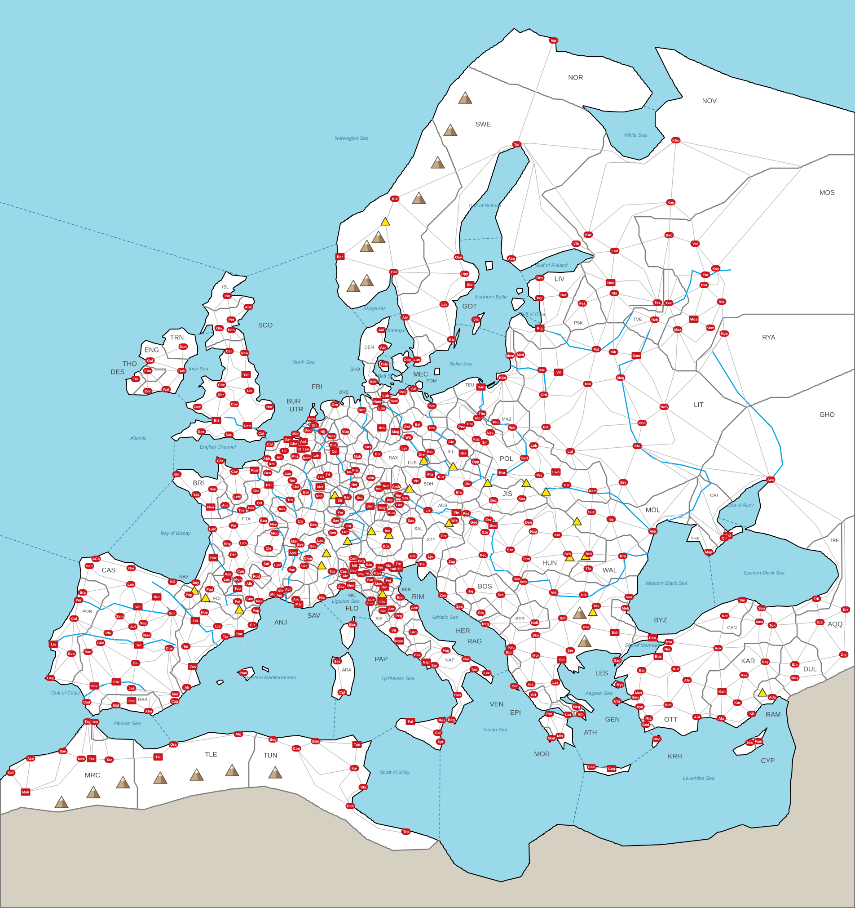

# SCENARIO: EUROPE 1440

*Everything here is specific to this map; the general rules are in [RULES.md](../../docs/RULES.md).*

Every town where it really is, the realms that really existed in the year it starts, and towns made cities by how big they
really were.

This file is the **only** place the map's facts are written down. The map's shapes — one per settlement's land,
plus the rivers and the sea zone dividers — are in [map-base.svg](map-base.svg). From the two, a script builds
[map.svg](map.svg), the map the game shows, and [scenario.json](scenario.json), this scenario as data for the
game. After changing either, run:

```
node tools/map.js scenarios/europe-1440              # check everything, rebuild map.svg and scenario.json, refresh this file
node tools/map.js scenarios/europe-1440 mountains    # the same, but first move any mountain that touches something
```

map-base.svg and the data tables here were first made by
[tools/make-base.js](../../tools/make-base.js) from real latitudes and longitudes ([data.js](data.js)); running it again
**overwrites** map-base.svg and the tables, so once you edit them by hand, use tools/map.js only.

Columns and blocks marked *generated* are rewritten by the script — edit the rest.

**x = 1** (see the scenario scaling note in RULES.md)

**Army speed:** 420 map units per year — a route takes its length on the map ÷ this (RULES.md §8). One map unit
is about 1.2 km, so an army covers about 500 km a year, as on the Mitteleuropa map.

<!-- generated:summary -->
466 settlements (69 cities, 397 towns) · 121 countries · 5,350,000 people · 1043 land routes, 19 straits, 23 mountain passes
<!-- /generated -->



## Countries

*Code, Country and Capital are data (Capital is a settlement ID; the script adds the name); the other columns are generated. A country that owns a city must have one as its capital (RULES.md §2).*

| Code | Country | Capital | Settlements | Pop | Army | Ships | HRE |
|---|---|---|---|---|---|---|---|
| NOR | Norway | 2 Bergen | 1, 2, 3, 4 | 50K | 2,000 | 25 | — |
| SWE | Sweden | 5 Stockholm | 5, 6, 7, 8, 9, 10, 11, 12, 13 | 100K | 4,000 | 50 | — |
| DEN | Denmark | 14 Copenhagen | 14, 15, 16, 17, 18 | 50K | 2,000 | 25 | — |
| GOT | Gotland | 19 Visby | 19 | 10K | 400 | 5 | — |
| LIV | Livonian Order | 20 Riga | 20, 21, 22, 23 | 50K | 2,000 | 25 | — |
| TEU | Teutonic Order | 24 Danzig | 24, 25, 26, 27 | 50K | 2,000 | 25 | — |
| ENG | England | 28 London | 28, 29, 30, 31, 32, 33, 34, 35, 36, 37, 38, 39, 40, 41, 42, 43, 44, 45, 86, 87, 88, 89, 90, 91, 92 | 300K | 12,000 | 150 | — |
| SCO | Scotland | 49 Edinburgh | 49, 50, 51, 52 | 40K | 1,600 | 20 | — |
| ISL | Lordship of the Isles | 53 Inverness | 53 | 10K | 400 | 5 | — |
| TRN | Tyrone | 46 Dungannon | 46 | 10K | 400 | — | — |
| THO | Thomond | 47 Ennis | 47 | 10K | 400 | — | — |
| DES | Desmond | 48 Tralee | 48 | 10K | 400 | 5 | — |
| FRA | France | 54 Paris | 54, 55, 56, 57, 58, 59, 60, 61, 62, 63, 64, 65, 66, 67, 68, 69, 70, 71, 72, 73, 74, 75, 76, 77, 78, 79, 80, 81, 82, 83, 84, 85 | 350K | 14,000 | 175 | — |
| BUR | Burgundy | 103 Brussels | 93, 94, 95, 96, 97, 98, 99, 100, 101, 102, 103, 104, 105, 106, 107, 108, 109, 110 | 220K | 8,800 | 110 | part |
| BRI | Brittany | 112 Nantes | 111, 112, 113, 114 | 50K | 2,000 | 25 | — |
| ANJ | Anjou | 117 Marseille | 115, 116, 117, 118, 119 | 60K | 2,400 | 30 | part |
| BOU | Bourbon | 120 Moulins | 120, 121 | 20K | 800 | — | — |
| ARM | Armagnac | 122 Rodez | 122, 123 | 20K | 800 | — | — |
| FOI | Foix-Béarn | 124 Pau | 124, 125 | 20K | 800 | — | — |
| SAV | Savoy | 127 Chambéry | 127, 128, 129, 130, 131, 132 | 60K | 2,400 | 30 | ✓ |
| LIE | Liège | 133 Liège | 133 | 20K | 800 | — | ✓ |
| UTR | Utrecht | 134 Utrecht | 134 | 10K | 400 | — | ✓ |
| GEL | Guelders | 135 Nijmegen | 135 | 10K | 400 | — | ✓ |
| FRI | Frisia | 136 Groningen | 136 | 10K | 400 | 5 | ✓ |
| LUX | Luxembourg | 137 Luxembourg | 137 | 10K | 400 | — | ✓ |
| CAS | Castile | 138 Toledo | 138, 139, 140, 141, 142, 143, 144, 145, 146, 147, 148, 149, 150, 151, 152, 153, 154, 155, 156, 157, 158, 159, 160, 161 | 290K | 11,600 | 145 | — |
| ARA | Aragon | 162 Zaragoza | 162, 163, 164, 165, 166, 167, 168, 169, 170, 171, 172, 237, 238, 239, 240, 241, 242, 243 | 220K | 8,800 | 110 | — |
| POR | Portugal | 173 Lisbon | 173, 174, 175, 176, 177, 178, 179 | 80K | 3,200 | 40 | — |
| NAV | Navarre | 180 Pamplona | 180 | 10K | 400 | — | — |
| GRA | Granada | 181 Granada | 181, 182, 183 | 40K | 1,600 | 20 | — |
| MIL | Milan | 184 Milan | 184, 185, 186, 187, 188, 189, 190 | 80K | 3,200 | — | ✓ |
| VEN | Venice | 191 Venice | 191, 192, 193, 194, 195, 196, 197, 198, 199, 200, 201, 202, 203, 204, 205, 206 | 190K | 7,600 | 95 | — |
| GEN | Genoa | 207 Genoa | 207, 208, 209, 210, 211, 212 | 80K | 3,200 | 40 | — |
| FLO | Florence | 213 Florence | 213, 214, 215 | 40K | 1,600 | 20 | — |
| SIE | Siena | 216 Siena | 216 | 10K | 400 | — | — |
| LUC | Lucca | 217 Lucca | 217 | 10K | 400 | — | — |
| PAP | Papal States | 218 Rome | 126, 218, 219, 220, 221, 222 | 80K | 3,200 | 40 | — |
| FER | Ferrara | 223 Ferrara | 223, 224 | 20K | 800 | — | part |
| MAN | Mantua | 225 Mantua | 225 | 10K | 400 | — | ✓ |
| MON | Montferrat | 226 Casale | 226 | 10K | 400 | — | ✓ |
| RIM | Rimini | 227 Rimini | 227 | 10K | 400 | 5 | — |
| NAP | Naples | 228 Naples | 228, 229, 230, 231, 232, 233, 234, 235, 236 | 100K | 4,000 | 50 | — |
| SHO | Schleswig-Holstein | 244 Schleswig | 244 | 10K | 400 | 5 | — |
| LUB | Lübeck | 245 Lübeck | 245 | 20K | 800 | 10 | ✓ |
| HAM | Hamburg | 246 Hamburg | 246 | 20K | 800 | 10 | ✓ |
| MEC | Mecklenburg | 247 Schwerin | 247, 248 | 20K | 800 | 10 | ✓ |
| POM | Pomerania | 249 Stettin | 249, 250 | 20K | 800 | 10 | ✓ |
| BRE | Bremen | 251 Bremen | 251 | 10K | 400 | 5 | ✓ |
| BRU | Brunswick-Lüneburg | 253 Brunswick | 252, 253 | 30K | 1,200 | — | ✓ |
| MAG | Magdeburg | 254 Magdeburg | 254 | 20K | 800 | — | ✓ |
| BRA | Brandenburg | 255 Berlin | 255, 256, 257 | 30K | 1,200 | — | ✓ |
| CLE | Cleves-Mark | 258 Wesel | 258 | 10K | 400 | — | ✓ |
| MUN | Münster | 259 Münster | 259 | 10K | 400 | — | ✓ |
| JUL | Jülich-Berg | 260 Düsseldorf | 260 | 10K | 400 | — | ✓ |
| COL | Cologne | 261 Cologne | 261 | 20K | 800 | — | ✓ |
| HES | Hesse | 262 Kassel | 262, 263 | 20K | 800 | — | ✓ |
| SAX | Saxony | 264 Wittenberg | 264, 265, 266, 267 | 40K | 1,600 | — | ✓ |
| LUS | Upper Lusatia | 268 Bautzen | 268 | 10K | 400 | — | ✓ |
| SIL | Silesia | 269 Breslau | 269, 270 | 30K | 1,200 | — | ✓ |
| OPP | Opole | 271 Oppeln | 271 | 10K | 400 | — | ✓ |
| TRI | Trier | 272 Trier | 272 | 10K | 400 | — | ✓ |
| MAI | Mainz | 273 Mainz | 273 | 10K | 400 | — | ✓ |
| FFM | Frankfurt | 274 Frankfurt | 274 | 10K | 400 | — | ✓ |
| WBG | Würzburg | 275 Würzburg | 275 | 10K | 400 | — | ✓ |
| ANS | Ansbach-Kulmbach | 276 Ansbach | 276 | 10K | 400 | — | ✓ |
| NUR | Nuremberg | 277 Nuremberg | 277 | 20K | 800 | — | ✓ |
| PAL | Palatinate | 278 Heidelberg | 278, 279 | 20K | 800 | — | ✓ |
| BOH | Bohemia | 280 Prague | 280, 281, 282, 283, 284 | 60K | 2,400 | — | ✓ |
| MET | Metz | 285 Metz | 285 | 20K | 800 | — | ✓ |
| STR | Strasbourg | 286 Strasbourg | 286 | 20K | 800 | — | ✓ |
| BAD | Baden | 287 Baden | 287 | 10K | 400 | — | ✓ |
| WRT | Württemberg | 288 Stuttgart | 288 | 10K | 400 | — | ✓ |
| ULM | Ulm | 289 Ulm | 289 | 20K | 800 | — | ✓ |
| AUG | Augsburg | 290 Augsburg | 290 | 20K | 800 | — | ✓ |
| BIN | Bavaria-Ingolstadt | 291 Ingolstadt | 291 | 10K | 400 | — | ✓ |
| REG | Regensburg | 292 Regensburg | 292 | 10K | 400 | — | ✓ |
| BMU | Bavaria-Munich | 293 Munich | 293, 294 | 20K | 800 | — | ✓ |
| BLA | Bavaria-Landshut | 295 Landshut | 295 | 10K | 400 | — | ✓ |
| AUS | Austria | 296 Vienna | 296, 297, 298 | 40K | 1,600 | — | ✓ |
| TYR | Tyrol | 299 Innsbruck | 299, 300, 301 | 30K | 1,200 | — | ✓ |
| BAS | Basel | 302 Basel | 302 | 10K | 400 | — | ✓ |
| ZUR | Zürich | 303 Zürich | 303 | 10K | 400 | — | ✓ |
| SWI | Swiss Confederacy | 304 Bern | 304, 305 | 20K | 800 | — | ✓ |
| SAL | Salzburg | 306 Salzburg | 306 | 10K | 400 | — | ✓ |
| STY | Inner Austria | 307 Graz | 307, 308, 309 | 30K | 1,200 | 15 | ✓ |
| POL | Poland | 310 Kraków | 310, 311, 312, 313, 314, 315, 316, 317, 318, 319, 320, 321, 322 | 150K | 6,000 | — | — |
| MAZ | Masovia | 323 Warsaw | 323, 324 | 20K | 800 | — | — |
| LIT | Lithuania | 325 Vilnius | 325, 326, 327, 328, 329, 330, 331, 332, 333, 334, 335, 336, 337, 338, 339 | 170K | 6,800 | — | — |
| HUN | Hungary | 340 Buda | 340, 341, 342, 343, 344, 345, 346, 347, 348, 349, 350, 351, 352, 353, 354 | 160K | 6,400 | — | — |
| JIS | Upper Hungary | 355 Kassa | 355, 356 | 20K | 800 | — | — |
| OTT | Ottoman Empire | 357 Edirne | 357, 358, 359, 360, 361, 362, 363, 364, 365, 366, 367, 368, 369, 370, 371, 372, 391, 392, 393, 394, 395, 396, 397, 398, 399, 400, 401, 402, 403, 404, 405, 406 | 350K | 14,000 | 175 | — |
| BYZ | Byzantium | 373 Constantinople | 373, 374 | 30K | 1,200 | 15 | — |
| MOR | Morea | 375 Mistra | 375, 376, 377 | 30K | 1,200 | 15 | — |
| SER | Serbia | 378 Novo Brdo | 378 | 10K | 400 | — | — |
| BOS | Bosnia | 379 Jajce | 379, 380 | 20K | 800 | — | — |
| HER | Herzegovina | 381 Blagaj | 381 | 10K | 400 | — | — |
| RAG | Ragusa | 382 Ragusa | 382 | 10K | 400 | 5 | — |
| WAL | Wallachia | 383 Târgoviște | 383, 384 | 20K | 800 | — | — |
| MOL | Moldavia | 385 Suceava | 385, 386, 387 | 30K | 1,200 | 15 | — |
| ATH | Athens | 388 Athens | 388 | 10K | 400 | 5 | — |
| EPI | Epirus | 389 Arta | 389 | 10K | 400 | — | — |
| LES | Lesbos | 390 Mytilene | 390 | 10K | 400 | 5 | — |
| KAR | Karaman | 407 Konya | 407, 408, 409, 410, 411, 412 | 70K | 2,800 | 35 | — |
| CAN | Candar | 413 Kastamonu | 413, 414 | 20K | 800 | 10 | — |
| TRE | Trebizond | 415 Trebizond | 415 | 10K | 400 | 5 | — |
| DUL | Dulkadir | 416 Elbistan | 416, 417 | 20K | 800 | — | — |
| RAM | Ramadan | 418 Adana | 418 | 10K | 400 | — | — |
| AQQ | Aq Qoyunlu | 419 Diyarbakır | 419, 420, 421 | 30K | 1,200 | — | — |
| CYP | Cyprus | 422 Nicosia | 422 | 10K | 400 | — | — |
| KRH | Knights of Rhodes | 423 Rhodes | 423, 424 | 20K | 800 | 10 | — |
| MOS | Muscovy | 425 Moscow | 425, 426, 427, 428, 429, 430, 431, 432, 433 | 100K | 4,000 | — | — |
| NOV | Novgorod | 434 Novgorod | 434, 435, 436, 437, 438, 439, 440 | 80K | 3,200 | — | — |
| PSK | Pskov | 441 Pskov | 441 | 10K | 400 | — | — |
| TVE | Tver | 442 Tver | 442, 443 | 20K | 800 | — | — |
| RYA | Ryazan | 444 Ryazan | 444 | 10K | 400 | — | — |
| CRI | Crimea | 445 Qırım | 445 | 10K | 400 | — | — |
| THE | Theodoro | 446 Mangup | 446 | 10K | 400 | — | — |
| GHO | Great Horde | 447 Azak | 447 | 10K | 400 | 5 | — |
| MRC | Morocco | 448 Fez | 448, 449, 450, 451, 452, 453, 454, 455 | 100K | 4,000 | 50 | — |
| TLE | Tlemcen | 456 Tlemcen | 456, 457, 458 | 40K | 1,600 | 20 | — |
| TUN | Tunis | 459 Tunis | 459, 460, 461, 462, 463, 464, 465, 466 | 90K | 3,600 | 45 | — |

## Settlements

- **Type** — `town` (red circle, 10,000 pop) or `city` (red square, 20,000 pop). The 69 cities are the largest
  towns of the map around 1440.
- **Port** — the settlement sits on the coast.
- **HRE** — inside the Holy Roman Empire.
- **X, Y** — marker centre, in map units (the coordinates of map.svg). The settlement's land is the shape
  `land-ID` in map-base.svg; country borders are drawn wherever two lands belong to different countries.
- **Borders** — settlements an army can march to in one step (every route is listed under both ends). Routes
  through a mountain pass are listed here too; the pass itself is in *Mountain passes*.
- **Straits** — crossings by sea (dashed lines, RULES.md §8).

| ID | Name | Country | Type | Port | HRE | X | Y | Borders | Straits |
|---|---|---|---|---|---|---|---|---|---|
| 1 | Oslo | NOR | town | port |  | 877 | 605 | 2, 3, 6, 7, 9, 10 |  |
| 2 | Bergen | NOR | city | port |  | 757 | 571 | 1, 3 |  |
| 3 | Nidaros | NOR | town | port |  | 879 | 442 | 1, 2, 10, 11 |  |
| 4 | Vardøhus | NOR | town | port |  | 1233 | 90 | 11 |  |
| 5 | Stockholm | SWE | city | port |  | 1046 | 633 | 6, 7 |  |
| 6 | Uppsala | SWE | town |  |  | 1035 | 609 | 1, 5, 7, 10 |  |
| 7 | Linköping | SWE | town |  |  | 989 | 677 | 1, 5, 6, 8, 9 |  |
| 8 | Kalmar | SWE | town | port |  | 1006 | 755 | 7, 9, 15 | 19 |
| 9 | Älvsborg | SWE | town | port |  | 902 | 706 | 1, 7, 8, 15 |  |
| 10 | Gävle | SWE | town | port |  | 1021 | 572 | 1, 3, 6, 11 |  |
| 11 | Torneå | SWE | town | port |  | 1151 | 321 | 3, 4, 10, 12, 13, 437, 440 |  |
| 12 | Åbo | SWE | town | port |  | 1139 | 575 | 11, 13 |  |
| 13 | Viborg | SWE | town | port |  | 1283 | 542 | 11, 12, 434, 436, 437 |  |
| 14 | Copenhagen | DEN | town | port |  | 907 | 800 |  | 15, 16 |
| 15 | Lund | DEN | town |  |  | 928 | 800 | 8, 9 | 14 |
| 16 | Odense | DEN | town | port |  | 856 | 810 |  | 14, 17 |
| 17 | Aarhus | DEN | town | port |  | 853 | 773 | 18, 244 | 16 |
| 18 | Aalborg | DEN | town | port |  | 849 | 734 | 17 |  |
| 19 | Visby | GOT | town | port |  | 1060 | 711 |  | 8 |
| 20 | Riga | LIV | city | port |  | 1202 | 730 | 22, 23, 27, 325, 326, 327, 332, 441 |  |
| 21 | Reval | LIV | town | port |  | 1202 | 618 | 22, 23 |  |
| 22 | Dorpat | LIV | town |  |  | 1255 | 656 | 20, 21, 23, 434, 441 |  |
| 23 | Pernau | LIV | town | port |  | 1202 | 663 | 20, 21, 22 |  |
| 24 | Danzig | TEU | city | port |  | 1071 | 861 | 25, 26, 249, 316 |  |
| 25 | Königsberg | TEU | town | port |  | 1119 | 840 | 24, 26, 27, 323, 324, 326, 327, 328 |  |
| 26 | Thorn | TEU | town |  |  | 1073 | 920 | 24, 25, 316, 324 |  |
| 27 | Memel | TEU | town | port |  | 1136 | 791 | 20, 25, 327 |  |
| 28 | London | ENG | city | port |  | 551 | 947 | 31, 32, 35, 36 |  |
| 29 | York | ENG | city |  |  | 548 | 833 | 34, 37, 38, 39 |  |
| 30 | Bristol | ENG | city | port |  | 482 | 935 | 32, 33, 35, 40, 41 |  |
| 31 | Norwich | ENG | town | port |  | 600 | 905 | 28, 34 |  |
| 32 | Southampton | ENG | town | port |  | 510 | 967 | 28, 30, 33 |  |
| 33 | Exeter | ENG | town | port |  | 448 | 960 | 30, 32 |  |
| 34 | Lincoln | ENG | town |  |  | 556 | 869 | 29, 31, 35, 38 |  |
| 35 | Coventry | ENG | town |  |  | 522 | 899 | 28, 30, 34, 38, 40 |  |
| 36 | Canterbury | ENG | town |  |  | 582 | 964 | 28 | 86 |
| 37 | Newcastle | ENG | town | port |  | 545 | 785 | 29, 39, 49 |  |
| 38 | Chester | ENG | town | port |  | 493 | 856 | 29, 34, 35, 39, 40 | 42 |
| 39 | Carlisle | ENG | town |  |  | 510 | 781 | 29, 37, 38, 49, 52 |  |
| 40 | Shrewsbury | ENG | town |  |  | 492 | 878 | 30, 35, 38, 41 |  |
| 41 | Carmarthen | ENG | town | port |  | 440 | 905 | 30, 40 |  |
| 42 | Dublin | ENG | town | port |  | 405 | 825 | 43, 45, 46, 47 | 38 |
| 43 | Waterford | ENG | town | port |  | 370 | 866 | 42, 44, 47 |  |
| 44 | Cork | ENG | town | port |  | 329 | 870 | 43, 47, 48 |  |
| 45 | Galway | ENG | town | port |  | 334 | 802 | 42, 46, 47 |  |
| 46 | Dungannon | TRN | town |  |  | 408 | 771 | 42, 45 |  |
| 47 | Ennis | THO | town |  |  | 329 | 825 | 42, 43, 44, 45, 48 |  |
| 48 | Tralee | DES | town | port |  | 302 | 843 | 44, 47 |  |
| 49 | Edinburgh | SCO | town | port |  | 515 | 734 | 37, 39, 50, 52 |  |
| 50 | Perth | SCO | town |  |  | 515 | 711 | 49, 51, 52, 53 |  |
| 51 | Aberdeen | SCO | town | port |  | 553 | 683 | 50, 53 |  |
| 52 | Glasgow | SCO | town |  |  | 488 | 730 | 39, 49, 50, 53 |  |
| 53 | Inverness | ISL | town | port |  | 506 | 658 | 50, 51, 52 |  |
| 54 | Paris | FRA | city |  |  | 599 | 1079 | 55, 57, 81, 82, 84, 85, 95 |  |
| 55 | Orléans | FRA | town |  |  | 578 | 1119 | 54, 56, 57, 58, 95 |  |
| 56 | Blois | FRA | town |  |  | 559 | 1130 | 55, 57, 58, 59, 90 |  |
| 57 | Chartres | FRA | town |  |  | 570 | 1092 | 54, 55, 56, 87, 88, 90 |  |
| 58 | Bourges | FRA | town |  |  | 587 | 1158 | 55, 56, 60, 63, 80, 95, 120 |  |
| 59 | Tours | FRA | town |  |  | 538 | 1135 | 56, 60, 90, 115 |  |
| 60 | Poitiers | FRA | town |  |  | 520 | 1169 | 58, 59, 61, 62, 63, 115 |  |
| 61 | La Rochelle | FRA | town | port |  | 473 | 1177 | 60, 62, 91, 112 |  |
| 62 | Angoulême | FRA | town |  |  | 506 | 1209 | 60, 61, 63, 64, 91 |  |
| 63 | Limoges | FRA | town |  |  | 542 | 1208 | 58, 60, 62, 64, 65, 76, 121 |  |
| 64 | Périgueux | FRA | town |  |  | 519 | 1234 | 62, 63, 65, 66, 91 |  |
| 65 | Cahors | FRA | town |  |  | 536 | 1271 | 63, 64, 66, 67, 69, 76, 122 |  |
| 66 | Agen | FRA | town |  |  | 508 | 1277 | 64, 65, 67, 91, 123 |  |
| 67 | Montauban | FRA | town |  |  | 530 | 1289 | 65, 66, 68, 69, 123 |  |
| 68 | Toulouse | FRA | city |  |  | 529 | 1309 | 67, 69, 70, 123, 125 |  |
| 69 | Albi | FRA | town |  |  | 555 | 1298 | 65, 67, 68, 70, 71, 122 |  |
| 70 | Carcassonne | FRA | town |  |  | 556 | 1332 | 68, 69, 71, 125, 169 |  |
| 71 | Narbonne | FRA | town |  |  | 577 | 1337 | 69, 70, 72, 169 |  |
| 72 | Montpellier | FRA | town |  |  | 609 | 1322 | 71, 73, 74, 122 |  |
| 73 | Aigues-Mortes | FRA | town | port |  | 622 | 1324 | 72, 74 |  |
| 74 | Nîmes | FRA | town |  |  | 626 | 1314 | 72, 73, 75, 78, 122, 126 |  |
| 75 | Le Puy | FRA | town |  |  | 618 | 1257 | 74, 76, 77, 78, 121, 122 |  |
| 76 | Saint-Flour | FRA | town |  |  | 593 | 1254 | 63, 65, 75, 121, 122 |  |
| 77 | Lyon | FRA | city |  |  | 653 | 1229 | 75, 78, 79, 96, 121, 127, 128 |  |
| 78 | Valence | FRA | town |  |  | 650 | 1267 | 74, 75, 77, 79, 126 |  |
| 79 | Grenoble | FRA | town |  |  | 678 | 1259 | 77, 78, 116, 127, 131, 132 |  |
| 80 | Nevers | FRA | town |  |  | 609 | 1166 | 58, 93, 95, 120 |  |
| 81 | Troyes | FRA | town |  |  | 646 | 1112 | 54, 82, 83, 93, 95, 119 |  |
| 82 | Reims | FRA | town |  |  | 651 | 1069 | 54, 81, 83, 84, 107 |  |
| 83 | Châlons | FRA | town |  |  | 659 | 1083 | 81, 82, 119, 137 |  |
| 84 | Laon | FRA | town |  |  | 641 | 1053 | 54, 82, 85, 97, 98, 106 |  |
| 85 | Beauvais | FRA | town |  |  | 596 | 1052 | 54, 84, 87, 98, 99 |  |
| 86 | Calais | ENG | town | port |  | 601 | 988 | 97, 99, 100, 101 | 36 |
| 87 | Rouen | ENG | city | port |  | 567 | 1046 | 57, 85, 88, 99 |  |
| 88 | Caen | ENG | town | port |  | 522 | 1049 | 57, 87, 89, 90, 111 |  |
| 89 | Cherbourg | ENG | town | port |  | 490 | 1025 | 88, 111 |  |
| 90 | Le Mans | ENG | town |  |  | 528 | 1105 | 56, 57, 59, 88, 111, 115 |  |
| 91 | Bordeaux | ENG | city | port |  | 475 | 1241 | 61, 62, 64, 66, 92, 124 |  |
| 92 | Bayonne | ENG | town | port |  | 436 | 1296 | 91, 124, 180 |  |
| 93 | Dijon | BUR | town |  |  | 669 | 1160 | 80, 81, 94, 95, 96, 118, 119 |  |
| 94 | Besançon | BUR | town |  | HRE | 698 | 1167 | 93, 118, 128, 130, 302, 304 |  |
| 95 | Auxerre | BUR | town |  |  | 628 | 1132 | 54, 55, 58, 80, 81, 93 |  |
| 96 | Mâcon | BUR | town |  |  | 656 | 1204 | 77, 93, 120, 128 |  |
| 97 | Arras | BUR | town |  |  | 622 | 1017 | 84, 86, 98, 99, 100, 106 |  |
| 98 | Amiens | BUR | town |  |  | 606 | 1032 | 84, 85, 97, 99 |  |
| 99 | Abbeville | BUR | town | port |  | 594 | 1020 | 85, 86, 87, 97, 98 |  |
| 100 | Lille | BUR | town |  |  | 633 | 1003 | 86, 97, 101, 102, 106 |  |
| 101 | Bruges | BUR | city | port |  | 642 | 978 | 86, 100, 102 |  |
| 102 | Ghent | BUR | city |  |  | 654 | 987 | 100, 101, 103, 104, 106 |  |
| 103 | Brussels | BUR | city |  | HRE | 671 | 999 | 102, 104, 105, 106, 107 |  |
| 104 | Antwerp | BUR | city | port | HRE | 675 | 982 | 102, 103, 105, 108, 109, 135 |  |
| 105 | Leuven | BUR | town |  | HRE | 681 | 999 | 103, 104, 107, 133 |  |
| 106 | Mons | BUR | town |  | HRE | 657 | 1015 | 84, 97, 100, 102, 103, 107 |  |
| 107 | Namur | BUR | town |  | HRE | 683 | 1018 | 82, 103, 105, 106, 133, 137 |  |
| 108 | Middelburg | BUR | town | port | HRE | 658 | 965 | 104, 109 |  |
| 109 | Dordrecht | BUR | town | port | HRE | 686 | 957 | 104, 108, 110, 134, 135 |  |
| 110 | Amsterdam | BUR | town | port | HRE | 694 | 932 | 109, 134 |  |
| 111 | Rennes | BRI | town |  |  | 474 | 1088 | 88, 89, 90, 112, 113, 115 |  |
| 112 | Nantes | BRI | city | port |  | 469 | 1128 | 61, 111, 113, 115 |  |
| 113 | Vannes | BRI | town | port |  | 437 | 1100 | 111, 112, 114 |  |
| 114 | Brest | BRI | town | port |  | 394 | 1055 | 113 |  |
| 115 | Angers | ANJ | town |  |  | 501 | 1124 | 59, 60, 90, 111, 112 |  |
| 116 | Aix | ANJ | town |  |  | 659 | 1333 | 79, 117, 126, 132 |  |
| 117 | Marseille | ANJ | city | port |  | 665 | 1344 | 116, 132 |  |
| 118 | Nancy | ANJ | town |  | HRE | 711 | 1103 | 93, 94, 119, 285, 286, 301, 302 |  |
| 119 | Bar-le-Duc | ANJ | town |  | HRE | 681 | 1095 | 81, 83, 93, 118, 137, 285 |  |
| 120 | Moulins | BOU | town |  |  | 612 | 1186 | 58, 80, 96, 121 |  |
| 121 | Clermont | BOU | town |  |  | 598 | 1220 | 63, 75, 76, 77, 120 |  |
| 122 | Rodez | ARM | town |  |  | 571 | 1282 | 65, 69, 72, 74, 75, 76 |  |
| 123 | Lectoure | ARM | town |  |  | 505 | 1289 | 66, 67, 68, 124 |  |
| 124 | Pau | FOI | town |  |  | 467 | 1311 | 91, 92, 123, 125, 163 |  |
| 125 | Foix | FOI | town |  |  | 529 | 1338 | 68, 70, 124, 163, 165, 166, 168, 169 |  |
| 126 | Avignon | PAP | town |  |  | 641 | 1311 | 74, 78, 116 |  |
| 127 | Chambéry | SAV | town |  | HRE | 686 | 1242 | 77, 79, 128, 129, 131 |  |
| 128 | Bourg-en-Bresse | SAV | town |  | HRE | 668 | 1211 | 77, 94, 96, 127, 129 |  |
| 129 | Geneva | SAV | town |  | HRE | 697 | 1215 | 127, 128, 130, 131 |  |
| 130 | Lausanne | SAV | town |  | HRE | 713 | 1202 | 94, 129, 131, 304 |  |
| 131 | Turin | SAV | town |  | HRE | 740 | 1271 | 79, 127, 129, 130, 132, 186, 190, 208, 226 |  |
| 132 | Nice | SAV | town | port | HRE | 717 | 1329 | 79, 116, 117, 131, 208 |  |
| 133 | Liège | LIE | city |  | HRE | 704 | 1013 | 105, 107, 135, 137, 260, 261, 272 |  |
| 134 | Utrecht | UTR | town |  | HRE | 700 | 946 | 109, 110, 135, 136 |  |
| 135 | Nijmegen | GEL | town |  | HRE | 719 | 960 | 104, 109, 133, 134, 136, 258, 260 |  |
| 136 | Groningen | FRI | town | port | HRE | 746 | 900 | 134, 135, 251, 259 |  |
| 137 | Luxembourg | LUX | town |  | HRE | 715 | 1061 | 83, 107, 119, 133, 272, 285 |  |
| 138 | Toledo | CAS | city |  |  | 309 | 1435 | 139, 146, 147, 150, 152 |  |
| 139 | Madrid | CAS | town |  |  | 327 | 1413 | 138, 146, 152, 153, 156 |  |
| 140 | Seville | CAS | city | port |  | 210 | 1526 | 141, 143, 148, 177, 178, 182 |  |
| 141 | Córdoba | CAS | city |  |  | 259 | 1517 | 140, 142, 147, 148, 149, 182 |  |
| 142 | Jaén | CAS | town |  |  | 293 | 1531 | 141, 144, 147, 181, 183 |  |
| 143 | Cádiz | CAS | town | port |  | 193 | 1562 | 140, 182 | 451 |
| 144 | Murcia | CAS | town |  |  | 390 | 1544 | 142, 145, 146, 147, 171, 183 |  |
| 145 | Cartagena | CAS | town | port |  | 389 | 1560 | 144, 183 |  |
| 146 | Cuenca | CAS | town |  |  | 377 | 1442 | 138, 139, 144, 147, 156, 164, 170, 171 |  |
| 147 | Ciudad Real | CAS | town |  |  | 302 | 1475 | 138, 141, 142, 144, 146, 149 |  |
| 148 | Badajoz | CAS | town |  |  | 196 | 1450 | 140, 141, 149, 176, 177 |  |
| 149 | Cáceres | CAS | town |  |  | 224 | 1430 | 141, 147, 148, 150, 176 |  |
| 150 | Plasencia | CAS | town |  |  | 241 | 1408 | 138, 149, 151, 152, 176 |  |
| 151 | Salamanca | CAS | town |  |  | 267 | 1371 | 150, 152, 154, 157, 175 |  |
| 152 | Ávila | CAS | town |  |  | 296 | 1394 | 138, 139, 150, 151, 153, 154 |  |
| 153 | Segovia | CAS | town |  |  | 319 | 1386 | 139, 152, 154, 155, 156 |  |
| 154 | Valladolid | CAS | city |  |  | 307 | 1350 | 151, 152, 153, 155, 157 |  |
| 155 | Burgos | CAS | city |  |  | 349 | 1328 | 153, 154, 156, 157, 159 |  |
| 156 | Soria | CAS | town |  |  | 383 | 1364 | 139, 146, 153, 155, 162, 164, 180 |  |
| 157 | León | CAS | town |  |  | 291 | 1300 | 151, 154, 155, 158, 160, 175 |  |
| 158 | Oviedo | CAS | town |  |  | 292 | 1264 | 157, 159, 161 |  |
| 159 | Bilbao | CAS | town | port |  | 384 | 1294 | 155, 158, 180 |  |
| 160 | Santiago | CAS | town |  |  | 199 | 1259 | 157, 161, 175 |  |
| 161 | A Coruña | CAS | town | port |  | 214 | 1243 | 158, 160 |  |
| 162 | Zaragoza | ARA | city |  |  | 435 | 1381 | 156, 163, 164, 165, 180 |  |
| 163 | Huesca | ARA | town |  |  | 455 | 1362 | 124, 125, 162, 165, 180 |  |
| 164 | Teruel | ARA | town |  |  | 414 | 1438 | 146, 156, 162, 165, 167, 170 |  |
| 165 | Lleida | ARA | town |  |  | 485 | 1393 | 125, 162, 163, 164, 166, 167 |  |
| 166 | Barcelona | ARA | city | port |  | 533 | 1410 | 125, 165, 167, 168 | 172 |
| 167 | Tarragona | ARA | town | port |  | 502 | 1416 | 164, 165, 166, 170 |  |
| 168 | Girona | ARA | town |  |  | 562 | 1390 | 125, 166, 169 |  |
| 169 | Perpignan | ARA | town |  |  | 570 | 1358 | 70, 71, 125, 168 |  |
| 170 | Valencia | ARA | city | port |  | 429 | 1483 | 146, 164, 167, 171 |  |
| 171 | Alicante | ARA | town | port |  | 416 | 1529 | 144, 146, 170 |  |
| 172 | Palma | ARA | town | port |  | 542 | 1497 |  | 166 |
| 173 | Lisbon | POR | city | port |  | 119 | 1433 | 176, 177, 178 |  |
| 174 | Porto | POR | town | port |  | 175 | 1335 | 175, 176 |  |
| 175 | Braga | POR | town |  |  | 184 | 1318 | 151, 157, 160, 174 |  |
| 176 | Coimbra | POR | town |  |  | 165 | 1376 | 148, 149, 150, 173, 174, 177 |  |
| 177 | Évora | POR | town |  |  | 159 | 1454 | 140, 148, 173, 176, 178 |  |
| 178 | Lagos | POR | town | port |  | 112 | 1508 | 140, 173, 177 |  |
| 179 | Ceuta | POR | town | port |  | 211 | 1606 | 448, 450, 451 |  |
| 180 | Pamplona | NAV | town |  |  | 421 | 1323 | 92, 156, 159, 162, 163 |  |
| 181 | Granada | GRA | city |  |  | 293 | 1559 | 142, 182, 183 |  |
| 182 | Málaga | GRA | town | port |  | 258 | 1569 | 140, 141, 143, 181 |  |
| 183 | Almería | GRA | town | port |  | 331 | 1582 | 142, 144, 145, 181 |  |
| 184 | Milan | MIL | city |  | HRE | 789 | 1258 | 185, 186, 188, 196, 226 |  |
| 185 | Pavia | MIL | town |  | HRE | 787 | 1270 | 184, 188, 190, 207, 226 |  |
| 186 | Como | MIL | town |  | HRE | 787 | 1242 | 131, 184, 196, 226, 305 |  |
| 187 | Cremona | MIL | town |  | HRE | 815 | 1275 | 188, 189, 195, 225 |  |
| 188 | Piacenza | MIL | town |  | HRE | 804 | 1277 | 184, 185, 187, 189, 207 |  |
| 189 | Parma | MIL | town |  | HRE | 824 | 1290 | 187, 188, 207, 217, 224, 225 |  |
| 190 | Alessandria | MIL | town |  | HRE | 769 | 1281 | 131, 185, 207, 208, 226 |  |
| 191 | Venice | VEN | city | port |  | 887 | 1264 | 192, 197, 223 |  |
| 192 | Padua | VEN | town |  |  | 875 | 1265 | 191, 194, 197, 223 |  |
| 193 | Verona | VEN | city |  |  | 847 | 1262 | 194, 195, 225, 300 |  |
| 194 | Vicenza | VEN | town |  |  | 865 | 1258 | 192, 193, 197, 300 |  |
| 195 | Brescia | VEN | town |  |  | 822 | 1256 | 187, 193, 196, 225, 300 |  |
| 196 | Bergamo | VEN | town |  |  | 805 | 1248 | 184, 186, 195, 300, 303 |  |
| 197 | Treviso | VEN | town |  |  | 887 | 1254 | 191, 192, 194, 198, 300 |  |
| 198 | Udine | VEN | town |  |  | 919 | 1237 | 197, 306, 308, 309 |  |
| 199 | Zara | VEN | town | port |  | 986 | 1324 | 200, 353, 379 |  |
| 200 | Spalato | VEN | town | port |  | 1023 | 1349 | 199, 379, 381 |  |
| 201 | Durazzo | VEN | town | port |  | 1133 | 1451 | 368, 369, 371 |  |
| 202 | Corfu | VEN | town | port |  | 1146 | 1526 |  | 389 |
| 203 | Modon | VEN | town | port |  | 1228 | 1642 | 375, 376 | 206 |
| 204 | Negroponte | VEN | town | port |  | 1284 | 1572 | 377, 388 |  |
| 205 | Candia | VEN | city | port |  | 1362 | 1710 | 206 |  |
| 206 | Canea | VEN | town | port |  | 1317 | 1706 | 205 | 203 |
| 207 | Genoa | GEN | city | port |  | 781 | 1302 | 185, 188, 189, 190, 208, 217 |  |
| 208 | Savona | GEN | town | port |  | 760 | 1305 | 131, 132, 190, 207 |  |
| 209 | Bastia | GEN | town | port |  | 785 | 1389 |  | 214, 243 |
| 210 | Chios | GEN | town | port |  | 1374 | 1560 |  | 396 |
| 211 | Famagusta | GEN | town | port |  | 1689 | 1649 | 422 | 411 |
| 212 | Caffa | GEN | city | port |  | 1621 | 1191 | 445 |  |
| 213 | Florence | FLO | city |  |  | 851 | 1339 | 215, 216, 217, 222, 227 |  |
| 214 | Pisa | FLO | town | port |  | 824 | 1341 | 216, 217 | 209 |
| 215 | Arezzo | FLO | town |  |  | 871 | 1354 | 213, 216, 220, 227 |  |
| 216 | Siena | SIE | town |  |  | 853 | 1359 | 213, 214, 215, 219, 220 |  |
| 217 | Lucca | LUC | town |  |  | 827 | 1334 | 189, 207, 213, 214, 222, 224 |  |
| 218 | Rome | PAP | city |  |  | 889 | 1426 | 219, 230, 237 |  |
| 219 | Viterbo | PAP | town |  |  | 877 | 1402 | 216, 218, 220, 230 |  |
| 220 | Perugia | PAP | town |  |  | 888 | 1370 | 215, 216, 219, 221, 227, 230 |  |
| 221 | Ancona | PAP | town | port |  | 923 | 1352 | 220, 227, 230 |  |
| 222 | Bologna | PAP | city |  |  | 856 | 1306 | 213, 217, 223, 224, 227 |  |
| 223 | Ferrara | FER | town |  |  | 865 | 1291 | 191, 192, 222, 224, 225, 227 |  |
| 224 | Modena | FER | town |  | HRE | 843 | 1298 | 189, 217, 222, 223, 225 |  |
| 225 | Mantua | MAN | town |  | HRE | 840 | 1275 | 187, 189, 193, 195, 223, 224 |  |
| 226 | Casale | MON | town |  | HRE | 765 | 1271 | 131, 184, 185, 186, 190 |  |
| 227 | Rimini | RIM | town | port |  | 891 | 1329 | 213, 215, 220, 221, 222, 223 |  |
| 228 | Naples | NAP | city | port |  | 949 | 1473 | 229, 231, 237 |  |
| 229 | Salerno | NAP | town | port |  | 967 | 1480 | 228, 231, 232, 235 |  |
| 230 | L'Aquila | NAP | town |  |  | 920 | 1406 | 218, 219, 220, 221, 231, 237 |  |
| 231 | Foggia | NAP | town |  |  | 993 | 1447 | 228, 229, 230, 232, 237 |  |
| 232 | Bari | NAP | town | port |  | 1038 | 1466 | 229, 231, 233 |  |
| 233 | Taranto | NAP | town | port |  | 1056 | 1489 | 232, 234, 235 |  |
| 234 | Lecce | NAP | town |  |  | 1084 | 1497 | 233 |  |
| 235 | Cosenza | NAP | town |  |  | 1019 | 1546 | 229, 233, 236 |  |
| 236 | Reggio | NAP | town | port |  | 1005 | 1601 | 235 | 239 |
| 237 | Gaeta | ARA | town | port |  | 929 | 1457 | 218, 228, 230, 231 |  |
| 238 | Palermo | ARA | city | port |  | 914 | 1605 | 240 |  |
| 239 | Messina | ARA | town | port |  | 984 | 1602 | 240 | 236 |
| 240 | Catania | ARA | town | port |  | 975 | 1630 | 238, 239, 241 |  |
| 241 | Syracuse | ARA | town | port |  | 981 | 1650 | 240 |  |
| 242 | Cagliari | ARA | town | port |  | 762 | 1540 | 243 |  |
| 243 | Sassari | ARA | town |  |  | 751 | 1471 | 242 | 209 |
| 244 | Schleswig | SHO | town | port |  | 831 | 849 | 17, 245, 246 |  |
| 245 | Lübeck | LUB | city | port | HRE | 859 | 880 | 244, 246, 247, 252 |  |
| 246 | Hamburg | HAM | city | port | HRE | 840 | 893 | 244, 245, 251, 252 |  |
| 247 | Schwerin | MEC | town |  | HRE | 878 | 892 | 245, 248, 252, 256 |  |
| 248 | Rostock | MEC | town | port | HRE | 897 | 872 | 247, 250, 255 |  |
| 249 | Stettin | POM | town | port | HRE | 962 | 903 | 24, 250, 255, 257, 311, 316 |  |
| 250 | Stralsund | POM | town | port | HRE | 921 | 865 | 248, 249 |  |
| 251 | Bremen | BRE | town | port | HRE | 806 | 912 | 136, 246, 252, 253, 259 |  |
| 252 | Lüneburg | BRU | town |  | HRE | 850 | 908 | 245, 246, 247, 251, 253, 254 |  |
| 253 | Brunswick | BRU | city |  | HRE | 850 | 952 | 251, 252, 254, 262, 267 |  |
| 254 | Magdeburg | MAG | city |  | HRE | 881 | 960 | 252, 253, 256, 264, 265, 267 |  |
| 255 | Berlin | BRA | town |  | HRE | 930 | 944 | 248, 249, 256, 257, 264 |  |
| 256 | Brandenburg | BRA | town |  | HRE | 907 | 949 | 247, 254, 255, 264 |  |
| 257 | Frankfurt (Oder) | BRA | town |  | HRE | 962 | 952 | 249, 255, 264, 268, 270, 311 |  |
| 258 | Wesel | CLE | town |  | HRE | 739 | 970 | 135, 259, 260 |  |
| 259 | Münster | MUN | town |  | HRE | 769 | 960 | 136, 251, 258, 260, 262, 263 |  |
| 260 | Düsseldorf | JUL | town |  | HRE | 742 | 990 | 133, 135, 258, 259, 261 |  |
| 261 | Cologne | COL | city |  | HRE | 745 | 1004 | 133, 260, 263, 272, 273 |  |
| 262 | Kassel | HES | town |  | HRE | 819 | 994 | 253, 259, 263, 267 |  |
| 263 | Marburg | HES | town |  | HRE | 796 | 1015 | 259, 261, 262, 267, 273, 274, 275 |  |
| 264 | Wittenberg | SAX | town |  | HRE | 909 | 973 | 254, 255, 256, 257, 265, 266 |  |
| 265 | Leipzig | SAX | town |  | HRE | 900 | 997 | 254, 264, 266, 267, 279, 281 |  |
| 266 | Dresden | SAX | town |  | HRE | 939 | 1011 | 264, 265, 268, 280, 281 |  |
| 267 | Eisenach | SAX | town |  | HRE | 841 | 1010 | 253, 254, 262, 263, 265, 275, 277, 279 |  |
| 268 | Bautzen | LUS | town |  | HRE | 958 | 1005 | 257, 266, 270, 280, 282 |  |
| 269 | Breslau | SIL | city |  | HRE | 1032 | 1008 | 270, 271, 282, 284, 313 |  |
| 270 | Glogau | SIL | town |  | HRE | 1005 | 983 | 257, 268, 269, 311 |  |
| 271 | Oppeln | OPP | town |  | HRE | 1059 | 1027 | 269, 284, 310, 313, 314 |  |
| 272 | Trier | TRI | town |  | HRE | 730 | 1056 | 133, 137, 261, 273, 278, 285, 287 |  |
| 273 | Mainz | MAI | town |  | HRE | 779 | 1050 | 261, 263, 272, 274, 278 |  |
| 274 | Frankfurt | FFM | town |  | HRE | 791 | 1046 | 263, 273, 275, 278 |  |
| 275 | Würzburg | WBG | town |  | HRE | 826 | 1063 | 263, 267, 274, 276, 277, 278, 288 |  |
| 276 | Ansbach | ANS | town |  | HRE | 844 | 1087 | 275, 277, 288, 289, 290, 291 |  |
| 277 | Nuremberg | NUR | city |  | HRE | 859 | 1081 | 267, 275, 276, 279, 291 |  |
| 278 | Heidelberg | PAL | town |  | HRE | 789 | 1078 | 272, 273, 274, 275, 287, 288 |  |
| 279 | Amberg | PAL | town |  | HRE | 882 | 1082 | 265, 267, 277, 281, 292 |  |
| 280 | Prague | BOH | city |  | HRE | 958 | 1055 | 266, 268, 281, 282 |  |
| 281 | Plzeň | BOH | town |  | HRE | 927 | 1070 | 265, 266, 279, 280, 294, 297 |  |
| 282 | Kutná Hora | BOH | town |  | HRE | 982 | 1061 | 268, 269, 280, 283, 284, 297 |  |
| 283 | Brno | BOH | town |  | HRE | 1022 | 1095 | 282, 284, 296, 297, 341 |  |
| 284 | Olomouc | BOH | town |  | HRE | 1041 | 1076 | 269, 271, 282, 283, 310, 356 |  |
| 285 | Metz | MET | city |  | HRE | 713 | 1083 | 118, 119, 137, 272, 286 |  |
| 286 | Strasbourg | STR | city |  | HRE | 757 | 1113 | 118, 285, 287, 301 |  |
| 287 | Baden | BAD | town |  | HRE | 773 | 1106 | 272, 278, 286, 288, 301 |  |
| 288 | Stuttgart | WRT | town |  | HRE | 801 | 1107 | 275, 276, 278, 287, 289, 301 |  |
| 289 | Ulm | ULM | city |  | HRE | 824 | 1126 | 276, 288, 290, 299, 303 |  |
| 290 | Augsburg | AUG | city |  | HRE | 851 | 1129 | 276, 289, 291, 293, 299 |  |
| 291 | Ingolstadt | BIN | town |  | HRE | 868 | 1112 | 276, 277, 290, 292, 293, 295 |  |
| 292 | Regensburg | REG | town |  | HRE | 888 | 1102 | 279, 291, 294, 295 |  |
| 293 | Munich | BMU | town |  | HRE | 871 | 1141 | 290, 291, 295, 299, 306 |  |
| 294 | Straubing | BMU | town |  | HRE | 902 | 1108 | 281, 292, 295, 297, 306 |  |
| 295 | Landshut | BLA | town |  | HRE | 889 | 1123 | 291, 292, 293, 294, 306 |  |
| 296 | Vienna | AUS | city |  | HRE | 1016 | 1140 | 283, 297, 298, 341 |  |
| 297 | Linz | AUS | town |  | HRE | 953 | 1135 | 281, 282, 283, 294, 296, 298, 306, 307 |  |
| 298 | Wiener Neustadt | AUS | town |  | HRE | 1012 | 1158 | 296, 297, 307, 341, 342 |  |
| 299 | Innsbruck | TYR | town |  | HRE | 863 | 1180 | 289, 290, 293, 300, 303, 306 |  |
| 300 | Bozen | TYR | town |  | HRE | 860 | 1215 | 193, 194, 195, 196, 197, 299, 303 |  |
| 301 | Freiburg | TYR | town |  | HRE | 758 | 1140 | 118, 286, 287, 288, 302, 303 |  |
| 302 | Basel | BAS | town |  | HRE | 748 | 1158 | 94, 118, 301, 303, 304, 305 |  |
| 303 | Zürich | ZUR | town |  | HRE | 776 | 1170 | 196, 289, 299, 300, 301, 302, 305 |  |
| 304 | Bern | SWI | town |  | HRE | 741 | 1185 | 94, 130, 302, 305 |  |
| 305 | Lucerne | SWI | town |  | HRE | 768 | 1183 | 186, 302, 303, 304 |  |
| 306 | Salzburg | SAL | town |  | HRE | 915 | 1158 | 198, 293, 294, 295, 297, 299 |  |
| 307 | Graz | STY | town |  | HRE | 988 | 1192 | 297, 298, 308, 342, 353 |  |
| 308 | Ljubljana | STY | town |  | HRE | 959 | 1238 | 198, 307, 309, 353 |  |
| 309 | Trieste | STY | town | port | HRE | 940 | 1255 | 198, 308, 353 |  |
| 310 | Kraków | POL | city |  |  | 1118 | 1051 | 271, 284, 314, 317, 319, 355, 356 |  |
| 311 | Poznań | POL | town |  |  | 1028 | 949 | 249, 257, 270, 312, 313, 316 |  |
| 312 | Gniezno | POL | town |  |  | 1046 | 943 | 311, 313, 316 |  |
| 313 | Kalisz | POL | town |  |  | 1061 | 977 | 269, 271, 311, 312, 314, 315 |  |
| 314 | Sieradz | POL | town |  |  | 1079 | 984 | 271, 310, 313, 315 |  |
| 315 | Łęczyca | POL | town |  |  | 1092 | 962 | 313, 314, 316, 317, 323, 324 |  |
| 316 | Inowrocław | POL | town |  |  | 1064 | 930 | 24, 26, 249, 311, 312, 315 |  |
| 317 | Sandomierz | POL | town |  |  | 1168 | 1019 | 310, 315, 318, 319, 323 |  |
| 318 | Lublin | POL | town |  |  | 1189 | 991 | 317, 319, 320, 323, 329, 330 |  |
| 319 | Przemyśl | POL | town |  |  | 1201 | 1057 | 310, 317, 318, 320, 321, 355 |  |
| 320 | Lwów | POL | city |  |  | 1238 | 1050 | 318, 319, 321, 330 |  |
| 321 | Halicz | POL | town |  |  | 1262 | 1079 | 319, 320, 322, 330, 349, 350, 355, 385 |  |
| 322 | Kamieniec | POL | town |  |  | 1320 | 1092 | 321, 330, 339, 385, 386 |  |
| 323 | Warsaw | MAZ | town |  |  | 1141 | 951 | 25, 315, 317, 318, 324, 328, 329 |  |
| 324 | Płock | MAZ | town |  |  | 1104 | 939 | 25, 26, 315, 323 |  |
| 325 | Vilnius | LIT | city |  |  | 1244 | 828 | 20, 326, 328, 331, 332 |  |
| 326 | Kaunas | LIT | town |  |  | 1207 | 823 | 20, 25, 325, 327, 328 |  |
| 327 | Medininkai | LIT | town |  |  | 1159 | 789 | 20, 25, 27, 326 |  |
| 328 | Grodno | LIT | town |  |  | 1211 | 878 | 25, 323, 325, 326, 329, 331 |  |
| 329 | Brest-Litovsk | LIT | town |  |  | 1216 | 950 | 318, 323, 328, 330, 331 |  |
| 330 | Lutsk | LIT | town |  |  | 1270 | 1004 | 318, 320, 321, 322, 329, 331, 336, 337, 339 |  |
| 331 | Minsk | LIT | town |  |  | 1309 | 854 | 325, 328, 329, 330, 332, 334, 337 |  |
| 332 | Polotsk | LIT | town |  |  | 1328 | 777 | 20, 325, 331, 333, 435, 441 |  |
| 333 | Vitebsk | LIT | town |  |  | 1366 | 783 | 332, 334, 335, 435, 443 |  |
| 334 | Mogilev | LIT | town |  |  | 1382 | 840 | 331, 333, 335, 337, 338 |  |
| 335 | Smolensk | LIT | city |  |  | 1417 | 791 | 333, 334, 338, 431, 443 |  |
| 336 | Kiev | LIT | town |  |  | 1419 | 992 | 330, 337, 338, 339, 387, 445, 447 |  |
| 337 | Chernigov | LIT | town |  |  | 1430 | 941 | 330, 331, 334, 336, 338 |  |
| 338 | Novgorod-Seversky | LIT | town |  |  | 1479 | 905 | 334, 335, 336, 337, 431, 444, 447 |  |
| 339 | Bratslav | LIT | town |  |  | 1388 | 1073 | 322, 330, 336, 386, 387 |  |
| 340 | Buda | HUN | city |  |  | 1098 | 1169 | 343, 344, 346, 349, 355, 356 |  |
| 341 | Pozsony | HUN | town |  |  | 1038 | 1142 | 283, 296, 298, 342, 343, 356 |  |
| 342 | Győr | HUN | town |  |  | 1055 | 1162 | 298, 307, 341, 343, 344, 345 |  |
| 343 | Esztergom | HUN | town |  |  | 1088 | 1156 | 340, 341, 342, 344, 356 |  |
| 344 | Székesfehérvár | HUN | town |  |  | 1080 | 1184 | 340, 342, 343, 345, 346 |  |
| 345 | Pécs | HUN | town |  |  | 1076 | 1235 | 342, 344, 346, 353, 354, 379, 380 |  |
| 346 | Szeged | HUN | town |  |  | 1136 | 1223 | 340, 344, 345, 347, 348, 349, 354 |  |
| 347 | Temesvár | HUN | town |  |  | 1172 | 1243 | 346, 348, 350, 351, 354, 364, 372 |  |
| 348 | Nagyvárad | HUN | town |  |  | 1188 | 1182 | 346, 347, 349, 350 |  |
| 349 | Debrecen | HUN | town |  |  | 1177 | 1162 | 321, 340, 346, 348, 350, 355 |  |
| 350 | Kolozsvár | HUN | town |  |  | 1241 | 1190 | 321, 347, 348, 349, 351, 352, 385 |  |
| 351 | Szeben | HUN | town |  |  | 1264 | 1232 | 347, 350, 352, 364, 383 |  |
| 352 | Brassó | HUN | town |  |  | 1311 | 1232 | 350, 351, 383, 384, 385, 386 |  |
| 353 | Zagreb | HUN | town |  |  | 1006 | 1249 | 199, 307, 308, 309, 345, 379 |  |
| 354 | Belgrade | HUN | town |  |  | 1151 | 1288 | 345, 346, 347, 372, 380 |  |
| 355 | Kassa | JIS | town |  |  | 1162 | 1109 | 310, 319, 321, 340, 349, 356 |  |
| 356 | Besztercebánya | JIS | town |  |  | 1099 | 1113 | 284, 310, 340, 341, 343, 355 |  |
| 357 | Edirne | OTT | city |  |  | 1369 | 1407 | 358, 359, 361, 373, 374 |  |
| 358 | Gallipoli | OTT | town | port |  | 1374 | 1469 | 357, 373 | 394 |
| 359 | Philippopolis | OTT | town |  |  | 1305 | 1395 | 357, 360, 361, 366 |  |
| 360 | Sofia | OTT | town |  |  | 1253 | 1375 | 359, 363, 364, 366, 367, 378 |  |
| 361 | Tarnovo | OTT | town |  |  | 1328 | 1348 | 357, 359, 362, 363, 374, 383 |  |
| 362 | Varna | OTT | town | port |  | 1401 | 1328 | 361, 374, 383, 384 |  |
| 363 | Nikopol | OTT | town |  |  | 1300 | 1323 | 360, 361, 364, 383 |  |
| 364 | Vidin | OTT | town |  |  | 1233 | 1318 | 347, 351, 360, 363, 372, 378, 383 |  |
| 365 | Salonica | OTT | city | port |  | 1251 | 1468 | 366, 368, 370 |  |
| 366 | Serres | OTT | town |  |  | 1270 | 1447 | 359, 360, 365, 367 |  |
| 367 | Skopje | OTT | town |  |  | 1193 | 1413 | 360, 366, 368, 371, 378 |  |
| 368 | Monastir | OTT | town |  |  | 1193 | 1458 | 201, 365, 367, 369, 370, 371 |  |
| 369 | Ioannina | OTT | town |  |  | 1182 | 1522 | 201, 368, 370, 389 |  |
| 370 | Larissa | OTT | town |  |  | 1237 | 1518 | 365, 368, 369, 377, 389 |  |
| 371 | Kruja | OTT | town |  |  | 1139 | 1440 | 201, 367, 368, 378, 382 |  |
| 372 | Smederevo | OTT | town |  |  | 1166 | 1294 | 347, 354, 364, 378, 380 |  |
| 373 | Constantinople | BYZ | city | port |  | 1453 | 1419 | 357, 358 | 391 |
| 374 | Mesembria | BYZ | town | port |  | 1393 | 1353 | 357, 361, 362 |  |
| 375 | Mistra | MOR | town |  |  | 1247 | 1637 | 203, 376, 377 |  |
| 376 | Patras | MOR | town | port |  | 1223 | 1588 | 203, 375, 377 |  |
| 377 | Corinth | MOR | town | port |  | 1265 | 1590 | 204, 370, 375, 376, 388, 389 |  |
| 378 | Novo Brdo | SER | town |  |  | 1191 | 1385 | 360, 364, 367, 371, 372, 380, 382 |  |
| 379 | Jajce | BOS | town |  |  | 1048 | 1315 | 199, 200, 345, 353, 380, 381 |  |
| 380 | Srebrenica | BOS | town |  |  | 1115 | 1323 | 345, 354, 372, 378, 379, 381, 382 |  |
| 381 | Blagaj | HER | town |  |  | 1071 | 1363 | 200, 379, 380, 382 |  |
| 382 | Ragusa | RAG | town | port |  | 1081 | 1388 | 371, 378, 380, 381 |  |
| 383 | Târgoviște | WAL | town |  |  | 1310 | 1265 | 351, 352, 361, 362, 363, 364, 384 |  |
| 384 | Brăila | WAL | town |  |  | 1387 | 1237 | 352, 362, 383, 386, 387 |  |
| 385 | Suceava | MOL | town |  |  | 1317 | 1139 | 321, 322, 350, 352, 386 |  |
| 386 | Iași | MOL | town |  |  | 1361 | 1155 | 322, 339, 352, 384, 385, 387 |  |
| 387 | Akkerman | MOL | town | port |  | 1454 | 1182 | 336, 339, 384, 386, 445, 446 |  |
| 388 | Athens | ATH | town | port |  | 1293 | 1589 | 204, 377 |  |
| 389 | Arta | EPI | town |  |  | 1188 | 1545 | 369, 370, 377 | 202 |
| 390 | Mytilene | LES | town | port |  | 1380 | 1523 |  | 394 |
| 391 | Bursa | OTT | city |  |  | 1466 | 1460 | 392, 394, 400 | 373 |
| 392 | Nicaea | OTT | town |  |  | 1486 | 1444 | 391, 393, 400 |  |
| 393 | Izmit | OTT | town | port |  | 1490 | 1428 | 392, 403, 413 |  |
| 394 | Balıkesir | OTT | town |  |  | 1429 | 1491 | 391, 395, 400 | 358, 390 |
| 395 | Manisa | OTT | town |  |  | 1422 | 1541 | 394, 396, 397, 399 |  |
| 396 | Smyrna | OTT | town | port |  | 1415 | 1551 | 395, 397 | 210 |
| 397 | Ayasoluk | OTT | town |  |  | 1425 | 1572 | 395, 396, 398, 399 |  |
| 398 | Milas | OTT | town |  |  | 1444 | 1598 | 397, 399, 424 |  |
| 399 | Denizli | OTT | town |  |  | 1488 | 1568 | 395, 397, 398, 400, 401, 402 |  |
| 400 | Kütahya | OTT | town |  |  | 1505 | 1488 | 391, 392, 394, 399, 401, 403 |  |
| 401 | Afyon | OTT | town |  |  | 1530 | 1513 | 399, 400, 402, 403, 407 |  |
| 402 | Antalya | OTT | town | port |  | 1552 | 1595 | 399, 401, 407, 412 |  |
| 403 | Ankara | OTT | town |  |  | 1599 | 1442 | 393, 400, 401, 404, 407, 409, 410, 413 |  |
| 404 | Amasya | OTT | town |  |  | 1691 | 1383 | 403, 405, 406, 410, 413, 414 |  |
| 405 | Tokat | OTT | town |  |  | 1720 | 1391 | 404, 406, 410, 415, 416, 420 |  |
| 406 | Samsun | OTT | town | port |  | 1696 | 1353 | 404, 405, 414 |  |
| 407 | Konya | KAR | city |  |  | 1608 | 1538 | 401, 402, 403, 408, 409, 412 |  |
| 408 | Karaman | KAR | town |  |  | 1642 | 1563 | 407, 409, 411, 412, 418 |  |
| 409 | Aksaray | KAR | town |  |  | 1657 | 1502 | 403, 407, 408, 410, 418 |  |
| 410 | Kayseri | KAR | town |  |  | 1704 | 1472 | 403, 404, 405, 409, 416, 417, 418 |  |
| 411 | Silifke | KAR | town | port |  | 1674 | 1588 | 408, 412, 418 | 211 |
| 412 | Alanya | KAR | town | port |  | 1606 | 1598 | 402, 407, 408, 411 |  |
| 413 | Kastamonu | CAN | town |  |  | 1614 | 1370 | 393, 403, 404, 414 |  |
| 414 | Sinop | CAN | town | port |  | 1653 | 1335 | 404, 406, 413 |  |
| 415 | Trebizond | TRE | town | port |  | 1818 | 1332 | 405, 420, 421, 447 |  |
| 416 | Elbistan | DUL | town |  |  | 1770 | 1478 | 405, 410, 417, 419, 420 |  |
| 417 | Maraş | DUL | town |  |  | 1770 | 1508 | 410, 416, 418, 419 |  |
| 418 | Adana | RAM | town |  |  | 1720 | 1551 | 408, 409, 410, 411, 417 |  |
| 419 | Diyarbakır | AQQ | town |  |  | 1879 | 1456 | 416, 417, 420, 421 |  |
| 420 | Erzincan | AQQ | town |  |  | 1826 | 1384 | 405, 415, 416, 419, 421 |  |
| 421 | Erzurum | AQQ | town |  |  | 1883 | 1356 | 415, 419, 420, 447 |  |
| 422 | Nicosia | CYP | town |  |  | 1670 | 1652 | 211 |  |
| 423 | Rhodes | KRH | town | port |  | 1463 | 1644 |  | 424 |
| 424 | Bodrum | KRH | town | port |  | 1438 | 1612 | 398 | 423 |
| 425 | Moscow | MOS | city |  |  | 1545 | 710 | 426, 427, 430, 431, 442 |  |
| 426 | Vladimir | MOS | town |  |  | 1607 | 671 | 425, 427, 429, 430, 444 |  |
| 427 | Rostov | MOS | town |  |  | 1568 | 634 | 425, 426, 428, 429, 442 |  |
| 428 | Yaroslavl | MOS | town |  |  | 1571 | 611 | 427, 429, 432, 442 |  |
| 429 | Kostroma | MOS | town |  |  | 1594 | 597 | 426, 427, 428, 432, 440 |  |
| 430 | Kolomna | MOS | town |  |  | 1582 | 729 | 425, 426, 431, 444 |  |
| 431 | Mozhaysk | MOS | town |  |  | 1509 | 733 | 335, 338, 425, 430, 442, 443, 444 |  |
| 432 | Vologda | MOS | town |  |  | 1548 | 542 | 428, 429, 433, 439, 440 |  |
| 433 | Beloozero | MOS | town |  |  | 1490 | 523 | 432, 436, 438, 439, 442 |  |
| 434 | Novgorod | NOV | city |  |  | 1360 | 629 | 13, 22, 435, 436, 438, 441 |  |
| 435 | Staraya Russa | NOV | town |  |  | 1368 | 652 | 332, 333, 434, 438, 441, 443 |  |
| 436 | Ladoga | NOV | town |  |  | 1369 | 558 | 13, 433, 434, 437, 438, 439 |  |
| 437 | Korela | NOV | town |  |  | 1310 | 522 | 11, 13, 436, 439, 440 |  |
| 438 | Torzhok | NOV | town |  |  | 1464 | 673 | 433, 434, 435, 436, 442, 443 |  |
| 439 | Kargopol | NOV | town |  |  | 1494 | 450 | 432, 433, 436, 437, 440 |  |
| 440 | Kholmogory | NOV | town |  |  | 1505 | 312 | 11, 429, 432, 437, 439 |  |
| 441 | Pskov | PSK | town |  |  | 1297 | 675 | 20, 22, 332, 434, 435 |  |
| 442 | Tver | TVE | town |  |  | 1489 | 674 | 425, 427, 428, 431, 433, 438, 443 |  |
| 443 | Rzhev | TVE | town |  |  | 1458 | 711 | 333, 335, 431, 435, 438, 442 |  |
| 444 | Ryazan | RYA | town |  |  | 1613 | 742 | 338, 426, 430, 431, 447 |  |
| 445 | Qırım | CRI | town |  |  | 1613 | 1197 | 212, 336, 387, 446, 447 |  |
| 446 | Mangup | THE | town |  |  | 1578 | 1228 | 387, 445 |  |
| 447 | Azak | GHO | town | port |  | 1716 | 1067 | 336, 338, 415, 421, 444, 445 |  |
| 448 | Fez | MRC | city |  |  | 204 | 1688 | 179, 449, 450, 451 |  |
| 449 | Meknes | MRC | town |  |  | 181 | 1688 | 448, 451, 452, 455 |  |
| 450 | Taza | MRC | town |  |  | 243 | 1690 | 179, 448, 456 |  |
| 451 | Tangier | MRC | town | port |  | 195 | 1605 | 179, 448, 449, 452 | 143 |
| 452 | Salé | MRC | town | port |  | 140 | 1671 | 449, 451, 453, 455 |  |
| 453 | Azemmour | MRC | town | port |  | 68 | 1687 | 452, 454, 455 |  |
| 454 | Safi | MRC | town | port |  | 24 | 1719 | 453, 455 |  |
| 455 | Marrakesh | MRC | city |  |  | 57 | 1762 | 449, 452, 453, 454 |  |
| 456 | Tlemcen | TLE | city |  |  | 352 | 1684 | 450, 457 |  |
| 457 | Oran | TLE | town | port |  | 386 | 1656 | 456, 458 |  |
| 458 | Algiers | TLE | town | port |  | 531 | 1633 | 457, 460 |  |
| 459 | Tunis | TUN | city | port |  | 795 | 1656 | 462, 463 |  |
| 460 | Bougie | TUN | town | port |  | 608 | 1645 | 458, 461 |  |
| 461 | Constantine | TUN | town |  |  | 660 | 1665 | 460, 462, 463, 465 |  |
| 462 | Bône | TUN | town | port |  | 703 | 1649 | 459, 461, 463 |  |
| 463 | Kairouan | TUN | town |  |  | 789 | 1709 | 459, 461, 462, 464, 465 |  |
| 464 | Sfax | TUN | town | port |  | 809 | 1751 | 463, 465 |  |
| 465 | Gabès | TUN | town | port |  | 780 | 1793 | 461, 463, 464, 466 |  |
| 466 | Tripoli | TUN | town | port |  | 904 | 1850 | 465 |  |

## Mountain passes

Yellow triangles on the map. Every route listed runs settlement → pass → settlement. A pass belongs to whoever
owns the settlement whose land it lies in (RULES.md §8). *Pass, X, Y and Routes are data; the other columns are
generated from where the pass lies.*

| Pass | X | Y | Routes | In the land of | Owner at start |
|---|---|---|---|---|---|
| P1 | 774 | 1206 | 186-305 | 305 Lucerne | SWI Swiss Confederacy |
| P2 | 827 | 1184 | 299-303 | 299 Innsbruck | TYR Tyrol |
| P3 | 866 | 1192 | 299-300 | 299 Innsbruck | TYR Tyrol |
| P4 | 1000 | 1166 | 298-307 | 298 Wiener Neustadt | AUS Austria |
| P5 | 944 | 1027 | 266-280 | 266 Dresden | SAX Saxony |
| P6 | 912 | 1089 | 281-294, 279-281 | 281 Plzeň | BOH Bohemia |
| P7 | 1009 | 1040 | 269-282 | 282 Kutná Hora | BOH Bohemia |
| P8 | 1086 | 1077 | 310-356 | 356 Besztercebánya | JIS Upper Hungary |
| P9 | 1172 | 1077 | 319-355, 310-355 | 355 Kassa | JIS Upper Hungary |
| P10 | 1216 | 1096 | 321-349, 321-355, 321-350 | 319 Przemyśl | POL Poland |
| P11 | 746 | 1104 | 118-286 | 286 Strasbourg | STR Strasbourg |
| P12 | 727 | 1233 | 130-131, 129-131 | 130 Lausanne | SAV Savoy |
| P13 | 716 | 1260 | 127-131, 79-131 | 131 Turin | SAV Savoy |
| P14 | 433 | 1316 | 92-180 | 180 Pamplona | NAV Navarre |
| P15 | 458 | 1332 | 124-163 | 124 Pau | FOI Foix-Béarn |
| P16 | 533 | 1358 | 125-165, 125-169 | 125 Foix | FOI Foix-Béarn |
| P17 | 1304 | 1239 | 352-383 | 352 Brassó | HUN Hungary |
| P18 | 1269 | 1242 | 351-383 | 351 Szeben | HUN Hungary |
| P19 | 1285 | 1162 | 350-385 | 385 Suceava | MOL Moldavia |
| P20 | 1320 | 1364 | 359-361 | 361 Tarnovo | OTT Ottoman Empire |
| P21 | 852 | 1324 | 213-222 | 213 Florence | FLO Florence |
| P22 | 1698 | 1543 | 408-418, 409-418 | 418 Adana | RAM Ramadan |
| P23 | 858 | 495 | 1-3, 2-3 | 3 Nidaros | NOR Norway |

## Route bends

A route is drawn straight, and the script bends it by itself only where the straight line would leave its
countries' land. List a route here to bend it through points of your own. *All columns are data.* Points are x,y
in map units, in order from the lower-numbered settlement; the route's length (and so its marching time) follows
the bend.

| Route | Through | Why |
|---|---|---|

## Mountains

Decoration only — mountains have no rules effect outside the passes. Apex positions (x,y in map units);
`node tools/map.js scenarios/europe-1440 mountains` moves any that touch something else.

```
1036,204  1003,276  975,348  933,427  843,514  817,534  817,610  787,623
1291,1350  1302,1413  517,1700  613,1705  438,1710  357,1717  274,1727  208,1749
137,1771
```

## Overview

<!-- generated:overview -->
**Cities (20K):** 2, 5, 20, 24, 28, 29, 30, 54, 68, 77, 87, 91, 101, 102, 103, 104, 112, 117, 133, 138, 140, 141, 154, 155, 162, 166, 170, 173, 181, 184, 191, 193, 205, 207, 212, 213, 218, 222, 228, 238, 245, 246, 253, 254, 261, 269, 277, 280, 285, 286, 289, 290, 296, 310, 320, 325, 335, 340, 357, 365, 373, 391, 407, 425, 434, 448, 455, 456, 459 — all other settlements are towns (10K).

**HRE settlements (97):** 94, 103–110, 118, 119, 127–137, 184–190, 224–226, 245–309 — held by 54 of the 121 countries.

**Ports (145):** 1, 2, 3, 4, 5, 8, 9, 10, 11, 12, 13, 14, 16, 17, 18, 19, 20, 21, 23, 24, 25, 27, 28, 30, 31, 32, 33, 37, 38, 41, 42, 43, 44, 45, 48, 49, 51, 53, 61, 73, 86, 87, 88, 89, 91, 92, 99, 101, 104, 108, 109, 110, 112, 113, 114, 117, 132, 136, 140, 143, 145, 159, 161, 166, 167, 170, 171, 172, 173, 174, 178, 179, 182, 183, 191, 199, 200, 201, 202, 203, 204, 205, 206, 207, 208, 209, 210, 211, 212, 214, 221, 227, 228, 229, 232, 233, 236, 237, 238, 239, 240, 241, 242, 244, 245, 246, 248, 249, 250, 251, 309, 358, 362, 365, 373, 374, 376, 377, 382, 387, 388, 390, 393, 396, 402, 406, 411, 412, 414, 415, 423, 424, 447, 451, 452, 453, 454, 457, 458, 459, 460, 462, 464, 465, 466 — on the coast; grow +0.5% more (RULES.md §2).

**On a river (162):** 20, 24, 26, 27, 28, 30, 36, 54, 55, 56, 58, 59, 65, 66, 67, 68, 73, 74, 75, 77, 78, 80, 81, 85, 87, 88, 91, 93, 95, 105, 107, 108, 109, 110, 112, 115, 116, 118, 119, 120, 123, 125, 126, 127, 128, 129, 130, 131, 133, 134, 135, 138, 139, 140, 141, 142, 143, 146, 149, 150, 154, 155, 156, 162, 164, 165, 173, 174, 175, 184, 185, 187, 188, 189, 190, 191, 192, 193, 222, 223, 224, 225, 226, 245, 246, 247, 249, 251, 252, 254, 256, 257, 258, 260, 261, 262, 264, 265, 266, 267, 268, 269, 270, 271, 273, 274, 278, 279, 280, 282, 284, 285, 286, 287, 289, 290, 291, 292, 293, 294, 295, 296, 297, 298, 301, 302, 303, 305, 310, 315, 316, 317, 318, 321, 322, 323, 324, 326, 328, 332, 333, 334, 335, 336, 340, 341, 342, 343, 344, 345, 354, 363, 364, 372, 384, 387, 427, 428, 429, 438, 442, 447 — within 24px of a river on the map; grow +0.5% more (RULES.md §2).

**Routes crossing a river (270):** 20-27, 20-325, 20-326, 20-327, 20-332, 24-25, 24-26, 24-249, 25-26, 25-27, 25-323, 25-326, 25-327, 26-324, 28-32, 28-36, 54-81, 54-82, 54-84, 54-85, 54-95, 55-58, 56-58, 57-87, 58-95, 59-60, 60-115, 61-91, 61-112, 62-91, 64-66, 64-91, 65-66, 66-67, 67-68, 67-123, 68-69, 68-70, 68-125, 75-77, 75-78, 77-78, 77-79, 77-121, 77-127, 78-79, 78-126, 80-93, 80-95, 81-93, 81-95, 83-137, 87-88, 96-120, 104-135, 107-137, 109-110, 109-134, 109-135, 116-126, 118-119, 118-301, 119-137, 119-285, 124-125, 125-163, 127-128, 127-129, 129-131, 130-131, 131-132, 131-190, 131-208, 131-226, 133-135, 133-137, 133-260, 133-261, 133-272, 134-135, 135-136, 135-258, 135-260, 138-146, 138-147, 138-150, 139-146, 139-156, 140-141, 140-143, 140-182, 141-142, 141-182, 142-144, 142-147, 146-156, 148-176, 149-150, 149-176, 151-154, 151-157, 151-175, 152-154, 153-154, 153-155, 153-156, 155-159, 156-162, 156-164, 156-180, 162-163, 162-165, 162-180, 164-165, 164-167, 167-170, 173-176, 174-175, 176-177, 185-190, 185-207, 187-189, 188-189, 188-207, 189-225, 190-226, 191-223, 192-223, 196-303, 223-225, 224-225, 245-252, 246-251, 246-252, 247-252, 249-257, 249-311, 249-316, 251-252, 251-253, 253-262, 254-256, 254-264, 257-270, 257-311, 258-260, 260-261, 261-263, 261-273, 262-267, 263-267, 264-265, 265-266, 266-280, 266-281, 268-270, 268-280, 268-282, 269-270, 269-271, 269-282, 269-313, 271-284, 272-273, 272-278, 272-287, 273-278, 276-290, 284-310, 286-287, 286-301, 289-290, 289-299, 289-303, 290-291, 291-293, 291-295, 292-294, 292-295, 294-295, 294-297, 294-306, 296-297, 296-298, 297-298, 297-306, 297-307, 298-341, 299-303, 300-303, 301-302, 301-303, 302-303, 302-305, 310-319, 310-355, 310-356, 315-324, 317-318, 317-319, 318-323, 321-349, 321-350, 321-355, 321-385, 322-385, 322-386, 323-324, 323-328, 323-329, 325-328, 325-332, 326-328, 328-331, 330-337, 331-332, 331-337, 332-333, 333-435, 334-335, 334-337, 334-338, 335-338, 335-431, 336-337, 336-338, 336-445, 336-447, 338-444, 339-386, 340-343, 340-346, 340-349, 340-355, 340-356, 341-342, 342-343, 343-344, 344-346, 345-346, 345-354, 347-364, 354-380, 360-363, 360-364, 361-363, 361-383, 362-383, 362-384, 364-372, 364-378, 372-378, 372-380, 384-387, 386-387, 387-445, 387-446, 415-447, 421-447, 425-442, 426-429, 427-428, 427-429, 427-442, 428-442, 431-442, 435-443, 438-443, 442-443, 444-447 — +1 month to march (RULES.md §8).

**Marching** at 420 map units a year, +1 month per river crossing, +2 per leg to or from a pass: a route takes 0.02–1.00 years (median 0.15); through a pass 0.41–0.77.

| Pop | Countries |
|---|---|
| 350K | 2: FRA France · OTT Ottoman Empire |
| 300K | 1: ENG England |
| 290K | 1: CAS Castile |
| 220K | 2: BUR Burgundy · ARA Aragon |
| 190K | 1: VEN Venice |
| 170K | 1: LIT Lithuania |
| 160K | 1: HUN Hungary |
| 150K | 1: POL Poland |
| 100K | 4: SWE Sweden · NAP Naples · MOS Muscovy · MRC Morocco |
| 90K | 1: TUN Tunis |
| 80K | 5: POR Portugal · MIL Milan · GEN Genoa · PAP Papal States · NOV Novgorod |
| 70K | 1: KAR Karaman |
| 60K | 3: ANJ Anjou · SAV Savoy · BOH Bohemia |
| 50K | 5: NOR Norway · DEN Denmark · LIV Livonian Order · TEU Teutonic Order · BRI Brittany |
| 40K | 6: SCO Scotland · GRA Granada · FLO Florence · SAX Saxony · AUS Austria · TLE Tlemcen |
| 30K | 9: BRU Brunswick-Lüneburg · BRA Brandenburg · SIL Silesia · TYR Tyrol · STY Inner Austria · BYZ Byzantium · MOR Morea · MOL Moldavia · AQQ Aq Qoyunlu |
| 20K | 28: BOU Bourbon · ARM Armagnac · FOI Foix-Béarn · LIE Liège · FER Ferrara · LUB Lübeck · HAM Hamburg · MEC Mecklenburg · POM Pomerania · MAG Magdeburg · COL Cologne · HES Hesse · NUR Nuremberg · PAL Palatinate · MET Metz · STR Strasbourg · ULM Ulm · AUG Augsburg · BMU Bavaria-Munich · SWI Swiss Confederacy · MAZ Masovia · JIS Upper Hungary · BOS Bosnia · WAL Wallachia · CAN Candar · DUL Dulkadir · KRH Knights of Rhodes · TVE Tver |
| 10K | 49: GOT Gotland · ISL Lordship of the Isles · TRN Tyrone · THO Thomond · DES Desmond · UTR Utrecht · GEL Guelders · FRI Frisia · LUX Luxembourg · NAV Navarre · SIE Siena · LUC Lucca · MAN Mantua · MON Montferrat · RIM Rimini · SHO Schleswig-Holstein · BRE Bremen · CLE Cleves-Mark · MUN Münster · JUL Jülich-Berg · LUS Upper Lusatia · OPP Opole · TRI Trier · MAI Mainz · FFM Frankfurt · WBG Würzburg · ANS Ansbach-Kulmbach · BAD Baden · WRT Württemberg · BIN Bavaria-Ingolstadt · REG Regensburg · BLA Bavaria-Landshut · BAS Basel · ZUR Zürich · SAL Salzburg · SER Serbia · HER Herzegovina · RAG Ragusa · ATH Athens · EPI Epirus · LES Lesbos · TRE Trebizond · RAM Ramadan · CYP Cyprus · PSK Pskov · RYA Ryazan · CRI Crimea · THE Theodoro · GHO Great Horde |

**Sailing:** 2 months to a neighbouring sea zone (RULES.md §8); the furthest apart, Gulf of Riga and Eastern Black Sea, are 16 hops (32 months).

**Naval powers:** 48 countries, 1755 ships. Crossing a strait needs 10 ships (10 × x) in the sea zone the strait lies in (RULES.md §8), so at the start a country can only cross the straits of its own ports' zones; for any other it must first sail 10 ships there.

| Country | Ports held | Home zones | Ships | Can cross straits? |
|---|---|---|---|---|
| FRA France | 61, 73 | Bay of Biscay, Western Mediterranean | 175 | yes: 166-172, 209-243 |
| OTT Ottoman Empire | 358, 362, 365, 393, 396, 402, 406 | Aegean Sea, Levantine Sea, Sea of Marmara, Western Black Sea, Eastern Black Sea | 175 | yes: 210-396, 211-411, 358-394, 373-391, 390-394, 423-424 |
| ENG England | 28, 30, 31, 32, 33, 37, 38, 41, 42, 43, 44, 45, 86, 87, 88, 89, 91, 92 | North Sea, English Channel, Irish Sea, Atlantic, Bay of Biscay | 150 | yes: 36-86, 38-42 |
| CAS Castile | 140, 143, 145, 159, 161 | Atlantic, Bay of Biscay, Gulf of Cádiz, Western Mediterranean | 145 | yes: 143-451, 166-172, 209-243 |
| BUR Burgundy | 99, 101, 104, 108, 109, 110 | North Sea, English Channel | 110 | yes: 36-86 |
| ARA Aragon | 166, 167, 170, 171, 172, 237, 238, 239, 240, 241, 242 | Western Mediterranean, Tyrrhenian Sea, Ionian Sea | 110 | yes: 166-172, 202-389, 203-206, 209-243, 236-239 |
| VEN Venice | 191, 199, 200, 201, 202, 203, 204, 205, 206 | Ionian Sea, Adriatic Sea, Aegean Sea | 95 | yes: 202-389, 203-206, 210-396, 236-239, 390-394 |
| SWE Sweden | 5, 8, 9, 10, 11, 12, 13 | Kattegat, Baltic Sea, Northern Baltic, Gulf of Bothnia, Gulf of Finland | 50 | yes: 8-19, 14-15 |
| NAP Naples | 228, 229, 232, 233, 236 | Tyrrhenian Sea, Ionian Sea, Adriatic Sea | 50 | yes: 202-389, 203-206, 236-239 |
| MRC Morocco | 451, 452, 453, 454 | Gulf of Cádiz | 50 | yes: 143-451 |
| TUN Tunis | 459, 460, 462, 464, 465, 466 | Western Mediterranean, Tyrrhenian Sea, Strait of Sicily | 45 | yes: 166-172, 209-243 |
| POR Portugal | 173, 174, 178, 179 | Gulf of Cádiz, Alboran Sea | 40 | yes: 143-451 |
| GEN Genoa | 207, 208, 209, 210, 211, 212 | Ligurian Sea, Tyrrhenian Sea, Aegean Sea, Levantine Sea, Eastern Black Sea | 40 | yes: 209-214, 210-396, 211-411, 390-394, 423-424 |
| PAP Papal States | 221 | Adriatic Sea | 40 | no — no strait in its zones |
| KAR Karaman | 411, 412 | Levantine Sea | 35 | yes: 211-411, 423-424 |
| ANJ Anjou | 117 | Western Mediterranean | 30 | yes: 166-172, 209-243 |
| SAV Savoy | 132 | Ligurian Sea | 30 | yes: 209-214 |
| NOR Norway | 1, 2, 3, 4 | Norwegian Sea, North Sea, Skagerrak | 25 | no — no strait in its zones |
| DEN Denmark | 14, 16, 17, 18 | Kattegat, Belt Sea | 25 | yes: 14-15, 14-16, 16-17 |
| LIV Livonian Order | 20, 21, 23 | Gulf of Riga, Gulf of Finland | 25 | no — no strait in its zones |
| TEU Teutonic Order | 24, 25, 27 | Baltic Sea | 25 | yes: 8-19 |
| BRI Brittany | 112, 113, 114 | Atlantic, Bay of Biscay | 25 | no — no strait in its zones |
| SCO Scotland | 49, 51 | North Sea | 20 | no — no strait in its zones |
| GRA Granada | 182, 183 | Alboran Sea | 20 | no — no strait in its zones |
| FLO Florence | 214 | Ligurian Sea | 20 | yes: 209-214 |
| TLE Tlemcen | 457, 458 | Western Mediterranean | 20 | yes: 166-172, 209-243 |
| STY Inner Austria | 309 | Adriatic Sea | 15 | no — no strait in its zones |
| BYZ Byzantium | 373, 374 | Sea of Marmara, Western Black Sea | 15 | yes: 358-394, 373-391 |
| MOR Morea | 376, 377 | Ionian Sea, Aegean Sea | 15 | yes: 202-389, 203-206, 210-396, 236-239, 390-394 — one zone at a time (10 ships in each) |
| MOL Moldavia | 387 | Western Black Sea | 15 | no — no strait in its zones |
| LUB Lübeck | 245 | Belt Sea | 10 | **exactly**: 14-16, 16-17 |
| HAM Hamburg | 246 | North Sea | 10 | no — no strait in its zones |
| MEC Mecklenburg | 248 | Belt Sea | 10 | **exactly**: 14-16, 16-17 |
| POM Pomerania | 249, 250 | Baltic Sea | 10 | **exactly**: 8-19 |
| CAN Candar | 414 | Eastern Black Sea | 10 | no — no strait in its zones |
| KRH Knights of Rhodes | 423, 424 | Aegean Sea, Levantine Sea | 10 | **exactly**: 210-396, 211-411, 390-394, 423-424 — one zone at a time (10 ships in each) |
| GOT Gotland | 19 | Northern Baltic | 5 | no — no strait in its zones |
| ISL Lordship of the Isles | 53 | North Sea | 5 | no — no strait in its zones |
| DES Desmond | 48 | Atlantic | 5 | no — no strait in its zones |
| FRI Frisia | 136 | North Sea | 5 | no — no strait in its zones |
| RIM Rimini | 227 | Adriatic Sea | 5 | no — no strait in its zones |
| SHO Schleswig-Holstein | 244 | Belt Sea | 5 | no — too few ships for 14-16, 16-17 |
| BRE Bremen | 251 | North Sea | 5 | no — no strait in its zones |
| RAG Ragusa | 382 | Adriatic Sea | 5 | no — no strait in its zones |
| ATH Athens | 388 | Aegean Sea | 5 | no — too few ships for 210-396, 390-394 |
| LES Lesbos | 390 | Aegean Sea | 5 | no — too few ships for 210-396, 390-394 |
| TRE Trebizond | 415 | Eastern Black Sea | 5 | no — no strait in its zones |
| GHO Great Horde | 447 | Sea of Azov | 5 | no — no strait in its zones |
<!-- /generated -->

## Special coring
*(no Courthouse and no 20-year wait)*

You may proclaim a region when **both** are true:

1. Your **capital** lies within the region.
2. You control **100%** of its settlements.

Every settlement in the region becomes core immediately. If you later lose one and retake it, it is core again
on capture.

| Formable | What it was | Settlements | Count |
|---|---|---|---|

## Sea zones

Seven zones, split by the dashed lines in the sea. A fleet operates in one zone at a time (RULES.md §7). A port
belongs to the zone its coast faces; crossing a strait needs 10 ships in the zone the strait lies in (RULES.md
§8). *Zone, X and Y are data — X, Y is where the name is drawn, and the zone it names is the one around that
point; the other columns are generated from the map.*

| Zone | X | Y | Ports | Straits | Next to |
|---|---|---|---|---|---|
| Norwegian Sea | 783 | 311 | 3, 4 | — | White Sea, North Sea, Atlantic |
| White Sea | 1415 | 304 | — | — | Norwegian Sea |
| North Sea | 676 | 809 | 2, 28, 31, 37, 49, 51, 53, 101, 104, 108, 109, 110, 136, 246, 251 | — | Norwegian Sea, Skagerrak, English Channel |
| Skagerrak | 834 | 690 | 1 | — | North Sea, Kattegat |
| Kattegat | 883 | 739 | 9, 14, 17, 18 | 14-15 | Skagerrak, Belt Sea, Baltic Sea |
| Belt Sea | 862 | 840 | 16, 244, 245, 248 | 14-16, 16-17 | Kattegat, Baltic Sea |
| Baltic Sea | 1026 | 813 | 8, 24, 25, 27, 249, 250 | 8-19 | Kattegat, Belt Sea, Northern Baltic |
| Northern Baltic | 1094 | 664 | 5, 10, 12, 19 | — | Baltic Sea, Gulf of Riga, Gulf of Bothnia, Gulf of Finland |
| Gulf of Riga | 1185 | 702 | 20, 23 | — | Northern Baltic |
| Gulf of Bothnia | 1080 | 461 | 11 | — | Northern Baltic |
| Gulf of Finland | 1228 | 594 | 13, 21 | — | Northern Baltic |
| English Channel | 485 | 998 | 32, 33, 86, 87, 88, 89, 99 | 36-86 | North Sea, Atlantic |
| Irish Sea | 442 | 824 | 38, 42 | 38-42 | Atlantic |
| Atlantic | 308 | 978 | 30, 41, 43, 44, 45, 48, 114, 161 | — | Norwegian Sea, English Channel, Irish Sea, Bay of Biscay, Gulf of Cádiz |
| Bay of Biscay | 391 | 1190 | 61, 91, 92, 112, 113, 159 | — | Atlantic |
| Gulf of Cádiz | 146 | 1545 | 140, 143, 173, 174, 178, 451, 452, 453, 454 | 143-451 | Atlantic, Alboran Sea |
| Alboran Sea | 283 | 1613 | 179, 182, 183 | — | Gulf of Cádiz, Western Mediterranean |
| Western Mediterranean | 602 | 1511 | 73, 117, 145, 166, 167, 170, 171, 172, 457, 458, 460, 462 | 166-172, 209-243 | Alboran Sea, Ligurian Sea, Tyrrhenian Sea |
| Ligurian Sea | 770 | 1341 | 132, 207, 208, 214 | 209-214 | Western Mediterranean, Tyrrhenian Sea |
| Tyrrhenian Sea | 886 | 1513 | 209, 228, 229, 237, 238, 242, 459 | — | Western Mediterranean, Ligurian Sea, Strait of Sicily, Ionian Sea |
| Strait of Sicily | 879 | 1722 | 464, 465, 466 | — | Tyrrhenian Sea, Ionian Sea |
| Ionian Sea | 1103 | 1627 | 202, 203, 233, 236, 239, 240, 241, 376 | 202-389, 203-206, 236-239 | Tyrrhenian Sea, Strait of Sicily, Adriatic Sea, Aegean Sea, Levantine Sea |
| Adriatic Sea | 991 | 1377 | 191, 199, 200, 201, 221, 227, 232, 309, 382 | — | Ionian Sea |
| Aegean Sea | 1334 | 1546 | 204, 205, 206, 210, 365, 377, 388, 390, 396, 424 | 210-396, 390-394 | Ionian Sea, Levantine Sea, Sea of Marmara |
| Levantine Sea | 1556 | 1735 | 211, 402, 411, 412, 423 | 211-411, 423-424 | Ionian Sea, Aegean Sea |
| Sea of Marmara | 1431 | 1439 | 358, 373, 393 | 358-394, 373-391 | Aegean Sea, Western Black Sea |
| Western Black Sea | 1484 | 1301 | 362, 374, 387 | — | Sea of Marmara, Eastern Black Sea |
| Eastern Black Sea | 1702 | 1278 | 212, 406, 414, 415 | — | Western Black Sea |
| Sea of Azov | 1649 | 1127 | 447 | — | — |

## The Holy Roman Empire

The Empire is every settlement marked **HRE** above (listed in the *Overview*).

Demand to become leader of the Empire under your hegemony. You must control **at least 20 settlements inside
the HRE**, and may propose **only once, ever**.

Each German state — every country that holds an HRE settlement — rolls on its own, like a protectorate demand
(RULES.md §10):
```
chance each German state joins = size × 10 % + opinion ÷ 10 %
at most 75%
0% if your pop is not larger than theirs, or if their opinion of you is below −50
```

Every German state that joins becomes your **protectorate** (RULES.md §10) and pays you **10%** of its yearly
money.

**The states that refuse form the League.** All of them make a **defensive alliance** with each other — declare
war on one member and the rest join against you. Refusing does not change their opinion of you (RULES.md §10).

## Victory

> **Control or vassalize 85 settlements.** Protectorates count as half — unless you demand one become a vassal
> and it agrees.

**End date: 1650.** The game ends when a player reaches 85, or at the start of **1650** — 210 years, about 2 hours
8 minutes of play. At the end date the player with the most settlements wins, counted the same way: controlled
and vassalized settlements count 1, protectorates ½. A tie goes to the larger total population (own settlements
and subjects).

---

## Design notes

*Hand-written. Unlike everything above it is not checked by the script, so re-read it after changing countries
or borders.*
