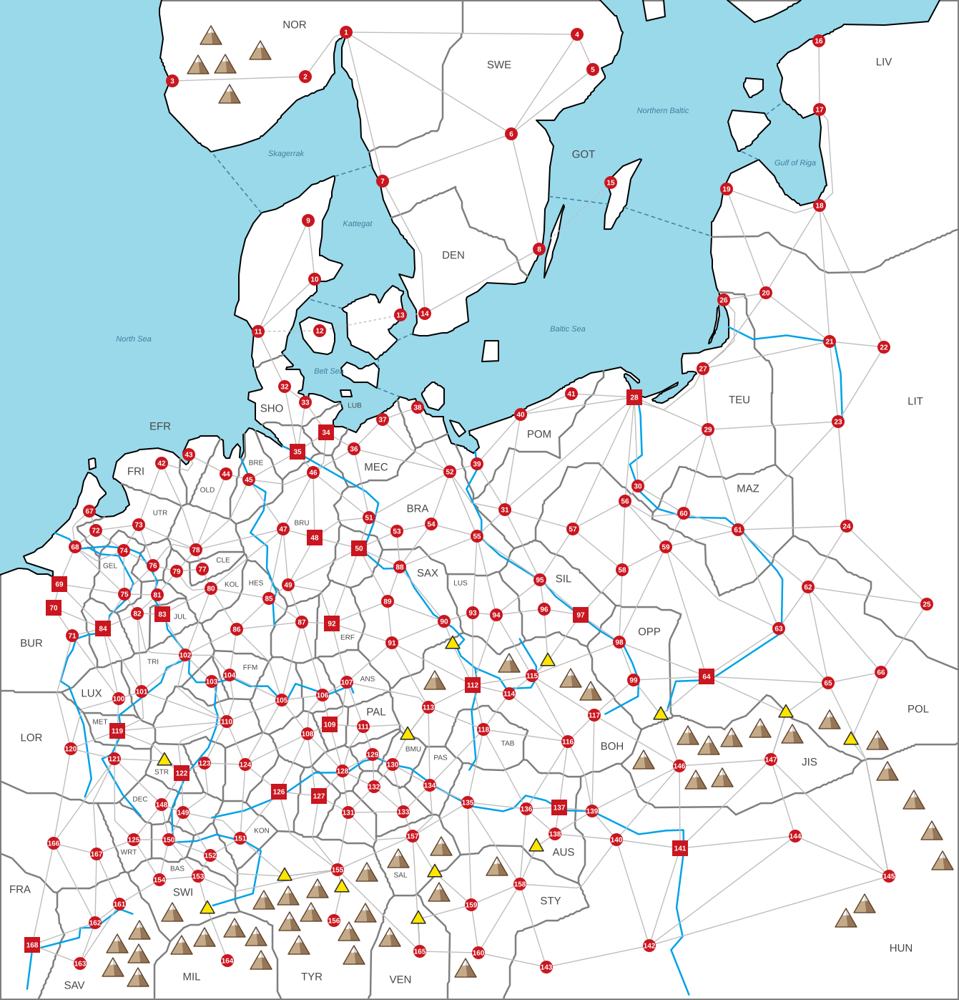

# SCENARIO: MITTELEUROPA: HISTORICAL 1440

*Everything here is specific to this map; the general rules are in [RULES.md](../../docs/RULES.md).*

A more accurate take on the Mitteleuropa map ([scenarios/mitteleuropa](../mitteleuropa/SCENARIO.md)): the same corner of Europe
in the year 1440, with every town where it really is, the realms that really existed, and towns made cities by
how big they really were.

This file is the **only** place the map's facts are written down. The map's shapes — one per settlement's land,
plus the rivers and the sea zone dividers — are in [map-base.svg](map-base.svg). From the two, a script builds
[map.svg](map.svg), the map the game shows, and [scenario.json](scenario.json), this scenario as data for the
game. After changing either, run:

```
node tools/map.js scenarios/historical-1440              # check everything, rebuild map.svg and scenario.json, refresh this file
node tools/map.js scenarios/historical-1440 mountains    # the same, but first move any mountain that touches something
```

map-base.svg and the data tables here were first made by
[make-base.js](make-base.js) from real latitudes and longitudes ([data.js](data.js)); running it again
**overwrites** map-base.svg and the tables, so once you edit them by hand, use tools/map.js only.

Columns and blocks marked *generated* are rewritten by the script — edit the rest.

**x = 1** (see the scenario scaling note in RULES.md)

**Army speed:** 420 map units per year — a route takes its length on the map ÷ this (RULES.md §8). One map unit
is about 1.2 km, so an army covers about 500 km a year, as on the Mitteleuropa map.

<!-- generated:summary -->
168 settlements (21 cities, 147 towns) · 74 countries · 1,890,000 people · 405 land routes, 4 straits, 13 mountain passes
<!-- /generated -->



## Countries

*Code, Country and Capital are data (Capital is a settlement ID; the script adds the name); the other columns are generated. A country that owns a city must have one as its capital (RULES.md §2).*

| Code | Country | Capital | Settlements | Pop | Army | Ships | HRE |
|---|---|---|---|---|---|---|---|
| NOR | Norway | 1 Oslo | 1, 2, 3 | 30K | 1,200 | 15 | — |
| SWE | Sweden | 5 Stockholm | 4, 5, 6, 7, 8 | 50K | 2,000 | 25 | — |
| DEN | Denmark | 13 Copenhagen | 9, 10, 11, 12, 13, 14 | 60K | 2,400 | 30 | — |
| GOT | Gotland | 15 Visby | 15 | 10K | 400 | 5 | — |
| LIV | Livonian Order | 18 Riga | 16, 17, 18, 19 | 40K | 1,600 | 20 | — |
| SHO | Schleswig-Holstein | 32 Schleswig | 32, 33 | 20K | 800 | 10 | part |
| LUB | Lübeck | 34 Lübeck | 34 | 20K | 800 | 10 | ✓ |
| HAM | Hamburg | 35 Hamburg | 35 | 20K | 800 | 10 | ✓ |
| MEC | Mecklenburg | 36 Schwerin | 36, 37 | 20K | 800 | 10 | ✓ |
| POM | Pomerania | 39 Stettin | 38, 39, 40, 41 | 40K | 1,600 | 20 | ✓ |
| TEU | Teutonic Order | 28 Danzig | 26, 27, 28, 29, 30, 31 | 70K | 2,800 | 35 | — |
| LIT | Lithuania | 22 Vilnius | 20, 21, 22, 23, 24, 25 | 60K | 2,400 | — | — |
| FRI | Frisia | 42 Groningen | 42 | 10K | 400 | — | ✓ |
| EFR | East Frisia | 43 Emden | 43 | 10K | 400 | 5 | ✓ |
| OLD | Oldenburg | 44 Oldenburg | 44 | 10K | 400 | — | ✓ |
| BRE | Bremen | 45 Bremen | 45 | 10K | 400 | 5 | ✓ |
| BRU | Brunswick-Lüneburg | 48 Brunswick | 46, 47, 48, 49 | 50K | 2,000 | — | ✓ |
| MAG | Magdeburg | 50 Magdeburg | 50 | 20K | 800 | — | ✓ |
| BRA | Brandenburg | 54 Berlin | 51, 52, 53, 54, 55 | 50K | 2,000 | — | ✓ |
| POL | Poland | 64 Kraków | 56, 57, 58, 59, 62, 63, 64, 65, 66 | 100K | 4,000 | — | — |
| MAZ | Masovia | 61 Warsaw | 60, 61 | 20K | 800 | — | — |
| BUR | Burgundy | 70 Brussels | 67, 68, 69, 70, 71, 166, 167 | 90K | 3,600 | 45 | part |
| UTR | Utrecht | 72 Utrecht | 72, 73 | 20K | 800 | — | ✓ |
| GEL | Guelders | 74 Nijmegen | 74, 75 | 20K | 800 | — | ✓ |
| CLE | Cleves-Mark | 76 Wesel | 76, 77 | 20K | 800 | — | ✓ |
| MUN | Münster | 78 Münster | 78 | 10K | 400 | — | ✓ |
| KOL | Electorate of Cologne | 80 Arnsberg | 79, 80 | 20K | 800 | — | ✓ |
| JUL | Jülich-Berg | 82 Jülich | 81, 82 | 20K | 800 | — | ✓ |
| COL | Cologne | 83 Cologne | 83 | 20K | 800 | — | ✓ |
| LIE | Liège | 84 Liège | 84 | 20K | 800 | — | ✓ |
| HES | Hesse | 85 Kassel | 85, 86 | 20K | 800 | — | ✓ |
| SAX | Saxony | 88 Wittenberg | 87, 88, 89, 90, 91 | 50K | 2,000 | — | ✓ |
| ERF | Erfurt | 92 Erfurt | 92 | 20K | 800 | — | ✓ |
| LUS | Upper Lusatia | 94 Görlitz | 93, 94 | 20K | 800 | — | ✓ |
| SIL | Silesia | 97 Breslau | 95, 96, 97 | 40K | 1,600 | — | ✓ |
| OPP | Opole | 98 Oppeln | 98, 99 | 20K | 800 | — | ✓ |
| LUX | Luxembourg | 100 Luxembourg | 100 | 10K | 400 | — | ✓ |
| TRI | Trier | 101 Trier | 101, 102 | 20K | 800 | — | ✓ |
| MAI | Mainz | 103 Mainz | 103 | 10K | 400 | — | ✓ |
| FFM | Frankfurt | 104 Frankfurt | 104 | 10K | 400 | — | ✓ |
| WBG | Würzburg | 105 Würzburg | 105 | 10K | 400 | — | ✓ |
| BAM | Bamberg | 106 Bamberg | 106 | 10K | 400 | — | ✓ |
| ANS | Ansbach-Kulmbach | 108 Ansbach | 107, 108 | 20K | 800 | — | ✓ |
| NUR | Nuremberg | 109 Nuremberg | 109 | 20K | 800 | — | ✓ |
| PAL | Palatinate | 110 Heidelberg | 110, 111 | 20K | 800 | — | ✓ |
| BOH | Bohemia | 112 Prague | 112, 113, 114, 115, 116, 117 | 70K | 2,800 | — | ✓ |
| TAB | Tábor | 118 Tábor | 118 | 10K | 400 | — | ✓ |
| MET | Metz | 119 Metz | 119 | 20K | 800 | — | ✓ |
| LOR | Lorraine | 121 Nancy | 120, 121 | 20K | 800 | — | ✓ |
| STR | Strasbourg | 122 Strasbourg | 122 | 20K | 800 | — | ✓ |
| BAD | Baden | 123 Baden | 123 | 10K | 400 | — | ✓ |
| WRT | Württemberg | 124 Stuttgart | 124, 125 | 20K | 800 | — | ✓ |
| ULM | Ulm | 126 Ulm | 126 | 20K | 800 | — | ✓ |
| AUG | Augsburg | 127 Augsburg | 127 | 20K | 800 | — | ✓ |
| BIN | Bavaria-Ingolstadt | 128 Ingolstadt | 128 | 10K | 400 | — | ✓ |
| REG | Regensburg | 129 Regensburg | 129 | 10K | 400 | — | ✓ |
| BMU | Bavaria-Munich | 131 Munich | 130, 131 | 20K | 800 | — | ✓ |
| BLA | Bavaria-Landshut | 132 Landshut | 132, 133 | 20K | 800 | — | ✓ |
| PAS | Passau | 134 Passau | 134 | 10K | 400 | — | ✓ |
| AUS | Austria | 137 Vienna | 135, 136, 137, 138 | 50K | 2,000 | — | ✓ |
| HUN | Hungary | 141 Buda | 139, 140, 141, 142, 143, 144, 145 | 80K | 3,200 | — | — |
| JIS | Upper Hungary | 147 Kassa | 146, 147 | 20K | 800 | — | — |
| DEC | Decapolis | 148 Colmar | 148 | 10K | 400 | — | ✓ |
| BAS | Basel | 150 Basel | 150 | 10K | 400 | — | ✓ |
| KON | Konstanz | 151 Konstanz | 151 | 10K | 400 | — | ✓ |
| ZUR | Zürich | 152 Zürich | 152 | 10K | 400 | — | ✓ |
| SWI | Swiss Confederacy | 154 Bern | 153, 154 | 20K | 800 | — | ✓ |
| TYR | Tyrol | 155 Innsbruck | 149, 155, 156 | 30K | 1,200 | — | ✓ |
| SAL | Salzburg | 157 Salzburg | 157 | 10K | 400 | — | ✓ |
| STY | Inner Austria | 158 Graz | 158, 159, 160 | 30K | 1,200 | — | ✓ |
| SAV | Savoy | 163 Chambéry | 161, 162, 163 | 30K | 1,200 | — | ✓ |
| MIL | Milan | 164 Como | 164 | 10K | 400 | — | — |
| VEN | Venice | 165 Udine | 165 | 10K | 400 | — | — |
| FRA | France | 168 Lyon | 168 | 20K | 800 | — | — |

## Settlements

- **Type** — `town` (red circle, 10,000 pop) or `city` (red square, 20,000 pop). The 21 cities are the largest
  towns of the map around 1440.
- **Port** — the settlement sits on the coast. 46 Bremen is a port **by ruling**: it lies up the Weser.
- **HRE** — inside the Holy Roman Empire.
- **X, Y** — marker centre, in map units (the coordinates of map.svg). The settlement's land is the shape
  `land-ID` in map-base.svg; country borders are drawn wherever two lands belong to different countries.
- **Borders** — settlements an army can march to in one step (every route is listed under both ends). Routes
  through a mountain pass are listed here too; the pass itself is in *Mountain passes*.
- **Straits** — crossings by sea (dashed lines, RULES.md §8).

| ID | Name | Country | Type | Port | HRE | X | Y | Borders | Straits |
|---|---|---|---|---|---|---|---|---|---|
| 1 | Oslo | NOR | town | port |  | 484 | 45 | 2, 4, 6, 7 |  |
| 2 | Skien | NOR | town | port |  | 427 | 107 | 1, 3 |  |
| 3 | Stavanger | NOR | town | port |  | 241 | 113 | 2 |  |
| 4 | Uppsala | SWE | town |  |  | 807 | 48 | 1, 5, 6 |  |
| 5 | Stockholm | SWE | town | port |  | 829 | 97 | 4, 6 |  |
| 6 | Linköping | SWE | town |  |  | 715 | 187 | 1, 4, 5, 7, 8 |  |
| 7 | Älvsborg | SWE | town | port |  | 535 | 253 | 1, 6, 14 |  |
| 8 | Kalmar | SWE | town | port |  | 754 | 348 | 6, 14 | 15 |
| 9 | Aalborg | DEN | town | port |  | 431 | 308 | 10, 11 |  |
| 10 | Aarhus | DEN | town | port |  | 440 | 390 | 9, 11 |  |
| 11 | Ribe | DEN | town | port |  | 361 | 463 | 9, 10, 32 | 12 |
| 12 | Odense | DEN | town | port |  | 447 | 462 |  | 11, 13 |
| 13 | Copenhagen | DEN | town | port |  | 560 | 440 |  | 12, 14 |
| 14 | Lund | DEN | town |  |  | 594 | 438 | 7, 8 | 13 |
| 15 | Visby | GOT | town | port |  | 854 | 255 |  | 8 |
| 16 | Reval | LIV | town | port |  | 1145 | 57 | 17 |  |
| 17 | Pernau | LIV | town | port |  | 1146 | 153 | 16, 18 |  |
| 18 | Riga | LIV | town | port |  | 1146 | 287 | 17, 19, 20, 21, 22 |  |
| 19 | Windau | LIV | town | port |  | 1016 | 264 | 18, 20 |  |
| 20 | Medininkai | LIT | town |  |  | 1071 | 409 | 18, 19, 21, 26, 27 |  |
| 21 | Kaunas | LIT | town |  |  | 1160 | 477 | 18, 20, 22, 23, 27 |  |
| 22 | Vilnius | LIT | town |  |  | 1236 | 485 | 18, 21, 23 |  |
| 23 | Grodno | LIT | town |  |  | 1172 | 589 | 21, 22, 24, 29, 61 |  |
| 24 | Brest | LIT | town |  |  | 1184 | 735 | 23, 25, 61, 62 |  |
| 25 | Lutsk | LIT | town |  |  | 1296 | 844 | 24, 62, 66 |  |
| 26 | Memel | TEU | town | port |  | 1012 | 419 | 20, 27 |  |
| 27 | Königsberg | TEU | town | port |  | 983 | 515 | 20, 21, 26, 28, 29 |  |
| 28 | Danzig | TEU | city | port |  | 887 | 555 | 27, 29, 30, 31, 40, 41, 56, 57 |  |
| 29 | Allenstein | TEU | town |  |  | 990 | 600 | 23, 27, 28, 30, 60, 61 |  |
| 30 | Thorn | TEU | town |  |  | 892 | 679 | 28, 29, 56, 60 |  |
| 31 | Landsberg | TEU | town |  |  | 706 | 712 | 28, 39, 40, 52, 55, 57, 95 |  |
| 32 | Schleswig | SHO | town | port |  | 398 | 540 | 11, 33, 35 |  |
| 33 | Kiel | SHO | town | port | HRE | 427 | 562 | 32, 34, 35 |  |
| 34 | Lübeck | LUB | city | port | HRE | 456 | 604 | 33, 35, 36, 46 |  |
| 35 | Hamburg | HAM | city | port | HRE | 416 | 631 | 32, 33, 34, 45, 46 |  |
| 36 | Schwerin | MEC | town |  | HRE | 495 | 627 | 34, 37, 46, 51, 52 |  |
| 37 | Rostock | MEC | town | port | HRE | 535 | 586 | 36, 38, 52 |  |
| 38 | Stralsund | POM | town | port | HRE | 584 | 569 | 37, 52 |  |
| 39 | Stettin | POM | town | port | HRE | 667 | 648 | 31, 40, 52 |  |
| 40 | Kolberg | POM | town | port | HRE | 728 | 579 | 28, 31, 39, 41 |  |
| 41 | Stolp | POM | town |  | HRE | 799 | 550 | 28, 40 |  |
| 42 | Groningen | FRI | town |  | HRE | 226 | 647 | 43, 73, 78 |  |
| 43 | Emden | EFR | town | port | HRE | 264 | 635 | 42, 44 |  |
| 44 | Oldenburg | OLD | town |  | HRE | 316 | 662 | 43, 45, 78 |  |
| 45 | Bremen | BRE | town | port | HRE | 348 | 670 | 35, 44, 46, 47, 78 |  |
| 46 | Lüneburg | BRU | town |  | HRE | 438 | 660 | 34, 35, 36, 45, 47, 48, 51 |  |
| 47 | Hanover | BRU | town |  | HRE | 396 | 739 | 45, 46, 48, 49, 78, 80, 85 |  |
| 48 | Brunswick | BRU | city |  | HRE | 440 | 751 | 46, 47, 49, 50, 51 |  |
| 49 | Göttingen | BRU | town |  | HRE | 403 | 817 | 47, 48, 50, 85, 87, 92 |  |
| 50 | Magdeburg | MAG | city |  | HRE | 502 | 766 | 48, 49, 51, 53, 88, 89, 92 |  |
| 51 | Stendal | BRA | town |  | HRE | 516 | 723 | 36, 46, 48, 50, 52, 53 |  |
| 52 | Prenzlau | BRA | town |  | HRE | 629 | 659 | 31, 36, 37, 38, 39, 51, 54, 55 |  |
| 53 | Brandenburg | BRA | town |  | HRE | 555 | 742 | 50, 51, 54, 88 |  |
| 54 | Berlin | BRA | town |  | HRE | 603 | 732 | 52, 53, 55, 88 |  |
| 55 | Frankfurt (Oder) | BRA | town |  | HRE | 667 | 749 | 31, 52, 54, 88, 93, 94, 95 |  |
| 56 | Inowrocław | POL | town |  |  | 874 | 700 | 28, 30, 57, 58, 59, 60 |  |
| 57 | Poznań | POL | town |  |  | 801 | 739 | 28, 31, 56, 58, 95 |  |
| 58 | Kalisz | POL | town |  |  | 870 | 796 | 56, 57, 59, 97, 98 |  |
| 59 | Łęczyca | POL | town |  |  | 931 | 764 | 56, 58, 60, 61, 63, 64, 98 |  |
| 60 | Płock | MAZ | town |  |  | 956 | 717 | 29, 30, 56, 59, 61 |  |
| 61 | Warsaw | MAZ | town |  |  | 1032 | 740 | 23, 24, 29, 59, 60, 62, 63 |  |
| 62 | Lublin | POL | town |  |  | 1130 | 820 | 24, 25, 61, 63, 65, 66 |  |
| 63 | Sandomierz | POL | town |  |  | 1089 | 878 | 59, 61, 62, 64, 65 |  |
| 64 | Kraków | POL | city |  |  | 988 | 945 | 59, 63, 65, 98, 99, 146, 147 |  |
| 65 | Przemyśl | POL | town |  |  | 1158 | 954 | 62, 63, 64, 66, 145, 147 |  |
| 66 | Lwów | POL | town |  |  | 1232 | 939 | 25, 62, 65, 145 |  |
| 67 | Amsterdam | BUR | town | port | HRE | 125 | 714 | 68, 72 |  |
| 68 | Dordrecht | BUR | town | port | HRE | 105 | 764 | 67, 69, 72, 74, 75 |  |
| 69 | Antwerp | BUR | city | port | HRE | 83 | 816 | 68, 70, 75, 84 |  |
| 70 | Brussels | BUR | city |  | HRE | 75 | 849 | 69, 71, 84 |  |
| 71 | Namur | BUR | town |  | HRE | 101 | 888 | 70, 84, 100, 120 |  |
| 72 | Utrecht | UTR | town |  | HRE | 134 | 741 | 67, 68, 73, 74 |  |
| 73 | Deventer | UTR | town |  | HRE | 194 | 733 | 42, 72, 74, 76, 78 |  |
| 74 | Nijmegen | GEL | town |  | HRE | 173 | 769 | 68, 72, 73, 75, 76 |  |
| 75 | Roermond | GEL | town |  | HRE | 174 | 830 | 68, 69, 74, 76, 81, 82, 84 |  |
| 76 | Wesel | CLE | town |  | HRE | 214 | 790 | 73, 74, 75, 78, 79, 81 |  |
| 77 | Hamm | CLE | town |  | HRE | 283 | 795 | 78, 79, 80 |  |
| 78 | Münster | MUN | town |  | HRE | 274 | 768 | 42, 44, 45, 47, 73, 76, 77, 79 |  |
| 79 | Recklinghausen | KOL | town |  | HRE | 247 | 798 | 76, 77, 78, 80, 81 |  |
| 80 | Arnsberg | KOL | town |  | HRE | 295 | 822 | 47, 77, 79, 83, 85, 86, 102 |  |
| 81 | Düsseldorf | JUL | town |  | HRE | 220 | 831 | 75, 76, 79, 82, 83 |  |
| 82 | Jülich | JUL | town |  | HRE | 192 | 857 | 75, 81, 83, 84, 101, 102 |  |
| 83 | Cologne | COL | city |  | HRE | 227 | 858 | 80, 81, 82, 102 |  |
| 84 | Liège | LIE | city |  | HRE | 144 | 878 | 69, 70, 71, 75, 82, 100, 101 |  |
| 85 | Kassel | HES | town |  | HRE | 376 | 836 | 47, 49, 80, 86, 87 |  |
| 86 | Marburg | HES | town |  | HRE | 331 | 879 | 80, 85, 87, 102, 104, 105 |  |
| 87 | Eisenach | SAX | town |  | HRE | 422 | 869 | 49, 85, 86, 92, 105, 106 |  |
| 88 | Wittenberg | SAX | town |  | HRE | 559 | 792 | 50, 53, 54, 55, 89, 90 |  |
| 89 | Leipzig | SAX | town |  | HRE | 542 | 840 | 50, 88, 90, 91, 92 |  |
| 90 | Dresden | SAX | town |  | HRE | 621 | 868 | 88, 89, 91, 93, 112 |  |
| 91 | Zwickau | SAX | town |  | HRE | 548 | 898 | 89, 90, 92, 107, 112, 113 |  |
| 92 | Erfurt | ERF | city |  | HRE | 464 | 871 | 49, 50, 87, 89, 91, 107 |  |
| 93 | Bautzen | LUS | town |  | HRE | 661 | 856 | 55, 90, 94, 112 |  |
| 94 | Görlitz | LUS | town |  | HRE | 694 | 859 | 55, 93, 95, 96, 112, 115 |  |
| 95 | Glogau | SIL | town |  | HRE | 755 | 810 | 31, 55, 57, 94, 96, 97 |  |
| 96 | Liegnitz | SIL | town |  | HRE | 761 | 851 | 94, 95, 97, 115 |  |
| 97 | Breslau | SIL | city |  | HRE | 812 | 859 | 58, 95, 96, 98, 115 |  |
| 98 | Oppeln | OPP | town |  | HRE | 866 | 897 | 58, 59, 64, 97, 99, 115 |  |
| 99 | Ratibor | OPP | town |  | HRE | 886 | 950 | 64, 98, 117, 146 |  |
| 100 | Luxembourg | LUX | town |  | HRE | 166 | 976 | 71, 84, 101, 119, 120 |  |
| 101 | Trier | TRI | town |  | HRE | 198 | 966 | 82, 84, 100, 102, 110, 119 |  |
| 102 | Koblenz | TRI | town |  | HRE | 259 | 915 | 80, 82, 83, 86, 101, 103, 104, 110 |  |
| 103 | Mainz | MAI | town |  | HRE | 296 | 952 | 102, 104, 110 |  |
| 104 | Frankfurt | FFM | town |  | HRE | 321 | 943 | 86, 102, 103, 105, 110 |  |
| 105 | Würzburg | WBG | town |  | HRE | 394 | 978 | 86, 87, 104, 106, 108, 110, 124 |  |
| 106 | Bamberg | BAM | town |  | HRE | 451 | 971 | 87, 105, 107, 108, 109 |  |
| 107 | Kulmbach | ANS | town |  | HRE | 485 | 953 | 91, 92, 106, 109, 111, 113 |  |
| 108 | Ansbach | ANS | town |  | HRE | 430 | 1025 | 105, 106, 109, 124, 126, 127, 128 |  |
| 109 | Nuremberg | NUR | city |  | HRE | 461 | 1012 | 106, 107, 108, 111, 128 |  |
| 110 | Heidelberg | PAL | town |  | HRE | 317 | 1008 | 101, 102, 103, 104, 105, 119, 122, 123, 124 |  |
| 111 | Amberg | PAL | town |  | HRE | 508 | 1015 | 107, 109, 113, 128, 129 |  |
| 112 | Prague | BOH | city |  | HRE | 661 | 957 | 90, 91, 93, 94, 113, 114, 115, 118 |  |
| 113 | Plzeň | BOH | town |  | HRE | 599 | 988 | 91, 107, 111, 112, 118, 130, 134 |  |
| 114 | Kutná Hora | BOH | town |  | HRE | 712 | 969 | 112, 115, 116, 118 |  |
| 115 | Hradec Králové | BOH | town |  | HRE | 744 | 944 | 94, 96, 97, 98, 112, 114, 116, 117 |  |
| 116 | Brno | BOH | town |  | HRE | 794 | 1036 | 114, 115, 117, 118, 136, 137, 139 |  |
| 117 | Olomouc | BOH | town |  | HRE | 831 | 999 | 99, 115, 116, 139, 146 |  |
| 118 | Tábor | TAB | town |  | HRE | 676 | 1019 | 112, 113, 114, 116, 134, 135, 136 |  |
| 119 | Metz | MET | city |  | HRE | 164 | 1021 | 100, 101, 110, 120, 121, 122 |  |
| 120 | Bar | LOR | town |  | HRE | 99 | 1046 | 71, 100, 119, 121, 166 |  |
| 121 | Nancy | LOR | town |  | HRE | 160 | 1060 | 119, 120, 122, 125, 148, 166, 167 |  |
| 122 | Strasbourg | STR | city |  | HRE | 254 | 1080 | 110, 119, 121, 123, 148, 149 |  |
| 123 | Baden | BAD | town |  | HRE | 286 | 1066 | 110, 122, 124, 149 |  |
| 124 | Stuttgart | WRT | town |  | HRE | 343 | 1068 | 105, 108, 110, 123, 126, 151 |  |
| 125 | Montbéliard | WRT | town |  | HRE | 187 | 1173 | 121, 148, 150, 154, 167 |  |
| 126 | Ulm | ULM | city |  | HRE | 390 | 1106 | 108, 124, 127, 151, 155 |  |
| 127 | Augsburg | AUG | city |  | HRE | 446 | 1112 | 108, 126, 128, 131, 155 |  |
| 128 | Ingolstadt | BIN | town |  | HRE | 479 | 1077 | 108, 109, 111, 127, 129, 131, 132 |  |
| 129 | Regensburg | REG | town |  | HRE | 521 | 1054 | 111, 128, 130, 132 |  |
| 130 | Straubing | BMU | town |  | HRE | 549 | 1068 | 113, 129, 132, 133, 134 |  |
| 131 | Munich | BMU | town |  | HRE | 487 | 1135 | 127, 128, 132, 133, 155, 157 |  |
| 132 | Landshut | BLA | town |  | HRE | 523 | 1099 | 128, 129, 130, 131, 133 |  |
| 133 | Burghausen | BLA | town |  | HRE | 564 | 1134 | 130, 131, 132, 134, 157 |  |
| 134 | Passau | PAS | town |  | HRE | 601 | 1097 | 113, 118, 130, 133, 135, 157 |  |
| 135 | Linz | AUS | town |  | HRE | 654 | 1121 | 118, 134, 136, 157, 158, 159 |  |
| 136 | St. Pölten | AUS | town |  | HRE | 736 | 1130 | 116, 118, 135, 137, 138, 158 |  |
| 137 | Vienna | AUS | city |  | HRE | 782 | 1128 | 116, 136, 138, 139 |  |
| 138 | Wiener Neustadt | AUS | town |  | HRE | 776 | 1165 | 136, 137, 139, 140, 158 |  |
| 139 | Pozsony | HUN | town |  |  | 828 | 1133 | 116, 117, 137, 138, 140, 146 |  |
| 140 | Győr | HUN | town |  |  | 862 | 1173 | 138, 139, 141, 142, 146, 158 |  |
| 141 | Buda | HUN | city |  |  | 951 | 1185 | 140, 142, 144, 146, 147 |  |
| 142 | Pécs | HUN | town |  |  | 908 | 1321 | 140, 141, 143, 144, 145 |  |
| 143 | Zagreb | HUN | town |  |  | 764 | 1351 | 142, 158, 160 |  |
| 144 | Debrecen | HUN | town |  |  | 1112 | 1168 | 141, 142, 145, 147 |  |
| 145 | Kolozsvár | HUN | town |  |  | 1243 | 1224 | 65, 66, 142, 144, 147 |  |
| 146 | Besztercebánya | JIS | town |  |  | 950 | 1070 | 64, 99, 117, 139, 140, 141, 147 |  |
| 147 | Kassa | JIS | town |  |  | 1078 | 1061 | 64, 65, 141, 144, 145, 146 |  |
| 148 | Colmar | DEC | town |  | HRE | 226 | 1124 | 121, 122, 125, 149, 150 |  |
| 149 | Freiburg | TYR | town |  | HRE | 256 | 1135 | 122, 123, 148, 150, 151, 152 |  |
| 150 | Basel | BAS | town |  | HRE | 236 | 1173 | 125, 148, 149, 152, 153, 154 |  |
| 151 | Konstanz | KON | town |  | HRE | 336 | 1171 | 124, 126, 149, 152, 155 |  |
| 152 | Zürich | ZUR | town |  | HRE | 294 | 1195 | 149, 150, 151, 153, 155 |  |
| 153 | Lucerne | SWI | town |  | HRE | 277 | 1224 | 150, 152, 154, 155, 164 |  |
| 154 | Bern | SWI | town |  | HRE | 223 | 1229 | 125, 150, 153, 161 |  |
| 155 | Innsbruck | TYR | town |  | HRE | 472 | 1215 | 126, 127, 131, 151, 152, 153, 156, 157, 165 |  |
| 156 | Bozen | TYR | town |  | HRE | 467 | 1286 | 155 |  |
| 157 | Salzburg | SAL | town |  | HRE | 577 | 1168 | 131, 133, 134, 135, 155, 159, 165 |  |
| 158 | Graz | STY | town |  | HRE | 727 | 1235 | 135, 136, 138, 140, 143, 159, 160 |  |
| 159 | St. Veit | STY | town |  | HRE | 659 | 1264 | 135, 157, 158, 160, 165 |  |
| 160 | Ljubljana | STY | town |  | HRE | 669 | 1331 | 143, 158, 159, 165 |  |
| 161 | Lausanne | SAV | town |  | HRE | 167 | 1263 | 154, 162, 163, 167 |  |
| 162 | Geneva | SAV | town |  | HRE | 133 | 1289 | 161, 163, 166, 167, 168 |  |
| 163 | Chambéry | SAV | town |  | HRE | 112 | 1346 | 161, 162, 168 |  |
| 164 | Como | MIL | town |  |  | 318 | 1342 | 153 |  |
| 165 | Udine | VEN | town |  |  | 587 | 1329 | 155, 157, 159, 160 |  |
| 166 | Dijon | BUR | town |  |  | 75 | 1178 | 120, 121, 162, 167, 168 |  |
| 167 | Besançon | BUR | town |  | HRE | 135 | 1193 | 121, 125, 161, 162, 166 |  |
| 168 | Lyon | FRA | city |  |  | 45 | 1320 | 162, 163, 166 |  |

## Mountain passes

Yellow triangles on the map. Every route listed runs settlement → pass → settlement. A pass belongs to whoever
owns the settlement whose land it lies in (RULES.md §8). *Pass, X, Y and Routes are data; the other columns are
generated from where the pass lies.*

| Pass | X | Y | Routes | In the land of | Owner at start |
|---|---|---|---|---|---|
| P1 | 290 | 1270 | 153-164 | 153 Lucerne | SWI Swiss Confederacy |
| P2 | 398 | 1224 | 151-155, 152-155 | 155 Innsbruck | TYR Tyrol |
| P3 | 478 | 1240 | 155-156 | 155 Innsbruck | TYR Tyrol |
| P4 | 608 | 1219 | 157-159 | 157 Salzburg | SAL Salzburg |
| P5 | 750 | 1183 | 138-158 | 138 Wiener Neustadt | AUS Austria |
| P6 | 585 | 1284 | 159-165 | 165 Udine | VEN Venice |
| P7 | 633 | 900 | 90-112 | 112 Prague | BOH Bohemia |
| P8 | 570 | 1027 | 113-130, 111-113 | 113 Plzeň | BOH Bohemia |
| P9 | 766 | 924 | 96-115, 97-115 | 115 Hradec Králové | BOH Bohemia |
| P10 | 924 | 999 | 99-146, 64-146 | 99 Ratibor | OPP Opole |
| P11 | 1099 | 996 | 65-147, 64-147 | 147 Kassa | JIS Upper Hungary |
| P12 | 1190 | 1034 | 66-145 | 65 Przemyśl | POL Poland |
| P13 | 230 | 1063 | 121-122 | 122 Strasbourg | STR Strasbourg |

## Route bends

A route is drawn straight, and the script bends it by itself only where the straight line would leave its
countries' land. List a route here to bend it through points of your own. *All columns are data.* Points are x,y
in map units, in order from the lower-numbered settlement; the route's length (and so its marching time) follows
the bend.

| Route | Through | Why |
|---|---|---|

## Mountains

Decoration only — mountains have no rules effect outside the passes. Apex positions (x,y in map units);
`node tools/map.js scenarios/historical-1440 mountains` moves any that touch something else.

```
295,36  364,57  315,76  277,77  321,118  712,913  798,934  608,937
826,952  1160,992  1063,1004  1108,1012  962,1014  1023,1017  1227,1021  991,1028
900,1048  1241,1064  1010,1073  973,1076  1278,1104  1303,1147  617,1169  557,1186
1318,1189  695,1197  513,1205  444,1228  614,1233  403,1238  369,1244  1209,1249
241,1261  435,1261  511,1262  1183,1269  405,1274  328,1283  195,1286  488,1288
358,1295  286,1296  545,1296  164,1305  254,1307  418,1307  194,1319  495,1321
365,1328  158,1338  651,1339  193,1352
```

## Overview

<!-- generated:overview -->
**Cities (20K):** 28, 34, 35, 48, 50, 64, 69, 70, 83, 84, 92, 97, 109, 112, 119, 122, 126, 127, 137, 141, 168 — all other settlements are towns (10K).

**HRE settlements (112):** 33–55, 67–138, 148–163, 167 — held by 60 of the 74 countries.

**Ports (32):** 1, 2, 3, 5, 7, 8, 9, 10, 11, 12, 13, 15, 16, 17, 18, 19, 26, 27, 28, 32, 33, 34, 35, 37, 38, 39, 40, 43, 45, 67, 68, 69 — on the coast; grow +0.5% more (RULES.md §2).

**On a river (70):** 21, 23, 28, 30, 35, 39, 45, 46, 49, 50, 51, 55, 60, 61, 63, 64, 68, 71, 72, 74, 75, 76, 81, 83, 84, 85, 88, 90, 95, 96, 97, 98, 99, 100, 101, 102, 103, 104, 105, 106, 107, 110, 112, 114, 115, 117, 118, 119, 120, 121, 122, 123, 126, 128, 129, 130, 134, 135, 136, 137, 139, 140, 141, 148, 149, 150, 151, 161, 162, 168 — within 24px of a river on the map; grow +0.5% more (RULES.md §2).

**Routes crossing a river (159):** 20-27, 21-23, 21-27, 22-23, 23-61, 24-61, 26-27, 27-28, 28-29, 28-30, 29-61, 30-56, 31-52, 31-55, 34-46, 35-45, 35-46, 36-46, 36-51, 39-52, 45-46, 45-47, 47-78, 47-80, 47-85, 49-85, 50-53, 50-88, 51-52, 51-53, 55-95, 56-60, 59-60, 60-61, 61-62, 62-63, 63-65, 64-65, 64-99, 64-146, 64-147, 67-68, 68-72, 68-74, 71-100, 72-74, 73-74, 74-75, 74-76, 75-76, 75-81, 75-82, 75-84, 76-81, 80-83, 80-102, 81-82, 81-83, 82-84, 83-102, 84-100, 84-101, 85-87, 86-87, 86-102, 87-106, 88-89, 88-90, 89-90, 90-91, 90-112, 93-112, 94-95, 94-112, 95-96, 95-97, 96-97, 96-115, 97-115, 98-99, 98-115, 99-146, 100-120, 101-102, 101-110, 101-119, 102-103, 102-104, 102-110, 103-110, 104-105, 104-110, 105-106, 105-108, 105-110, 105-124, 106-107, 107-109, 107-111, 108-127, 110-119, 110-122, 112-114, 112-115, 112-118, 113-118, 113-130, 113-134, 114-115, 115-116, 115-117, 116-136, 118-134, 118-136, 119-120, 119-121, 119-122, 120-121, 121-125, 121-166, 121-167, 122-123, 122-149, 124-151, 126-127, 126-151, 126-155, 127-128, 128-131, 128-132, 129-130, 129-132, 134-135, 135-136, 135-157, 135-158, 135-159, 136-137, 137-138, 138-139, 139-140, 140-146, 141-144, 141-146, 141-147, 142-144, 142-145, 148-149, 149-150, 149-152, 150-152, 151-152, 151-155, 152-155, 153-155, 161-163, 162-163, 162-168, 163-168 — +1 month to march (RULES.md §8).

**Marching** at 420 map units a year, +1 month per river crossing, +2 per leg to or from a pass: a route takes 0.06–1.06 years (median 0.24); through a pass 0.51–1.06.

| Pop | Countries |
|---|---|
| 100K | 1: POL Poland |
| 90K | 1: BUR Burgundy |
| 80K | 1: HUN Hungary |
| 70K | 2: TEU Teutonic Order · BOH Bohemia |
| 60K | 2: DEN Denmark · LIT Lithuania |
| 50K | 5: SWE Sweden · BRU Brunswick-Lüneburg · BRA Brandenburg · SAX Saxony · AUS Austria |
| 40K | 3: LIV Livonian Order · POM Pomerania · SIL Silesia |
| 30K | 4: NOR Norway · TYR Tyrol · STY Inner Austria · SAV Savoy |
| 20K | 32: SHO Schleswig-Holstein · LUB Lübeck · HAM Hamburg · MEC Mecklenburg · MAG Magdeburg · MAZ Masovia · UTR Utrecht · GEL Guelders · CLE Cleves-Mark · KOL Electorate of Cologne · JUL Jülich-Berg · COL Cologne · LIE Liège · HES Hesse · ERF Erfurt · LUS Upper Lusatia · OPP Opole · TRI Trier · ANS Ansbach-Kulmbach · NUR Nuremberg · PAL Palatinate · MET Metz · LOR Lorraine · STR Strasbourg · WRT Württemberg · ULM Ulm · AUG Augsburg · BMU Bavaria-Munich · BLA Bavaria-Landshut · JIS Upper Hungary · SWI Swiss Confederacy · FRA France |
| 10K | 23: GOT Gotland · FRI Frisia · EFR East Frisia · OLD Oldenburg · BRE Bremen · MUN Münster · LUX Luxembourg · MAI Mainz · FFM Frankfurt · WBG Würzburg · BAM Bamberg · TAB Tábor · BAD Baden · BIN Bavaria-Ingolstadt · REG Regensburg · PAS Passau · DEC Decapolis · BAS Basel · KON Konstanz · ZUR Zürich · SAL Salzburg · MIL Milan · VEN Venice |

**Sailing:** 2 months to a neighbouring sea zone (RULES.md §8); the furthest apart, North Sea and Gulf of Riga, are 5 hops (10 months).

**Naval powers:** 14 countries, 245 ships. Crossing a strait needs 10 ships (10 × x) in the sea zone the strait lies in (RULES.md §8), so at the start a country can only cross the straits of its own ports' zones; for any other it must first sail 10 ships there.

| Country | Ports held | Home zones | Ships | Can cross straits? |
|---|---|---|---|---|
| BUR Burgundy | 67, 68, 69 | North Sea | 45 | no — no strait in its zones |
| TEU Teutonic Order | 26, 27, 28 | Baltic Sea | 35 | yes: 8-15 |
| DEN Denmark | 9, 10, 11, 12, 13 | North Sea, Kattegat, Belt Sea | 30 | yes: 11-12, 12-13, 13-14 |
| SWE Sweden | 5, 7, 8 | Kattegat, Baltic Sea, Northern Baltic | 25 | yes: 8-15, 13-14 |
| LIV Livonian Order | 16, 17, 18, 19 | Northern Baltic, Gulf of Riga | 20 | no — no strait in its zones |
| POM Pomerania | 38, 39, 40 | Baltic Sea | 20 | yes: 8-15 |
| NOR Norway | 1, 2, 3 | North Sea, Skagerrak | 15 | no — no strait in its zones |
| SHO Schleswig-Holstein | 32, 33 | Belt Sea | 10 | **exactly**: 11-12, 12-13 |
| LUB Lübeck | 34 | Belt Sea | 10 | **exactly**: 11-12, 12-13 |
| HAM Hamburg | 35 | North Sea | 10 | no — no strait in its zones |
| MEC Mecklenburg | 37 | Belt Sea | 10 | **exactly**: 11-12, 12-13 |
| GOT Gotland | 15 | Northern Baltic | 5 | no — no strait in its zones |
| EFR East Frisia | 43 | North Sea | 5 | no — no strait in its zones |
| BRE Bremen | 45 | North Sea | 5 | no — no strait in its zones |
<!-- /generated -->

## Special coring
*(no Courthouse and no 20-year wait)*

You may proclaim a region when **both** are true:

1. Your **capital** lies within the region.
2. You and your **vassals** together control **100%** of its settlements (a protectorate's do not count: it keeps its own
   diplomacy). Your vassals' settlements count as they do for winning.

Every settlement in the region becomes your core immediately, your vassals' too (they stay theirs, core for you should
they ever be yours). If you later lose one and retake it, it is core again on capture.

| Formable | What it was | Settlements | Count |
|---|---|---|---|
| **Unite the Swiss** | the Confederacy with Zürich and Basel (1501) | 150, 152–154 | 4 |
| **Reunite Bavaria** | the Wittelsbach duchies, one again from 1505 | 128–133 | 6 |
| **Habsburg Austria** | the hereditary lands of the house of Habsburg | 135–138, 149, 155, 156, 158–160 | 10 |
| **Kingdom of Hungary** | the crown of St Stephen | 139–147 | 9 |
| **Lands of the Bohemian Crown** | Bohemia, Moravia, Silesia and Lusatia | 93–99, 112–118 | 14 |
| **Kalmar Union** | the three northern crowns under one king | 1–15 | 15 |
| **Wettin Saxony** | Saxony, Thuringia and Meissen | 87–92 | 6 |
| **Crown of Poland** | Poland, Masovia (1526) and Royal Prussia (1466) | 28–30, 56–66 | 14 |
| **Brandenburg-Prussia** | the Hohenzollern lands of 1618 | 26, 27, 31, 51–55, 107, 108 | 10 |
| **Burgundian Netherlands** | the Seventeen Provinces of 1549 | 42, 67–75, 84, 100, 166, 167 | 14 |
| **Kingdom of Burgundy** | the realm Charles the Bold wanted, Frisia to the Alps | 42, 67–75, 84, 100, 119–121, 125, 148, 149, 166, 167 | 20 |
| **Hanseatic League** | its leading towns, under Lübeck | 15, 16, 18, 28, 34, 35, 37, 38, 45, 83 | 10 |
| **Polish-Lithuanian Commonwealth** | Poland and Lithuania joined at Lublin (1569) | 16–30, 56–66 | 26 |

## Sea zones

Seven zones, split by the dashed lines in the sea. A fleet operates in one zone at a time (RULES.md §7). A port
belongs to the zone its coast faces; crossing a strait needs 10 ships in the zone the strait lies in (RULES.md
§8). *Zone, X and Y are data — X, Y is where the name is drawn, and the zone it names is the one around that
point; the other columns are generated from the map.*

| Zone | X | Y | Ports | Straits | Next to |
|---|---|---|---|---|---|
| North Sea | 187 | 477 | 3, 11, 35, 43, 45, 67, 68, 69 | — | Skagerrak |
| Skagerrak | 400 | 218 | 1, 2 | — | North Sea, Kattegat |
| Kattegat | 500 | 316 | 7, 9, 10, 13 | 13-14 | Skagerrak, Belt Sea, Baltic Sea |
| Belt Sea | 460 | 522 | 12, 32, 33, 34, 37 | 11-12, 12-13 | Kattegat, Baltic Sea |
| Baltic Sea | 794 | 463 | 8, 26, 27, 28, 38, 39, 40 | 8-15 | Kattegat, Belt Sea, Northern Baltic |
| Northern Baltic | 927 | 158 | 5, 15, 16, 19 | — | Baltic Sea, Gulf of Riga |
| Gulf of Riga | 1112 | 231 | 17, 18 | — | Northern Baltic |

## The situation in 1440

The game opens in the middle of four wars, and with the alliances of 1440 already signed. They count exactly as
if declared and signed in play (RULES.md §10): the sides below are at war from the first day, the agreements are
in force, and every warmonger score still starts at 0. War score in these wars counts populations as they were at
the start. Allies are **not** in these wars unless listed — a military alliance only calls an ally into wars
declared from now on.

### Wars

| War | Attacking side | Defending side | What happened |
|---|---|---|---|
| **Dutch–Hanseatic War** (since 1438) | LUB Lübeck, HAM Hamburg | BUR Burgundy | The Wendish towns of the Hansa fought Holland's ships out of the Baltic trade; peace at Copenhagen in 1441. |
| **Hungarian civil war** (1440) | HUN Hungary | JIS Upper Hungary | Władysław III against the party of the infant Ladislaus Posthumus; Jan Jiskra held the north for Ladislaus until 1462. |
| **Old Zürich War** (1440) | SWI Swiss Confederacy | ZUR Zürich | Schwyz and the cantons against Zürich over the Toggenburg inheritance; Zürich turned to the Habsburgs in 1442. Peace in 1450. |
| **Wars in Lombardy** (since 1438) | MIL Milan | VEN Venice | The Visconti against Venice for the Lombard plain — Anghiari was fought in 1440; peace at Cremona in 1441. |

### Agreements

| Agreement | Between | Why |
|---|---|---|
| Military alliance | POL Poland – HUN Hungary | Władysław III is king of both. |
| Defensive alliance | POL Poland – LIT Lithuania | The Jagiellon brothers: Władysław in Kraków, Casimir in Vilnius. |
| Defensive alliances | DEN Denmark – SWE Sweden – NOR Norway (each pair) | One king, Christopher of Bavaria — the Kalmar Union. |
| Military alliance | TEU Teutonic Order – LIV Livonian Order | Two branches of one Order. |
| Military alliances | STY Inner Austria – AUS Austria – TYR Tyrol (each pair) | Frederick III rules all three Habsburg lands: his own, and two as guardian. |
| Guarantee | STY Inner Austria → JIS Upper Hungary | Frederick holds the infant Ladislaus — and the Holy Crown of Hungary. |
| Defensive alliance | BRA Brandenburg – ANS Ansbach-Kulmbach | The Hohenzollern brothers Frederick Irontooth and Albert Achilles. |
| Defensive alliance | LUB Lübeck – HAM Hamburg | The Wendish towns of the Hansa. |
| Non-aggression pact, 5 years left | TEU Teutonic Order – POL Poland | The Peace of Brest (1435). |

## The Holy Roman Empire

> **Not built yet.** The engine plays none of this section: there is no Emperor, no election and no demand of the
> Empire in this scenario; two German states only think 10 better of each other (RULES.md §10). It is the design for
> when it is built (docs/design.md, *Open questions*).

The Empire is every settlement marked **HRE** above (listed in the *Overview*). A **German state** is any country
that holds at least one HRE settlement; an **outsider** is any country that holds none. The Empire is not a
country: it is a **crown**, worn by one German state and won by election, and a set of **laws** that grow as
the crown's authority grows. In 1440 the crown was almost powerless — this is about whether anyone can change that.

### The Emperor

At the start the Emperor is **STY Inner Austria**: Frederick III, elected King of the Romans on 2 February 1440.

The Emperor must stay a German state. If it no longer holds any HRE settlement, the throne falls vacant and an
election is held at once.

### Imperial Authority

**Imperial Authority (IA)** runs from 0 to 100 and belongs to the crown, not to a country — a new Emperor takes
over the old one's. It starts at **20**: Frederick III was mocked as the Empire's "arch-sleepyhead".

| When | IA |
|---|---|
| Each year (at its start) in which no two German states are at war with each other | +2 |
| Each year in which three or more wars between German states are being fought | −2 |
| The Emperor wins a war as Defender of the Empire (below) | +5 |
| The Emperor wins a war of execution (below) | +10 |
| An outsider keeps an HRE settlement in a peace | −5 per settlement |
| The Emperor refuses a call as Defender of the Empire | −10 |
| The Emperor declares war on a German state that is not under the ban | −15 |
| The crown passes to another country | −10 |

**German states' opinion of the Emperor** gains **IA ÷ 5** (+4 at the start, up to +20).

### The electors

Seven votes choose the Emperor. Each belongs to a settlement, and **whoever holds that settlement casts the
vote** — conquer it and the vote is yours. One country may hold several.

| Vote | Settlement | Holder at start |
|---|---|---|
| Archbishop of Mainz | 103 Mainz | MAI Mainz |
| Archbishop of Trier | 101 Trier | TRI Trier |
| Archbishop of Cologne | 80 Arnsberg | KOL Electorate of Cologne |
| King of Bohemia | 112 Prague | BOH Bohemia |
| Count Palatine of the Rhine | 110 Heidelberg | PAL Palatinate |
| Duke of Saxony | 88 Wittenberg | SAX Saxony |
| Margrave of Brandenburg | 53 Brandenburg | BRA Brandenburg |

### Elections

An election is held **every 25 years** — 1465, 1490, 1515, 1540, 1565, 1590, 1615 and 1640 — and whenever the
throne falls vacant. The reigning Emperor stands again; this is how the Habsburgs had their sons chosen King of
the Romans in their own lifetime. Each scheduled election is **announced at the start of the year before**, so
there is a year to court the electors — or to take their settlements.

**Candidates:** the reigning Emperor, every German state of **20K pop or more**, and any outsider of **100K or
more** (Francis I of France stood in 1519).

An elector held by a player votes as that player chooses. One held by a computer country votes for itself if it
is a candidate, and otherwise for the candidate it scores highest:
```
elector's score = its opinion of the candidate (RULES.md §10)
                + 20 for the reigning Emperor                      the electors liked an Emperor they knew
                + 1 per 2,000 money the candidate promises it, at most +30
                − 20 if the candidate has 150K pop or more         and one too weak to rule them
                − 50 if the candidate is at war with it
```
**Promises are paid** from the candidate's treasury when the vote is cast, whether or not the elector votes for
it — the Fuggers lent Charles V about 850,000 florins to buy the vote of 1519. A candidate may not promise more
than it holds.

The candidate with the most votes wins. A tie goes to the reigning Emperor if it is tied; otherwise to the larger
population.

### What the crown gives

- **The imperial cities pay their dues.** Every free city — LUB, HAM, BRE, COL, FFM, NUR, AUG, ULM, REG, MET, STR,
  KON, BAS, DEC and ERF — pays the Emperor **5%** of its yearly money (RULES.md §2), when positive, while the two
  are not at war. It counts as tribute (RULES.md §10).
- **Defender of the Empire.** When an outsider declares war on a German state, the Emperor is called into the war
  on the German state's side, like a military ally. It may refuse (−10 IA).
- **The imperial ban.** For **10 IA** the Emperor may put a German state under the ban if it has a warmonger score
  of 30 or more, or holds an HRE settlement it took from another German state in the last 10 years. The Emperor
  is then at war with it — a **war of execution**, which costs no IA and counts as the defending side. Every
  German state whose opinion of the Emperor is 0 or more may join the Emperor; joining is not declaring war (no
  +5 warmonger), and joiners count as the defending side too. The ban ends at the peace.

### Imperial reform

Reforms are the laws that turned the Empire into something like a state. The Emperor may propose the next one in
order once IA reaches its level. It passes if **at least four of the seven votes** agree: player electors choose,
computer electors agree if their opinion of the Emperor is 0 or more. A failed proposal may be made again after
5 years. Reforms stay in force even if IA falls back, and through any change of Emperor.

| Reform | IA | Effect |
|---|---|---|
| **1. Eternal Public Peace** (*Ewiger Landfriede*, 1495) | 40 | A German state that declares war on another German state breaks an agreement (RULES.md §10) — unless the target is under the ban. Wars already being fought are not affected. |
| **2. Common Penny** (*Gemeiner Pfennig*, 1495) | 55 | Every German state pays the Emperor **2%** of its yearly money, when positive (the imperial cities pay their 5% on top). |
| **3. Imperial Circles** (*Reichskreise*, 1500–1512) | 70 | Every German state gives the Emperor military access. When an outsider declares war on a German state, every German state whose opinion of the Emperor is 0 or more joins the defence. |
| **4. Renovatio Imperii** | 85 | The Emperor may demand, **once per country that wears the crown**, that every German state become its protectorate (below). |
| **5. Hereditary Empire** | 100 | Elections end: the crown stays with the Emperor's country for good. Its protectorates inside the Empire may be asked to become vassals with **+20%** to the chance (RULES.md §10). |

**Renovatio Imperii.** Each German state rolls on its own, like a protectorate demand (RULES.md §10), with the
crown's authority behind it:
```
chance each German state accepts = size × 10 % + opinion ÷ 10 % + 10 %
at most 75%
0% if the Emperor's pop is not larger than theirs, or if their opinion of the Emperor is below −50
```
Every state that accepts becomes the Emperor's **protectorate** and pays it **10%** of its yearly money. **The
states that refuse form the League**: all of them make a **defensive alliance** with each other, and IA falls by
**20**. Refusing does not change their opinion of the Emperor.

*The HRE proposal and HRE vote in RULES.md §10 mean Renovatio Imperii here. Subjects it brings add nothing to
the warmonger score.*

## Victory

> **Control or vassalize 85 settlements.** Protectorates count as half — unless you demand one become a vassal
> and it agrees.

**End date: 1650.** The game ends when a player reaches 85, or at the start of **1650** — 210 years, about 2 hours
8 minutes of play. At the end date the player with the most settlements wins, counted the same way: controlled
and vassalized settlements count 1, protectorates ½. A tie goes to the larger total population (own settlements
and subjects).

---

## Achievements

This scenario's own achievements, beside the ones every scenario has (docs/design.md, *Achievements*). The **Goal** is
for `tools/map.js` and the server: clauses joined by `;`, all met by your country in one game — `as` the countries you
may play, `win`, `survive` (still in at the end), `proclaim` a region by its id (*Special coring*), `hold` settlements
all at once, `keep` settlements held at the end, `eliminate` a country (take its last settlement), `by` a year
(everything else done before it begins).

| Achievement | Icon | Goal | Description |
|---|---|---|---|
| A.E.I.O.U. | 🦅 | `as STY AUS TYR; proclaim habsburg-austria; by 1500` | As a Habsburg — Inner Austria, Austria or Tyrol — proclaim Habsburg Austria before 1500. |
| The Burgundian Dream | ⚜️ | `as BUR; proclaim kingdom-of-burgundy` | As Burgundy, proclaim the Kingdom of Burgundy. |
| Queen of the Hanse | ⚓ | `as LUB HAM BRE COL; proclaim hanseatic-league` | As Lübeck, Hamburg, Bremen or Cologne, proclaim the Hanseatic League. |
| Kalmar Union | ❄️ | `proclaim kalmar-union` | Unite the three northern crowns. |
| Crown of Saint Wenceslas | 🔥 | `as BOH TAB; proclaim lands-of-the-bohemian-crown` | As Bohemia or Tábor, proclaim the Lands of the Bohemian Crown. |
| Union of Lublin | 🐎 | `as POL LIT; proclaim polish-lithuanian-commonwealth` | As Poland or Lithuania, proclaim the Polish-Lithuanian Commonwealth. |
| Brandenburg-Prussia | 🦅 | `as BRA; proclaim brandenburg-prussia` | As Brandenburg, proclaim Brandenburg-Prussia. |
| Forest Cantons | 🏔️ | `as SWI ZUR; proclaim unite-the-swiss; by 1480` | As the Confederacy or Zürich, unite the Swiss before 1480. |
| Teutonic Defiance | ✠ | `as TEU; survive; keep 27 28` | As the Teutonic Order, still hold Königsberg and Danzig at the end. |
| City Air Makes Free | 🏙️ | `as LUB HAM BRE COL FFM NUR AUG ULM REG MET STR KON BAS DEC ERF; win` | Win as a free city. |

## Characters

*How the computer plays each country when no person does (docs/design.md, *Characters and rivalries*). Data: every country
needs one of six characters — conqueror, zealot, opportunist, diplomat, defender, merchant — and `node tools/map.js` refuses a
lopsided spread: no character for more than 30% of the countries, every one for at least two, conqueror and zealot together
for no more than 30%. Each game varies a character a little, so a country keeps its nature without being scripted.*

| Code | Character | Why |
|---|---|---|
| NOR | Defender | The junior kingdom of the Kalmar Union, keeping to its fjords. |
| SWE | Opportunist | Its nobles had risen with Engelbrekt in 1434 and would leave the Union when they could. |
| DEN | Conqueror | The Union's kings, at war for Sweden, Schleswig and the Sound for two centuries. |
| GOT | Opportunist | From 1439 the deposed King Eric held Visby and lived by piracy. |
| LIV | Zealot | The Livonian branch of the Teutonic Order. |
| SHO | Opportunist | The Holstein counts, who had taken Schleswig while the Danish crown was weak. |
| LUB | Merchant | The queen of the Hansa. |
| HAM | Merchant | A city of the Hansa, the North Sea's gate. |
| MEC | Diplomat | Its dukes had sat on the Swedish throne by marriage and election. |
| POM | Opportunist | The dukes of Pomerania, fighting Brandenburg over Stettin and the Uckermark. |
| TEU | Zealot | The Teutonic Order: knights of a crusade with no heathens left to fight. |
| LIT | Conqueror | The Grand Duchy that had reached the Black Sea. |
| FRI | Defender | The "Frisian freedom": no lord, and none wanted. |
| EFR | Defender | The Cirksena chiefs, holding East Frisia together. |
| OLD | Diplomat | Its count was elected King of Denmark in 1448. |
| BRE | Merchant | A city of the Hansa. |
| BRU | Opportunist | The Welf dukes of Brunswick and Lüneburg, in feud with neighbours and with each other. |
| MAG | Zealot | The archbishopric, and later "Our Lord God's chancery", the Lutherans' stronghold. |
| BRA | Conqueror | Frederick Irontooth broke Berlin's freedoms and bought the Neumark back from the Order. |
| POL | Conqueror | The Jagiellon kingdom that would win the Thirteen Years' War. |
| MAZ | Defender | A small duchy between Poland and the Order. |
| BUR | Conqueror | Philip the Good, and after him Charles the Bold. |
| UTR | Defender | A prince-bishopric torn by the Utrecht schism, and later by Burgundy's bishops. |
| GEL | Opportunist | The dukes of Guelders, who fought Burgundy and the Habsburgs for most of a century. |
| CLE | Opportunist | Cleves-Mark, which took Soest from Cologne in the feud of 1444–49. |
| MUN | Zealot | The prince-bishopric of the Münster feud and, in 1534, the Anabaptists' kingdom. |
| KOL | Diplomat | An elector-archbishop, whose weapon was his vote. |
| JUL | Diplomat | Jülich and Berg, joined by marriage and later joined to Cleves the same way. |
| COL | Merchant | The largest city of the Empire, a free city living by trade. |
| LIE | Defender | The prince-bishopric that rose again and again against Burgundy. |
| HES | Opportunist | The landgraves, who took Katzenelnbogen and Ziegenhain when chances came. |
| SAX | Opportunist | The Wettin electors, who fought even each other in the Fratricidal War (1446–51). |
| ERF | Merchant | A great trading town, rich on woad. |
| LUS | Defender | The Six Towns of Upper Lusatia, a league against the robber knights. |
| SIL | Merchant | Breslau, a staple of the trade between east and west. |
| OPP | Defender | A small Piast duchy. |
| LUX | Diplomat | The house that had given the Empire four emperors. |
| TRI | Diplomat | An elector-archbishop, whose weapon was his vote. |
| MAI | Diplomat | The archbishop-elector of Mainz, Arch-Chancellor of the Empire. |
| FFM | Merchant | The fairs of Frankfurt, and the city where emperors were elected. |
| WBG | Defender | A prince-bishopric. |
| BAM | Defender | A prince-bishopric. |
| ANS | Conqueror | Albert Achilles, "the German Achilles", who made war on Nuremberg in 1449. |
| NUR | Merchant | The richest free city of the south, and the Empire's workshop. |
| PAL | Opportunist | Frederick the Victorious, who beat Baden and Württemberg at Seckenheim in 1462. |
| BOH | Zealot | The Utraquists of George of Poděbrady: a faith in arms. |
| TAB | Zealot | The Taborites, the Hussites' radicals. |
| MET | Merchant | A free city of merchants and bankers. |
| LOR | Defender | Lorraine, which stopped Charles the Bold at Nancy in 1477. |
| STR | Merchant | A free city of the Rhine trade. |
| BAD | Diplomat | The margraves, who rose by marriage and service to the Habsburgs. |
| WRT | Defender | Württemberg under Eberhard the Bearded: built up, rather than out. |
| ULM | Merchant | A free imperial city, leader of the Swabian League. |
| AUG | Merchant | The city of the Fuggers. |
| BIN | Opportunist | Louis the Bearded, who feuded with every neighbour he had. |
| REG | Merchant | An old trading town on the Danube. |
| BMU | Defender | The dukes of Munich, the quiet branch of the Wittelsbachs. |
| BLA | Opportunist | The "rich dukes" of Landshut, who took Ingolstadt in 1447. |
| PAS | Defender | A prince-bishopric. |
| AUS | Diplomat | "Let others wage war; you, happy Austria, marry." |
| HUN | Conqueror | Hunyadi's and Matthias Corvinus's kingdom, which took Vienna in 1485. |
| JIS | Defender | Jan Jiskra, holding the north of Hungary for the infant Ladislaus. |
| DEC | Defender | The league of Alsatian free towns, holding together against the lords. |
| BAS | Merchant | A city of the Rhine trade, host of the Council. |
| KON | Merchant | A lake town of trade and linen. |
| ZUR | Diplomat | It turned to the Habsburgs in 1442 to win its war. |
| SWI | Conqueror | The Confederates, who took the Aargau and the Thurgau and broke Burgundy. |
| TYR | Merchant | Sigismund "the Rich" and the silver of Schwaz. |
| SAL | Merchant | The prince-archbishops' salt. |
| STY | Defender | Inner Austria, on the frontier of the Turkish raids. |
| SAV | Diplomat | Its duke was elected pope, as Felix V, in 1439. |
| MIL | Conqueror | The Visconti, and the Sforza after them. |
| VEN | Merchant | The Republic of merchants. |
| FRA | Opportunist | A crown recovering from the Hundred Years' War, ready to take what Burgundy dropped. |

### Rivalries

*Pairs the computer holds a grudge between: of the neighbours it is strong enough to attack, it goes for a rival first, and it
never proposes anything to one. A rivalry goes both ways. It is the computer's preference, not a rule: a person playing either
country is free of it, and a rival's proposals are still answered by the game's formulas, like anyone's.*

| Rivals | Why |
|---|---|
| POL Poland – TEU Teutonic Order | Grunwald (1410), and the Thirteen Years' War (1454–66). |
| LIT Lithuania – TEU Teutonic Order | The Order's crusade against Lithuania. |
| LIT Lithuania – LIV Livonian Order | The Livonian Order's long border war with Lithuania. |
| DEN Denmark – SWE Sweden | The Kalmar Union's kings against the Swedish nobility, until 1523. |
| DEN Denmark – LUB Lübeck | The Danish kings against the Hansa, for the Sound and the Baltic trade. |
| DEN Denmark – SHO Schleswig-Holstein | The crown and the Holstein counts, over Schleswig. |
| BUR Burgundy – LUB Lübeck | The Dutch–Hanseatic War, still going in 1440. |
| BUR Burgundy – LOR Lorraine | Charles the Bold died besieging Nancy in 1477. |
| BUR Burgundy – LIE Liège | Burgundy crushed Liège's risings and burned the city in 1468. |
| BUR Burgundy – SWI Swiss Confederacy | The Burgundian Wars: Grandson, Murten, Nancy. |
| BUR Burgundy – GEL Guelders | Guelders fought to stay out of Burgundy's hands for a century. |
| SWI Swiss Confederacy – TYR Tyrol | The Confederates and the Habsburgs, to the Swabian War of 1499. |
| SWI Swiss Confederacy – ZUR Zürich | The Old Zürich War, being fought in 1440. |
| HUN Hungary – AUS Austria | Matthias Corvinus and Frederick III, until Vienna fell in 1485. |
| HUN Hungary – JIS Upper Hungary | The civil war of 1440 over the crown. |
| MIL Milan – VEN Venice | The wars for Lombardy, being fought in 1440. |
| BRA Brandenburg – POM Pomerania | Stettin and the Uckermark, fought over for a century. |
| ANS Ansbach-Kulmbach – NUR Nuremberg | The Margrave War of 1449. |
| CLE Cleves-Mark – KOL Electorate of Cologne | The Soest Feud (1444–49). |
| BIN Bavaria-Ingolstadt – BLA Bavaria-Landshut | The Wittelsbach cousins; Landshut took Ingolstadt in 1447. |
| PAL Palatinate – BAD Baden | Seckenheim (1462), where the Palatine took the margrave prisoner. |
| BOH Bohemia – SAX Saxony | Hussites and Wettins, from the battle of Aussig (1426) on. |
| BOH Bohemia – TAB Tábor | The moderates crushed the Taborites at Lipany (1434). |

## Design notes

*Hand-written. Unlike everything above it is not checked by the script, so re-read it after changing countries
or borders.*

### The world in 1440

Every country is one that existed in 1440, with the towns it held that year.

- **The North.** Christopher of Bavaria was elected king of Denmark in 1440, of Sweden in 1441 and of Norway in
  1442: the Kalmar Union, three kingdoms under one king. They start apart here and can be joined again as a
  formable. Scania, Halland and Blekinge are Danish, Bohuslän is Norwegian, Finland is Swedish, and Sweden reaches
  the Kattegat only at Älvsborg. Eric of Pomerania, the king deposed in 1439, holds out on **Gotland** (Visby).
- **Schleswig-Holstein.** Adolf VIII was granted Schleswig as a hereditary fief in 1440. Holstein (Kiel) is in the
  Empire; Schleswig is not.
- **The Teutonic Order** holds Prussia, Pomerelia (Danzig), Memel and the **Neumark** (Landsberg), bought in 1402 and
  sold to Brandenburg in 1455. Its towns formed the Prussian Confederation in 1440; the Thirteen Years' War against
  the Order begins in 1454. Its capital is Danzig because the rules make a country's city its capital — the
  Order's seat, Marienburg, is not a settlement.
- **The Livonian Order** holds Riga, Reval, Pernau and Courland (Windau).
- **Lithuania.** Casimir Jagiellon became Grand Duke in 1440. Samogitia (Medininkai) has reached the sea at
  Palanga since 1422; Volhynia (Lutsk) is Švitrigaila's.
- **Poland.** Władysław III, king of Poland, was also elected king of Hungary in 1440. **Masovia** (Warsaw, Płock)
  was a separate Piast duchy until 1526.
- **Hungary** is at civil war in 1440 between Władysław and the party of the infant Ladislaus Posthumus. Jan
  Jiskra holds **Upper Hungary** (Kassa, Besztercebánya) for Ladislaus until 1462. Croatia (Zagreb) and
  Transylvania (Kolozsvár) are under the crown.
- **Bohemia** has had no king since Albert II died in 1439. The Hussite town of **Tábor** answered to no one until
  1452. Moravia (Brno, Olomouc) goes with Bohemia; **Silesia** and the six towns of **Upper Lusatia** are Bohemian
  crown lands with their own estates; **Opole** is held by Piast dukes.
- **The Habsburgs.** Frederick III was elected King of the Romans in 1440. He rules **Inner Austria** (Styria,
  Carinthia, Carniola) himself, **Austria** as guardian of Ladislaus, and **Tyrol** with Further Austria (Freiburg)
  as guardian of Sigismund.
- **Bavaria** is split into Bavaria-Munich, Bavaria-Landshut and Bavaria-Ingolstadt (until 1447).
- **The Swiss.** The Old Zürich War (1440–1446): **Zürich** fights the other cantons, allied with the Habsburgs.
  **Basel** is hosting the Council of Basel (1431–1449).
- **Burgundy.** Philip the Good holds Brabant (Brussels, Antwerp), Holland (Amsterdam, Dordrecht), Namur, the
  Franche-Comté (Besançon) and the duchy of Burgundy (Dijon, a French fief outside the Empire) — two blocks with
  Lorraine between them. Flanders and Artois lie off the west edge. **Luxembourg** was still Elisabeth of
  Görlitz's in 1440; Burgundy took it in 1443.
- **Brandenburg.** Frederick II Irontooth became elector in 1440; the Franconian Hohenzollerns hold
  **Ansbach-Kulmbach**.
- **Lorraine** and Bar are René of Anjou's. **Savoy** is Duke Louis's — his father Amadeus VIII had been elected
  antipope Felix V in 1439. **Milan** (Como, Visconti) and **Venice** (Udine, Friuli) reach in at the south edge,
  **France** at Lyon.
- **The free cities** — Lübeck, Hamburg, Bremen, Cologne, Frankfurt, Nuremberg, Augsburg, Ulm, Regensburg, Metz,
  Strasbourg, Konstanz, Basel, the Decapolis (Colmar) and, in practice, Erfurt — are countries of their own, and
  so are the prince-bishops and electors of Cologne, Trier, Mainz, Liège, Utrecht, Münster, Würzburg, Bamberg,
  Passau and Salzburg.

### Cities

The 21 cities are the largest towns of the map around 1440 (roughly 18,000–40,000 people): Cologne, Prague,
Brussels, Lübeck, Nuremberg, Metz, Strasbourg, Vienna, Antwerp, Danzig, Augsburg, Breslau, Erfurt, Lyon, Magdeburg,
Brunswick, Kraków, Hamburg, Liège, Buda and Ulm. Many later capitals — Berlin, Munich, Dresden, Stockholm,
Copenhagen, Warsaw — were small towns in 1440.

### The powers at the start

| Power | Settlements | Pop | Position |
|---|---|---|---|
| **Poland** | 9 | 100K | The largest realm. Its king is also claiming Hungary; Masovia and the Order are its natural targets. |
| **Burgundy** | 7 | 90K | The richest: two cities and the biggest fleet (45 ships), but split in two by Lorraine. |
| **Hungary** | 7 | 80K | Big and outside the Empire, with Jiskra's Upper Hungary in revolt on its northern flank. |
| **Teutonic Order** | 6 | 70K | Holds the Baltic coast from the Neumark to Memel; Poland and Lithuania on both sides. |
| **Bohemia** | 6 | 70K | Ringed by mountains and passes, with Hussite Tábor in its heart. |
| **Denmark**, **Lithuania** | 6 each | 60K | Denmark holds the Sound; Lithuania looks south and west. |

Inside the Empire nobody is that big: Brunswick-Lüneburg, Brandenburg, Saxony and Austria start at 50K, and the
Empire is a patchwork of 60 states. The crown sits on one of the weaker of them — Inner Austria, 30K, with
Imperial Authority at 20 — and four of the seven votes are small: Mainz at 10K, Trier, the Electorate of Cologne
and the Palatinate at 20K. Courting, buying or conquering four votes is the way to the throne; making the
throne worth having takes decades of peace and reform.

### How the map was made

- **Positions** are real latitudes and longitudes, drawn in a Lambert conformal conic projection (standard
  parallels 47° and 57° N, centred on 14° E) — the usual projection for maps of Europe. One map unit is about
  1.2 km, so distances and marching times are true to scale.
- **Lands**: every settlement gets the land nearer to it, over land, than to any other settlement. Extra seeds
  in data.js pull borders to where they lay in 1440 — Halland and Blekinge to Denmark, Bohuslän to Norway,
  Pomerelia and the Neumark to the Order, Glatz and the Ore Mountains to Bohemia, Vorarlberg to Tyrol, Trent to
  Bozen, Samogitia to the sea. Inside a country these borders are approximate.
- **Coasts** are drawn to within a few km. Straits and lagoon mouths (the Little Belt, the Świna, the mouths of
  the Vistula and Curonian lagoons) are widened so they stay open, and the tips of estuaries narrower than 3
  units are filled in. The Zuiderzee and the three lagoons are drawn; lakes are not.
- **Passes** are real ones: the Gotthard, Arlberg, Brenner, Radstädter Tauern, Semmering and Plöcken in the Alps;
  Nollendorf (Ore Mountains), Cham (Bohemian Forest) and Náchod (Sudetes) into Bohemia; Jablunka, Dukla and
  Verecke over the Carpathians; Saverne over the Vosges. The Moravian Gate is a lowland gap, so it has none.
  Routes over the high Alps with no pass are left out.

### Compared with the Mitteleuropa map

- **Towns that did not exist in 1440 are gone**: Gdynia, Esbjerg, Gothenburg, Wolfsburg, Kristiansand and Łódź,
  and the Seelow Heights. In their place are towns that mattered then: Danzig (now a city), Ribe, Älvsborg,
  Brunswick, Skien and Łęczyca.
- **Sizes follow 1440**: Cologne is a city and Düsseldorf a town; Kraków is Poland's capital city; Buda, not
  Pozsony, is Hungary's capital.
- **Missing great towns are added**: Lübeck, Nuremberg, Augsburg, Regensburg, Erfurt, Metz, Vilnius, Riga and Reval.
- **Countries are 1440's**: no Ruhr, Elsass-Lothringen, Belgium or Netherlands; instead Burgundy, the Rhenish
  bishoprics and duchies, the Livonian and Teutonic Orders, and the Bavarian and Habsburg partitions.
- **Scale**: 168 settlements and 74 countries instead of 87 and 45, so victory needs 85 settlements. The balance has
  not been playtested.
- **The Empire is elected**: instead of one vote to make a single power its leader, the crown passes by the votes
  of the seven electors and grows stronger only through Imperial Authority and reform.
- **The game opens at war**: four wars of 1440 are already being fought, and the alliances of the year are signed.

### Known warnings from tools/map.js

- Some routes cross two rivers (Trier–Mainz crosses the Moselle and the Rhine, Hamburg–Bremen the Elbe and the
  Weser) and are charged one crossing, as the rules say; the script points these out each run.
- Fifteen of the small states in the Rhineland, Franconia and Bavaria have no room for their country code on the
  map.
