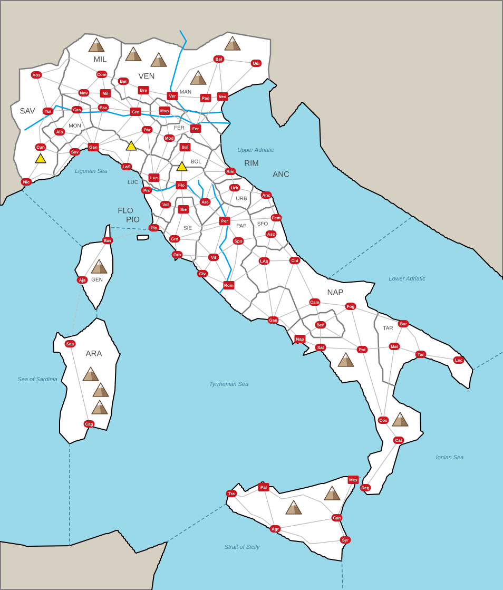

# SCENARIO: ITALY 1440

*Everything here is specific to this map; the general rules are in [RULES.md](../../docs/RULES.md).*

A battle of Italy in the year 1440: the peninsula and its islands, every town where it really is, the states that really existed,
and towns made cities by how big they really were — 71 settlements and 20 states, a smaller map than Mitteleuropa's 87 — with one
outsider, Aragon. Who reunites Italy?

This file is the **only** place the map's facts are written down. The map's shapes — one per settlement's land,
plus the rivers and the sea zone dividers — are in [map-base.svg](map-base.svg). From the two, a script builds
[map.svg](map.svg), the map the game shows, and [scenario.json](scenario.json), this scenario as data for the
game. After changing either, run:

```
node tools/map.js scenarios/italy-1440              # check everything, rebuild map.svg and scenario.json, refresh this file
node tools/map.js scenarios/italy-1440 mountains    # the same, but first move any mountain that touches something
```

map-base.svg and the data tables here were first made by
[tools/make-base.js](../../tools/make-base.js) from real latitudes and longitudes ([data.js](data.js)); running it again
**overwrites** map-base.svg and the tables, so once you edit them by hand, use tools/map.js only.

Columns and blocks marked *generated* are rewritten by the script — edit the rest.

**x = 1** (see the scenario scaling note in RULES.md)

**Army speed:** 458 map units per year — a route takes its length on the map ÷ this (RULES.md §8). One map unit
is about 1.1 km, so an army covers about 500 km a year, as on the Mitteleuropa map.

<!-- generated:summary -->
71 settlements (18 cities, 53 towns) · 20 countries · 890,000 people · 141 land routes, 3 straits, 3 mountain passes
<!-- /generated -->



## About

*For players: shown on the Rules page with the rest of this scenario's facts.*

Italy in 1440, between the Peace of Ferrara and the Peace of Lodi: Milan and Venice at war for Lombardy, with Florence, the Pope and
the condottiere Francesco Sforza on Venice's side; Alfonso of Aragon fighting René of Anjou for Naples; a Pope who had fled Rome for
Florence. 20 states, from Naples' ten settlements to free cities of one, and a single outsider, on a small map of 71. Winning is
reuniting Italy: two thirds of it — four centuries before it happened.

## Countries

*Code, Country and Capital are data (Capital is a settlement ID; the script adds the name); the other columns are generated. A country that owns a city must have one as its capital (RULES.md §2).*

| Code | Country | Capital | Colour | Settlements | Pop | Army | Ships | HRE |
|---|---|---|---|---|---|---|---|---|
| SAV | Savoy | 1 Turin | #a8c4ec | 1, 2, 3, 4 | 40K | 1,600 | 5 | — |
| MON | Montferrat | 5 Casale |  | 5, 6 | 20K | 800 | — | — |
| GEN | Genoa | 7 Genoa | #e88a8a | 7, 8, 9, 10, 11 | 60K | 2,400 | 50 | — |
| MIL | Milan | 12 Milan | #8cc68c | 12, 13, 14, 15, 16, 17 | 80K | 3,200 | — | — |
| VEN | Venice | 18 Venice | #e8c070 | 18, 19, 20, 21, 22, 23, 24 | 110K | 4,400 | 90 | — |
| MAN | Mantua | 25 Mantua |  | 25 | 20K | 800 | — | — |
| FER | Ferrara | 26 Ferrara | #b8d8f0 | 26, 27 | 30K | 1,200 | — | — |
| BOL | Bologna | 28 Bologna |  | 28 | 20K | 800 | — | — |
| RIM | Rimini | 29 Rimini |  | 29 | 10K | 400 | 5 | — |
| URB | Urbino | 30 Urbino |  | 30 | 10K | 400 | — | — |
| SFO | Sforza's March | 31 Fermo | #dcb0b0 | 31, 32 | 20K | 800 | 5 | — |
| ANC | Ancona | 33 Ancona |  | 33 | 10K | 400 | 5 | — |
| FLO | Florence | 34 Florence | #c4a0d8 | 34, 35, 36, 37 | 50K | 2,000 | 12 | — |
| SIE | Siena | 38 Siena | #d8d8cc | 38, 39, 40 | 40K | 1,600 | 5 | — |
| LUC | Lucca | 41 Lucca |  | 41 | 20K | 800 | — | — |
| PIO | Piombino | 42 Piombino |  | 42 | 10K | 400 | 5 | — |
| PAP | Papal States | 43 Rome | #f0e0a0 | 43, 44, 45, 46, 47, 48 | 80K | 3,200 | 10 | — |
| NAP | Naples | 49 Naples | #a8d8b8 | 49, 50, 51, 52, 53, 55, 56, 57, 58, 59 | 110K | 4,400 | 25 | — |
| TAR | Taranto | 60 Taranto |  | 54, 60, 61, 62 | 40K | 1,600 | 20 | — |
| ARA | Aragon | 64 Palermo | #f0c040 | 63, 64, 65, 66, 67, 68, 69, 70, 71 | 110K | 4,400 | 35 | — |

## Settlements

- **Type** — `town` (red circle, 10,000 pop) or `city` (red square, 20,000 pop). The 18 cities are the largest
  towns of the map around 1440.
- **Port** — the settlement sits on the coast.
- **HRE** — inside the Holy Roman Empire.
- **X, Y** — marker centre, in map units (the coordinates of map.svg). The settlement's land is the shape
  `land-ID` in map-base.svg; country borders are drawn wherever two lands belong to different countries.
- **Borders** — settlements an army can march to in one step (every route is listed under both ends). Routes
  through a mountain pass are listed here too; the pass itself is in *Mountain passes*.
- **Straits** — crossings by sea (dashed lines, RULES.md §8).

| ID | Name | Country | Type | Port | HRE | X | Y | Borders | Straits |
|---|---|---|---|---|---|---|---|---|---|
| 1 | Turin | SAV | town |  |  | 91 | 211 | 2, 3, 5, 6, 15 |  |
| 2 | Aosta | SAV | town |  |  | 69 | 142 | 1, 14, 15 |  |
| 3 | Cuneo | SAV | town |  |  | 77 | 279 | 1, 4, 6, 8 |  |
| 4 | Nice | SAV | town | port |  | 50 | 345 | 3, 8 |  |
| 5 | Casale | MON | town |  |  | 146 | 208 | 1, 6, 7, 13, 15 |  |
| 6 | Alba | MON | town |  |  | 113 | 250 | 1, 3, 5, 7, 8 |  |
| 7 | Genoa | GEN | city | port |  | 177 | 279 | 5, 6, 8, 9, 13, 16, 17 |  |
| 8 | Savona | GEN | town | port |  | 142 | 288 | 3, 4, 6, 7 |  |
| 9 | La Spezia | GEN | town | port |  | 240 | 316 | 7, 16, 41 |  |
| 10 | Bastia | GEN | town | port |  | 204 | 456 | 11 | 42 |
| 11 | Ajaccio | GEN | town | port |  | 156 | 531 | 10 | 71 |
| 12 | Milan | MIL | city |  |  | 200 | 177 | 13, 14, 15, 17, 24 |  |
| 13 | Pavia | MIL | town |  |  | 196 | 204 | 5, 7, 12, 15, 17 |  |
| 14 | Como | MIL | town |  |  | 193 | 141 | 2, 12, 15, 24 |  |
| 15 | Novara | MIL | town |  |  | 159 | 176 | 1, 2, 5, 12, 13, 14 |  |
| 16 | Parma | MIL | town |  |  | 279 | 246 | 7, 9, 17, 25, 27, 41 |  |
| 17 | Cremona | MIL | city |  |  | 257 | 212 | 7, 12, 13, 16, 23, 24, 25 |  |
| 18 | Venice | VEN | city | port |  | 422 | 183 | 19, 21, 22, 26 |  |
| 19 | Padua | VEN | city |  |  | 390 | 186 | 18, 20, 21, 26 |  |
| 20 | Verona | VEN | city |  |  | 327 | 182 | 19, 21, 23, 25, 26 |  |
| 21 | Belluno | VEN | town |  |  | 415 | 112 | 18, 19, 20, 22 |  |
| 22 | Udine | VEN | town |  |  | 486 | 120 | 18, 21 |  |
| 23 | Brescia | VEN | city |  |  | 272 | 171 | 17, 20, 24, 25 |  |
| 24 | Bergamo | VEN | town |  |  | 234 | 154 | 12, 14, 17, 23 |  |
| 25 | Mantua | MAN | city |  |  | 312 | 210 | 16, 17, 20, 23, 26, 27 |  |
| 26 | Ferrara | FER | city |  |  | 371 | 244 | 18, 19, 20, 25, 27, 28, 29 |  |
| 27 | Modena | FER | town |  |  | 321 | 262 | 16, 25, 26, 28, 41 |  |
| 28 | Bologna | BOL | city |  |  | 351 | 279 | 26, 27, 29, 34, 41 |  |
| 29 | Rimini | RIM | town | port |  | 437 | 325 | 26, 28, 30, 34, 36 |  |
| 30 | Urbino | URB | town |  |  | 445 | 356 | 29, 33, 36, 46 |  |
| 31 | Fermo | SFO | town | port |  | 524 | 413 | 32, 33, 46 |  |
| 32 | Ascoli | SFO | town |  |  | 514 | 444 | 31, 47, 50, 51 |  |
| 33 | Ancona | ANC | town | port |  | 505 | 370 | 30, 31, 46 |  |
| 34 | Florence | FLO | city |  |  | 344 | 351 | 28, 29, 36, 37, 38, 41 |  |
| 35 | Pisa | FLO | town | port |  | 278 | 361 | 37, 41 |  |
| 36 | Arezzo | FLO | town |  |  | 389 | 383 | 29, 30, 34, 38, 46 |  |
| 37 | Volterra | FLO | town |  |  | 314 | 388 | 34, 35, 38, 41, 42 |  |
| 38 | Siena | SIE | city |  |  | 348 | 397 | 34, 36, 37, 39, 46 |  |
| 39 | Grosseto | SIE | town | port |  | 331 | 453 | 38, 40, 42, 45, 46 |  |
| 40 | Orbetello | SIE | town | port |  | 336 | 483 | 39, 44, 45 |  |
| 41 | Lucca | LUC | city |  |  | 292 | 337 | 9, 16, 27, 28, 34, 35, 37 |  |
| 42 | Piombino | PIO | town | port |  | 292 | 432 | 37, 39 | 10 |
| 43 | Rome | PAP | city |  |  | 434 | 541 | 44, 45, 47, 50, 63 |  |
| 44 | Civitavecchia | PAP | town | port |  | 384 | 519 | 40, 43, 45 |  |
| 45 | Viterbo | PAP | town |  |  | 405 | 488 | 39, 40, 43, 44, 46, 47 |  |
| 46 | Perugia | PAP | city |  |  | 426 | 419 | 30, 31, 33, 36, 38, 39, 45, 47 |  |
| 47 | Spoleto | PAP | town |  |  | 452 | 457 | 32, 43, 45, 46, 50 |  |
| 48 | Benevento | PAP | town |  |  | 608 | 616 | 49, 52, 53, 55, 56 |  |
| 49 | Naples | NAP | city | port |  | 569 | 643 | 48, 56, 63 |  |
| 50 | L'Aquila | NAP | town |  |  | 501 | 495 | 32, 43, 47, 51, 63 |  |
| 51 | Chieti | NAP | town |  |  | 559 | 494 | 32, 50, 52, 63 |  |
| 52 | Campobasso | NAP | town |  |  | 597 | 573 | 48, 51, 53, 63 |  |
| 53 | Foggia | NAP | town |  |  | 665 | 581 | 48, 52, 54, 55 |  |
| 54 | Bari | TAR | town | port |  | 765 | 614 | 53, 60, 62 |  |
| 55 | Potenza | NAP | town |  |  | 687 | 663 | 48, 53, 56, 57, 62 |  |
| 56 | Salerno | NAP | town | port |  | 608 | 659 | 48, 49, 55 |  |
| 57 | Cosenza | NAP | town |  |  | 727 | 797 | 55, 58, 62 |  |
| 58 | Catanzaro | NAP | town |  |  | 756 | 835 | 57, 59 |  |
| 59 | Reggio | NAP | town | port |  | 693 | 925 | 58 | 65 |
| 60 | Taranto | TAR | town | port |  | 798 | 672 | 54, 61, 62 |  |
| 61 | Lecce | TAR | town |  |  | 870 | 683 | 60 |  |
| 62 | Matera | TAR | town |  |  | 748 | 657 | 54, 55, 57, 60 |  |
| 63 | Gaeta | ARA | town | port |  | 518 | 607 | 43, 49, 50, 51, 52 |  |
| 64 | Palermo | ARA | city | port |  | 500 | 924 | 66, 68, 69 |  |
| 65 | Messina | ARA | city | port |  | 670 | 910 | 66 | 59 |
| 66 | Catania | ARA | town | port |  | 639 | 982 | 64, 65, 67, 68 |  |
| 67 | Syracuse | ARA | town | port |  | 655 | 1024 | 66, 68 |  |
| 68 | Agrigento | ARA | town | port |  | 522 | 1003 | 64, 66, 67, 69 |  |
| 69 | Trapani | ARA | town | port |  | 439 | 936 | 64, 68 |  |
| 70 | Cagliari | ARA | town | port |  | 169 | 804 | 71 |  |
| 71 | Sassari | ARA | town |  |  | 133 | 652 | 70 | 11 |

## Mountain passes

Yellow triangles on the map. Every route listed runs settlement → pass → settlement. A pass belongs to whoever
owns the settlement whose land it lies in (RULES.md §8). *Pass, X, Y and Routes are data; the other columns are
generated from where the pass lies.*

| Pass | X | Y | Routes | In the land of | Owner at start |
|---|---|---|---|---|---|
| P1 | 77 | 303 | 3-4 | 3 Cuneo | SAV Savoy |
| P2 | 249 | 279 | 9-16 | 9 La Spezia | GEN Genoa |
| P3 | 345 | 318 | 28-34 | 34 Florence | FLO Florence |

## Route bends

A route is drawn straight, and the script bends it by itself only where the straight line would leave its
countries' land. List a route here to bend it through points of your own. *All columns are data.* Points are x,y
in map units, in order from the lower-numbered settlement; the route's length (and so its marching time) follows
the bend.

| Route | Through | Why |
|---|---|---|

## Mountains

Decoration only — mountains have no rules effect outside the passes. Apex positions (x,y in map units);
`node tools/map.js scenarios/italy-1440 mountains` moves any that touch something else.

```
441,69  183,72  253,89  301,100  376,134  188,492  656,669  172,696
191,726  189,759  759,782  630,922  557,949
```

## Overview

<!-- generated:overview -->
**Cities (20K):** 7, 12, 17, 18, 19, 20, 23, 25, 26, 28, 34, 38, 41, 43, 46, 49, 64, 65 — all other settlements are towns (10K).

**HRE settlements (0):**  — held by 0 of the 20 countries.

**Ports (28):** 4, 7, 8, 9, 10, 11, 18, 29, 31, 33, 35, 39, 40, 42, 44, 49, 54, 56, 59, 60, 63, 64, 65, 66, 67, 68, 69, 70 — on the coast; grow +0.5% more (RULES.md §2).

**On a river (14):** 1, 5, 13, 17, 20, 25, 26, 34, 35, 36, 41, 43, 45, 46 — within 24px of a river on the map; grow +0.5% more (RULES.md §2).

**Routes crossing a river (29):** 1-3, 1-5, 1-6, 5-6, 5-7, 7-13, 7-17, 16-17, 16-25, 18-26, 19-20, 19-26, 20-21, 20-26, 25-26, 25-27, 30-36, 30-46, 31-46, 33-46, 34-36, 34-37, 34-38, 35-41, 37-41, 43-44, 43-45, 45-47, 46-47 — +1 month to march for each crossing (RULES.md §8).

**Marching** at 458 map units a year, +1 month per river crossing, +2 per leg to or from a pass: a route takes 0.06–0.51 years (median 0.17); through a pass 0.49–0.51.

| Pop | Countries |
|---|---|
| 110K | 3: VEN Venice · NAP Naples · ARA Aragon |
| 80K | 2: MIL Milan · PAP Papal States |
| 60K | 1: GEN Genoa |
| 50K | 1: FLO Florence |
| 40K | 3: SAV Savoy · SIE Siena · TAR Taranto |
| 30K | 1: FER Ferrara |
| 20K | 5: MON Montferrat · MAN Mantua · BOL Bologna · SFO Sforza's March · LUC Lucca |
| 10K | 4: RIM Rimini · URB Urbino · ANC Ancona · PIO Piombino |

**Sailing:** 2 months to a neighbouring sea zone (RULES.md §8); the furthest apart, Ligurian Sea and Upper Adriatic, are 4 hops (8 months).

**Naval powers:** 13 countries, 272 ships. Crossing a strait needs 10 ships (10 × x) in the sea zone the strait lies in (RULES.md §8), so at the start a country can only cross the straits of its own ports' zones; for any other it must first sail 10 ships there. A voyage by sea lane, to a port up to three zones off, needs 10 at each end, and no enemy fleet at sea on the way.

| Country | Ports held | Home zones | Ships | Can cross straits? |
|---|---|---|---|---|
| VEN Venice | 18 | Upper Adriatic | 90 | no — no strait in its zones |
| GEN Genoa | 7, 8, 9, 10, 11 | Ligurian Sea, Tyrrhenian Sea, Sea of Sardinia | 50 | yes: 10-42, 11-71 |
| ARA Aragon | 63, 64, 65, 66, 67, 68, 69, 70 | Tyrrhenian Sea, Strait of Sicily, Ionian Sea | 35 | yes: 10-42, 59-65 |
| NAP Naples | 49, 56, 59 | Tyrrhenian Sea, Ionian Sea | 25 | yes: 10-42, 59-65 |
| TAR Taranto | 54, 60 | Ionian Sea, Lower Adriatic | 20 | yes: 59-65 |
| FLO Florence | 35 | Ligurian Sea | 12 | no — no strait in its zones |
| PAP Papal States | 44 | Tyrrhenian Sea | 10 | **exactly**: 10-42 |
| SAV Savoy | 4 | Ligurian Sea | 5 | no — no strait in its zones |
| RIM Rimini | 29 | Upper Adriatic | 5 | no — no strait in its zones |
| SFO Sforza's March | 31 | Upper Adriatic | 5 | no — no strait in its zones |
| ANC Ancona | 33 | Upper Adriatic | 5 | no — no strait in its zones |
| SIE Siena | 39, 40 | Tyrrhenian Sea | 5 | no — too few ships for 10-42 |
| PIO Piombino | 42 | Tyrrhenian Sea | 5 | no — too few ships for 10-42 |
<!-- /generated -->

## Special coring
*(no Courthouse and no 20-year wait)*

You may proclaim a region when **both** are true:

1. Your **capital** lies within the region — in a union, any one of its capitals (RULES.md §2).
2. You and your **vassals** together control **100%** of its settlements — or, for a region with *Needs*, the settlements it names
   and that many of its settlements in all (those named among them). A protectorate's do not count: it keeps its own diplomacy.

Every settlement in the region becomes your core immediately — for a region with *Needs*, every one of them, held or not, so each
you take later is core the day it falls. If you later lose one and retake it, it is core again on capture.

The **Kingdom of Italy** is the whole map, and needs half of it with Rome and Milan — the City and the Iron Crown — so it is the
crown of the half-way mark, not of the end: reuniting Italy is winning (*Victory*). A region with a **Becomes** makes a new state:
proclaiming it, your country takes that name, and on the map that code and colour (RULES.md §2).

| Formable | What it was | Settlements | Count | Needs | Becomes |
|---|---|---|---|---|---|
| **Kingdom of Italy** | the Regnum Italiae of the emperors, and the kingdom Gian Galeazzo Visconti died wanting (1402) — the whole peninsula, with Rome and Milan | 1–71 | 71 | Rome, Milan and 36 in all | Italy, ITA, #4e9a7a |
| **Grand Duchy of Tuscany** | Florence, Siena, Lucca and Piombino under the Medici, as Cosimo I made it (1569) | 34–42 | 9 | — | Tuscany, TUS, #b04a7a |
| **States of the Church** | the Patrimony, Umbria, the March, the Romagna and Bologna under the Pope, as Julius II won them back (1506–12) | 28–33, 43–48 | 12 | — | — |
| **Kingdom of the Two Sicilies** | Naples and Sicily under one king, as Alfonso held them from 1442 | 49–69 | 21 | — | Two Sicilies, TSI, #3f6fb5 |

## Sea zones

Seven zones, split by the dashed lines in the sea. A fleet operates in one zone at a time (RULES.md §7). A port
belongs to the zone its coast faces; crossing a strait needs 10 ships in the zone the strait lies in (RULES.md
§8). *Zone, X and Y are data — X, Y is where the name is drawn, and the zone it names is the one around that
point; the other columns are generated from the map.*

| Zone | X | Y | Ports | Straits | Next to |
|---|---|---|---|---|---|
| Ligurian Sea | 173 | 328 | 4, 7, 8, 9, 35 | — | Tyrrhenian Sea, Sea of Sardinia |
| Tyrrhenian Sea | 434 | 732 | 10, 39, 40, 42, 44, 49, 56, 63, 64, 69, 70 | 10-42 | Ligurian Sea, Sea of Sardinia, Strait of Sicily, Ionian Sea |
| Sea of Sardinia | 71 | 723 | 11 | 11-71 | Ligurian Sea, Tyrrhenian Sea |
| Strait of Sicily | 459 | 1041 | 68 | — | Tyrrhenian Sea, Ionian Sea |
| Ionian Sea | 853 | 871 | 59, 60, 65, 66, 67 | 59-65 | Tyrrhenian Sea, Strait of Sicily, Lower Adriatic |
| Lower Adriatic | 772 | 532 | 54 | — | Ionian Sea, Upper Adriatic |
| Upper Adriatic | 485 | 288 | 18, 29, 31, 33 | — | Lower Adriatic |

## The situation in 1440

The game opens in the middle of two wars, and with the alliances of 1440 already signed. They count exactly as if declared and signed
in play (RULES.md §10): the sides below are at war from the first day, the agreements are in force, and every warmonger score still
starts at 0. Allies are **not** in these wars unless listed — a military alliance only calls an ally into wars declared from now on.
Imperial Italy is no Empire here: there are no electors and no German states, so nobody wears a crown over the others.

### Wars

| War | Attacking side | Defending side | What happened |
|---|---|---|---|
| **Wars in Lombardy** (since 1438) | MIL Milan, MAN Mantua | VEN Venice, FLO Florence, PAP Papal States, SFO Sforza's March | Filippo Maria Visconti, with the Gonzaga, against Venice and her League; Sforza led the League's army, and Florence beat Milan's at Anghiari in June 1440. Peace at Cremona in 1441, sealed by Sforza's marriage to Visconti's daughter. |
| **War for Naples** (since 1435) | ARA Aragon | NAP Naples | Alfonso V against René of Anjou, both heirs of Joanna II; Alfonso took Naples in June 1442. |

### Agreements

| Agreement | Between | Why |
|---|---|---|
| Military alliance | VEN Venice – FLO Florence | The League against the Visconti, since 1425. |
| Military alliance | MIL Milan – ARA Aragon | The Treaty of Milan (1435): Visconti freed the Alfonso whom Genoa had taken at Ponza, and made him his ally. |
| Defensive alliance | NAP Naples – GEN Genoa | Genoa, free of Milan since 1435, held to the house of Anjou against Aragon. |

### Subjects

| Subject | Overlord | Kind | Why |
|---|---|---|---|
| ANC Ancona | PAP Papal States | protectorate | A free maritime republic under the Pope's lordship. |

### Fleets

What each sea power had afloat, in place of the rule's people ÷ 2000 ships (RULES.md §2): Venice and Genoa, the two naval powers of
the Mediterranean, far above it; the Pope, Naples and the inland states with a port below. A country given more than the rule has its
navy cap raised in the same proportion for the whole game (RULES.md §9). Every coastal country not listed has the rule's.

| Country | Ships | Why |
|---|---|---|
| VEN Venice | 90 | The Arsenal's galleys: the greatest navy of the Mediterranean. |
| GEN Genoa | 50 | The fleet that took Alfonso and his brothers prisoner at Ponza in 1435. |
| ARA Aragon | 35 | The galleys Alfonso brought against Naples — fewer than the rule's, so that his islands are not out of everyone's reach. |
| NAP Naples | 25 | René's few galleys, with Genoa's help. |
| FLO Florence | 12 | The galleys of Pisa and Porto Pisano, bought from Genoa in 1421. |
| PAP Papal States | 10 | A few galleys at Civitavecchia. |
| SAV Savoy | 5 | Nice, the duchy's one port. |
| SIE Siena | 5 | Talamone and Orbetello, little ports. |
| SFO Sforza's March | 5 | Fermo's beach. |

### Walls

The great fortresses of 1440 begin with **Walls** (RULES.md §3 and §6: ×1.8 in defence, a siege twice as long — both worn down by
cannons), as if built in play. Every other settlement begins without; walls may be bought anywhere as the game goes on.

| Settlements | Why |
|---|---|
| 18 Venice | The lagoon: no enemy took the city until Napoleon, in 1797. |
| 43 Rome | Castel Sant'Angelo, where popes fled their enemies. |
| 49 Naples | Castel Nuovo and the Castel dell'Ovo, which held out for René until 1442. |
| 12 Milan | The Visconti castle of Porta Giovia, rebuilt by the Sforza. |
| 25 Mantua | Its lakes, and the Gonzaga's castle of San Giorgio. |
| 20 Verona | The Scaligers' walls. |

### Universities

The universities of 1440 begin with a **University** and its **Library** (RULES.md §3 and §4), as if founded in play — three a
country at most. Italy had more than all of Europe north of the Alps.

| Settlements | Why |
|---|---|
| 28 Bologna | The oldest in Europe, of 1088. |
| 19 Padua | Founded in 1222 by masters who left Bologna. |
| 49 Naples | Frederick II's, of 1224: the first founded by a ruler. |
| 38 Siena | The commune's, of 1240. |
| 43 Rome | The Sapienza, of 1303. |
| 46 Perugia | Of 1308. |
| 34 Florence | The Studio Fiorentino, of 1348. |
| 35 Pisa | Of 1343. |
| 13 Pavia | The Visconti's university, of 1361. |
| 26 Ferrara | The Este's, of 1391. |
| 1 Turin | Of 1404. |
| 66 Catania | Alfonso's own, of 1434: Sicily's first. |

## Victory

> **Control or vassalize 48 settlements** — two thirds of Italy: Italy reunited. Protectorates count as half — unless you demand
> one become a vassal and it agrees.

**End date: 1650.** The game ends when a player reaches 48, or at the start of **1650** — 210 years, about 2 hours 8 minutes of play.
At the end date the player with the most settlements wins, counted the same way: controlled and vassalized settlements count 1,
protectorates ½. A tie goes to the larger total population (own settlements and subjects). Two thirds, not the half of the other
maps: a half of Italy is the Kingdom (*Special coring*), the rest is the work of reuniting it. A long game needs the same 48, held for
2 years (RULES.md, *Victory*).

---

## Achievements

This scenario's own achievements, beside the ones every scenario has (docs/design.md, *Achievements*). The **Goal** is
for `tools/map.js` and the server: clauses joined by `;`, all met by your country in one game — `as` the countries you
may play, `win`, `survive` (still in at the end), `proclaim` a region by its id (*Special coring*), `hold` settlements
all at once, `keep` settlements held at the end, `eliminate` a country (take its last settlement), `by` a year
(everything else done before it begins).

| Achievement | Icon | Goal | Description |
|---|---|---|---|
| The Iron Crown | 🔱 | `proclaim kingdom-of-italy` | Proclaim the Kingdom of Italy, with Rome, Milan and half the peninsula. |
| Duke of Milan | 🐍 | `as SFO; hold 12` | As Sforza's March, hold Milan — Francesco Sforza made himself its duke in 1450. |
| The Magnanimous | 🌋 | `as ARA; hold 49; by 1443` | As Aragon, hold Naples before 1443 — Alfonso entered it in June 1442. |
| Grand Duke | 🌸 | `as FLO; proclaim grand-duchy-of-tuscany` | As Florence, proclaim the Grand Duchy of Tuscany, as Cosimo I did in 1569. |
| The Warrior Pope | 🗝️ | `as PAP; proclaim states-of-the-church` | As the Pope, proclaim the States of the Church — Julius II won them back in armour. |
| Beyond the Adda | 🛶 | `as VEN; hold 12` | As Venice, hold Milan — the Republic's armies stood at its gates in 1448. |
| Libertas | 🕊️ | `as LUC; survive; keep 41` | As Lucca, still free in your own city at the end — the word on the republic's banner, which it kept until Napoleon. |
| The Wolf of Rimini | 🐺 | `as RIM; hold 30` | As Rimini, take Urbino: Sigismondo Malatesta's feud with Federico da Montefeltro. |
| Two Sicilies | 🍋 | `proclaim kingdom-of-the-two-sicilies` | Proclaim the Kingdom of the Two Sicilies. |

## Characters

*How the computer plays each country when no person does (docs/design.md, *Characters and rivalries*). Data: every country
needs one of six characters — conqueror, zealot, opportunist, diplomat, defender, merchant — and `node tools/map.js` refuses a
lopsided spread: no character for more than 30% of the countries, every one for at least two, conqueror and zealot together
for no more than 30%. Each game varies a character a little, so a country keeps its nature without being scripted.*

| Code | Character | Why |
|---|---|---|
| SAV | Diplomat | Its duke Amadeus VIII was elected pope, as Felix V, in 1439. |
| MON | Opportunist | The Palaiologoi of Montferrat, changing sides between Milan, Savoy and Venice. |
| GEN | Merchant | The Bank of Saint George and the trade of the Levant. |
| MIL | Conqueror | The Visconti, and the Sforza after them. |
| VEN | Merchant | The Republic of merchants. |
| MAN | Opportunist | The Gonzaga, condottieri who sold their swords to Venice and to Milan by turns. |
| FER | Diplomat | The Este, whose court made peace between the powers of Italy. |
| BOL | Defender | The Bentivoglio, holding the city's freedom against the Pope and Milan. |
| RIM | Conqueror | Sigismondo Malatesta, "the Wolf of Rimini". |
| FLO | Merchant | The Medici bank. |
| SIE | Zealot | The city of the Virgin, and of Saint Bernardino, who preached in its Campo. |
| LUC | Merchant | A republic of silk. |
| PIO | Merchant | The iron of Elba. |
| PAP | Zealot | The Pope. |
| URB | Opportunist | The Montefeltro: Federico, from 1444, the most sought-after condottiere of his age. |
| SFO | Conqueror | Francesco Sforza, a condottiere who meant to be a duke. |
| ANC | Merchant | A port of the Levant trade. |
| NAP | Defender | René of Anjou, holding his capital. |
| TAR | Opportunist | Giovanni Antonio Orsini, Prince of Taranto, the kingdom's greatest baron, on whichever side paid. |
| ARA | Conqueror | Alfonso V, who spent his life winning Naples and then lived there. |

### Rivalries

*Pairs the computer holds a grudge between: of the neighbours it is strong enough to attack, it goes for a rival first, and it
never proposes anything to one. A rivalry goes both ways. Mostly it is the computer's preference: a person playing either
country is free of it, and a rival's proposals are answered by the game's formulas, like anyone's — but for one rule: a computer
country never agrees to become its rival's subject on demand (RULES.md §10). The Diplomacy tab shows a country's rivals.*

| Rivals | Why |
|---|---|
| MIL Milan – VEN Venice | The wars for Lombardy, being fought in 1440. |
| MIL Milan – FLO Florence | Anghiari (1440), and half a century of Visconti wars before it. |
| ARA Aragon – NAP Naples | The war for the crown of Naples. |
| ARA Aragon – GEN Genoa | Ponza (1435), and the long naval war of Catalans and Genoese. |
| FLO Florence – SIE Siena | Montaperti (1260); Florence took Siena in 1555. |
| FLO Florence – LUC Lucca | Florence's wars on Lucca, 1429–33 and 1437–38. |
| PAP Papal States – SFO Sforza's March | Eugenius IV and the condottiere who had taken the March from him. |
| RIM Rimini – URB Urbino | The Malatesta and the Montefeltro, a feud of a lifetime. |
| VEN Venice – GEN Genoa | Chioggia (1378–81), and the trade of the Levant. |
| VEN Venice – FER Ferrara | The Polesine, which Venice took from the Este in the War of Ferrara (1482–84). |
| SAV Savoy – MON Montferrat | Neighbours fighting over Piedmont. |

## Design notes

*Hand-written. Unlike everything above it is not checked by the script, so re-read it after changing countries
or borders.*

### Italy in 1440

Every country is one that existed in 1440, with the towns it held that year — at about one settlement for 110,000 people, so that no
two are much closer than 30 km. The smallest lordships are folded into their neighbours: Saluzzo and Asti into Savoy and Montferrat,
Trent into Venice, Faenza, Forlì and Ravenna into Bologna and Rimini, Carpi and Mirandola into Ferrara, Pesaro into Rimini, Camerino
into Sforza's March. Savoy is its lands this side of the Alps, with Turin for a capital (the duke's court was still at Chambéry).
Bologna is the Bentivoglio's free city, as it was again from 1443. The Kingdom of Naples is split as the war left it, but for the
balance: René of Anjou holds the capital, the Abruzzi, Molise, the Basilicata, Salerno and Calabria; Alfonso holds Gaeta, Sicily and
Sardinia; the Prince of Taranto holds the heel and Bari, his own master. Alfonso held Salerno and Calabria too, but with a foothold at
the strait Aragon won more than half the computer's games (*Balance*, below).

### How the map was made

- **Positions** are real latitudes and longitudes, drawn in a Lambert conformal conic projection (standard parallels 38° and 45° N,
  centred on 41.5° N 12.5° E). One map unit is 1.1 km: a map of 901 by 1119 units, smaller than the Mitteleuropa map's 1308 by 1165.
  Where two towns were nearer than 30 km the markers are moved apart a little: Pisa and Lucca, Messina and Reggio.
- **Coasts and rivers** are those of the Europe map ([data.js](data.js) imports them), with Italy's coast, Corsica, Sardinia and Sicily
  drawn about twice as finely and Elba added; the Strait of Messina is widened so that it stays open. The Adige, the Arno and the Tiber
  are added to the Po.
- **Waste**: the far side of the Alps and Provence, Istria, Dalmatia and Albania, and Tunis are grey — land nobody holds.
- **Passes**: the Col de Tende, the Cisa and the Futa. The Alpine passes lead off the map, so it has none.
- **Balance**, in 20 computer games to 1650 (experiments/README.md, 33): seven different winners — Aragon and Venice 5 each, Milan 4,
  Naples and the Pope 2, Genoa and Siena 1 — and 7 of the 20 won by reaching 48 (1540 to 1645), the rest on time. Two tries were
  lopsided: Naples with Bari won 8, Aragon with Reggio, its foothold at the strait, 11. A larger version, 148 settlements at 0.8 km a
  map unit, was made first and taken out as too big: the computer never reached its 99 (experiments/README.md, 32).

### Known warnings from tools/map.js

- Most of the Alps' mountains have no room on the grey land beyond the crest and are left out.
