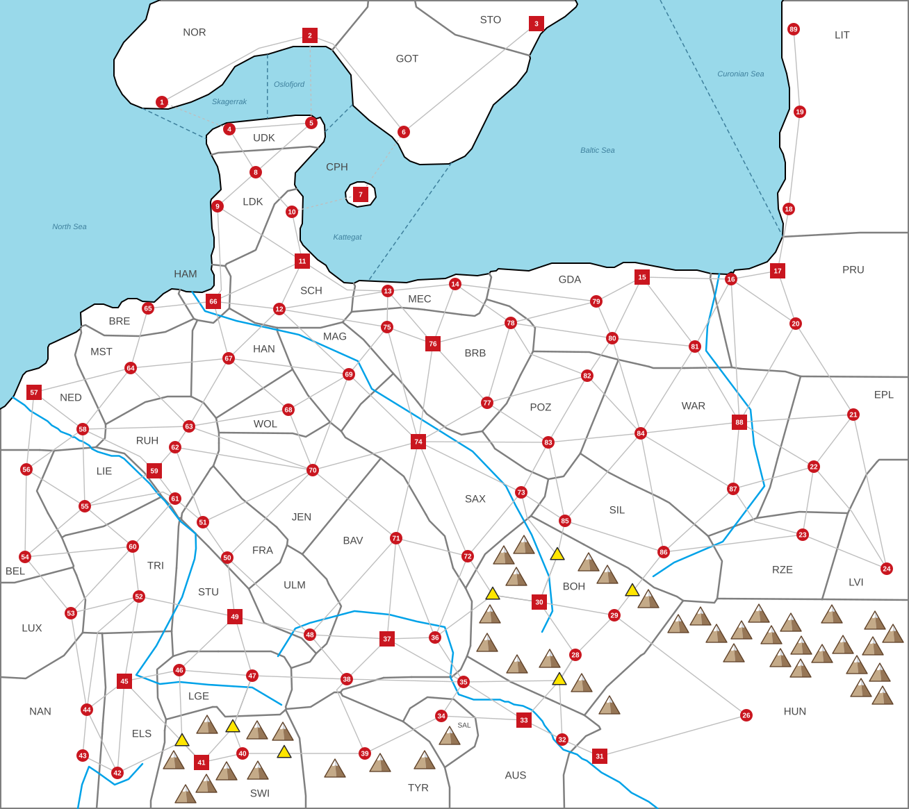

# SCENARIO: MITTELEUROPA: BALANCED

*Everything here is specific to this map; the general rules are in [RULES.md](../../docs/RULES.md).*

This file is the **only** place the map's facts are written down. The map's shapes — one per
settlement's land, plus the rivers — are in [map-base.svg](map-base.svg) (edit it in Inkscape).
From the two, a script builds [map.svg](map.svg), the map the game shows, and
[scenario.json](scenario.json), this scenario as data for the game. After changing either, run:

```
node tools/map.js              # check everything, rebuild map.svg and scenario.json, refresh this file
node tools/map.js mountains    # the same, but first move any mountain that touches something
```

Columns and blocks marked *generated* are rewritten by the script — edit the rest.

**x = 1** (see the scenario scaling note in RULES.md)

**Army speed:** 480 map units per year — a route takes its length on the map ÷ this (RULES.md §8).

<!-- generated:summary -->
87 settlements (19 cities, 68 towns) · 45 countries · 1,060,000 people · 187 land routes, 4 straits, 7 mountain passes
<!-- /generated -->



## Countries

*Code, Country and Capital are data (Capital is a settlement ID; the script adds the name); the other columns are generated. A country that owns a city must have one as its capital (RULES.md §2).*

| Code | Country | Capital | Settlements | Pop | Army | Ships | HRE |
|---|---|---|---|---|---|---|---|
| NOR | Norway | 2 Oslo | 1, 2 | 30K | 1,200 | 15 | — |
| GOT | Gothenburg | 6 Gothenburg | 6 | 10K | 400 | 5 | — |
| STO | Stockholm | 3 Stockholm | 3 | 20K | 800 | 10 | — |
| UDK | Upper Denmark | 4 Thisted | 4, 5 | 20K | 800 | 10 | — |
| LDK | Lower Denmark | 8 Herning | 8, 9 | 20K | 800 | 10 | — |
| CPH | Copenhagen | 7 Copenhagen | 7 | 20K | 800 | 10 | — |
| SCH | Schleswig | 11 Kiel | 10, 11, 12 | 40K | 1,600 | 20 | ✓ |
| MEC | Mecklenburg | 13 Rostock | 13, 14 | 20K | 800 | 10 | ✓ |
| GDA | Gdansk | 15 Gdynia | 15, 79, 80, 81 | 50K | 2,000 | 25 | — |
| PRU | Prussia | 17 Königsberg | 16, 17, 20 | 40K | 1,600 | 20 | — |
| LIT | Lithuania | 19 Klaipėda | 18, 19, 89 | 30K | 1,200 | 15 | — |
| EPL | Eastern Poland | 22 Lublin | 21, 22 | 20K | 800 | — | — |
| WAR | Warsaw | 88 Warsaw | 84, 87, 88 | 40K | 1,600 | — | — |
| RZE | Rzeszów | 23 Rzeszów | 23 | 10K | 400 | — | — |
| LVI | Lviv | 24 Lviv | 24 | 10K | 400 | — | — |
| POZ | Poznań | 83 Poznań | 82, 83 | 20K | 800 | — | — |
| SIL | Silesia | 85 Breslau | 85, 86 | 20K | 800 | — | part |
| HUN | Hungary | 31 Pozsony | 26, 31 | 30K | 1,200 | — | — |
| BOH | Bohemia | 30 Prague | 28, 29, 30 | 40K | 1,600 | — | ✓ |
| AUS | Austria | 33 Vienna | 32, 33, 35 | 40K | 1,600 | — | ✓ |
| SAL | Salzburg | 34 Salzburg | 34 | 10K | 400 | — | ✓ |
| TYR | Tyrol | 39 Innsbruck | 39 | 10K | 400 | — | ✓ |
| BAV | Bavaria | 37 Munich | 36, 37, 38, 71 | 50K | 2,000 | — | ✓ |
| ULM | Ulm | 48 Ulm | 48 | 10K | 400 | — | ✓ |
| STU | Stuttgart | 49 Stuttgart | 49 | 20K | 800 | — | ✓ |
| LGE | Lower Germany | 46 Basel | 46, 47 | 20K | 800 | — | ✓ |
| SWI | Switzerland | 41 Bern | 40, 41 | 30K | 1,200 | — | ✓ |
| ELS | Elsass-Lothringen | 45 Strassburg | 42, 45 | 30K | 1,200 | — | ✓ |
| NAN | Nancy | 44 Nancy | 43, 44 | 20K | 800 | — | part |
| LUX | Luxemburg | 53 Luxemburg | 53 | 10K | 400 | — | ✓ |
| TRI | Trier | 52 Trier | 52, 60 | 20K | 800 | — | ✓ |
| LIE | Liège | 55 Liège | 55 | 10K | 400 | — | ✓ |
| BEL | Belgium | 54 Brussels | 54, 56 | 20K | 800 | — | ✓ |
| NED | Netherlands | 57 Rotterdam | 57, 58 | 30K | 1,200 | 15 | ✓ |
| MST | Münster | 64 Münster | 64 | 10K | 400 | — | ✓ |
| BRE | Bremen | 65 Bremen | 65 | 10K | 400 | 5 | ✓ |
| HAM | Hamburg | 66 Hamburg | 66 | 20K | 800 | 10 | ✓ |
| HAN | Hanover | 67 Hanover | 67 | 10K | 400 | — | ✓ |
| WOL | Wolfsburg | 68 Wolfsburg | 68 | 10K | 400 | — | ✓ |
| JEN | Jena | 70 Jena | 70 | 10K | 400 | — | ✓ |
| RUH | Ruhr | 59 Düsseldorf | 59, 61, 62, 63 | 50K | 2,000 | — | ✓ |
| FRA | Frankfurt | 50 Frankfurt | 50, 51 | 20K | 800 | — | ✓ |
| SAX | Saxony | 74 Leipzig | 72, 73, 74 | 40K | 1,600 | — | ✓ |
| MAG | Magdeburg | 69 Magdeburg | 69 | 10K | 400 | — | ✓ |
| BRB | Brandenburg | 76 Berlin | 75, 76, 77, 78 | 50K | 2,000 | — | ✓ |

## Settlements

- **Type** — `town` (red circle, 10,000 pop) or `city` (red square, 20,000 pop).
- **Port** — the settlement sits on the coast. 65 Bremen and 66 Hamburg are ports **by ruling**,
  though the map does not draw them on the coastline.
- **HRE** — inside the Holy Roman Empire.
- **X, Y** — marker centre, in map units (the coordinates of map.svg). The settlement's land is
  the shape `land-ID` in map-base.svg; country borders are drawn wherever two lands belong to
  different countries.
- **Borders** — settlements an army can march to in one step (every route is listed under both
  ends). Routes through a mountain pass are listed here too; the pass itself is in
  *Mountain passes*.
- **Straits** — crossings by sea (dashed lines, RULES.md §8).

Settlements 25 and 27 were deleted from the map.

| ID | Name | Country | Type | Port | HRE | X | Y | Borders | Straits |
|---|---|---|---|---|---|---|---|---|---|
| 1 | Kristiansand | NOR | town | port |  | 233 | 147 | 2 | 4 |
| 2 | Oslo | NOR | city | port |  | 446 | 51 | 1, 6 | 5 |
| 3 | Stockholm | STO | city | port |  | 772 | 34 | 6 |  |
| 4 | Thisted | UDK | town | port |  | 330 | 186 | 5, 8 | 1 |
| 5 | Skagen | UDK | town | port |  | 448 | 177 | 4, 8 | 2 |
| 6 | Gothenburg | GOT | town | port |  | 581 | 190 | 2, 3 | 7 |
| 7 | Copenhagen | CPH | city | port |  | 519 | 280 |  | 6, 10 |
| 8 | Herning | LDK | town |  |  | 368 | 248 | 4, 5, 9, 10 |  |
| 9 | Esbjerg | LDK | town | port |  | 313 | 297 | 8, 11, 66 |  |
| 10 | Flensburg | SCH | town | port | HRE | 420 | 305 | 8, 11 | 7 |
| 11 | Kiel | SCH | city | port | HRE | 435 | 376 | 9, 10, 12, 13, 66 |  |
| 12 | Lüneburg | SCH | town |  | HRE | 402 | 445 | 11, 13, 66, 67, 69, 75 |  |
| 13 | Rostock | MEC | town | port | HRE | 558 | 419 | 11, 12, 14, 75, 76 |  |
| 14 | Stettin | MEC | town | port | HRE | 655 | 409 | 13, 76, 78, 79 |  |
| 15 | Gdynia | GDA | city | port |  | 924 | 399 | 16, 79, 80, 81 |  |
| 16 | Danzig | PRU | town | port |  | 1052 | 402 | 15, 17, 20, 81, 88 |  |
| 17 | Königsberg | PRU | city | port |  | 1119 | 390 | 16, 18, 20 |  |
| 18 | Rusnė | LIT | town | port |  | 1135 | 301 | 17, 19 |  |
| 19 | Klaipėda | LIT | town | port |  | 1151 | 161 | 18, 89 |  |
| 20 | Olsztyn | PRU | town |  |  | 1145 | 466 | 16, 17, 21, 88 |  |
| 21 | Brest | EPL | town |  |  | 1228 | 597 | 20, 22, 24, 88 |  |
| 22 | Lublin | EPL | town |  |  | 1171 | 672 | 21, 23, 24, 87, 88 |  |
| 23 | Rzeszów | RZE | town |  |  | 1155 | 770 | 22, 24, 86, 87 |  |
| 24 | Lviv | LVI | town |  |  | 1276 | 819 | 21, 22, 23 |  |
| 26 | Kassa | HUN | town |  |  | 1074 | 1030 | 29, 31 |  |
| 28 | Brno | BOH | town |  | HRE | 828 | 943 | 29, 30, 32, 33, 35 |  |
| 29 | Ostrava | BOH | town |  | HRE | 884 | 886 | 26, 28, 30, 86 |  |
| 30 | Prague | BOH | city |  | HRE | 776 | 867 | 28, 29, 36, 72, 73, 85 |  |
| 31 | Pozsony | HUN | city |  |  | 863 | 1089 | 26, 32 |  |
| 32 | Hainburg | AUS | town |  | HRE | 809 | 1065 | 28, 31, 33 |  |
| 33 | Vienna | AUS | city |  | HRE | 754 | 1037 | 28, 32, 34, 35 |  |
| 34 | Salzburg | SAL | town |  | HRE | 635 | 1031 | 33, 35, 39 |  |
| 35 | Linz | AUS | town |  | HRE | 667 | 982 | 28, 33, 34, 36, 37, 38 |  |
| 36 | Passau | BAV | town |  | HRE | 626 | 918 | 30, 35, 37, 71, 72 |  |
| 37 | Munich | BAV | city |  | HRE | 557 | 920 | 35, 36, 38, 48, 71 |  |
| 38 | Memmingen | BAV | town |  | HRE | 499 | 978 | 35, 37, 39, 47, 48 |  |
| 39 | Innsbruck | TYR | town |  | HRE | 525 | 1085 | 34, 38, 40 |  |
| 40 | Zürich | SWI | town |  | HRE | 349 | 1085 | 39, 41, 47 |  |
| 41 | Bern | SWI | city |  | HRE | 290 | 1098 | 40, 42, 45, 46, 47 |  |
| 42 | Geneva | ELS | town |  | HRE | 169 | 1113 | 41, 43, 44, 45 |  |
| 43 | Lyon | NAN | town |  |  | 119 | 1088 | 42, 44 |  |
| 44 | Nancy | NAN | town |  | HRE | 125 | 1022 | 42, 43, 45, 52, 53 |  |
| 45 | Strassburg | ELS | city |  | HRE | 179 | 981 | 41, 42, 44, 46, 52 |  |
| 46 | Basel | LGE | town |  | HRE | 258 | 965 | 41, 45, 47, 49 |  |
| 47 | Konstanz | LGE | town |  | HRE | 363 | 973 | 38, 40, 41, 46, 49 |  |
| 48 | Ulm | ULM | town |  | HRE | 446 | 914 | 37, 38, 49, 50, 71 |  |
| 49 | Stuttgart | STU | city |  | HRE | 338 | 888 | 46, 47, 48, 50, 52 |  |
| 50 | Frankfurt | FRA | town |  | HRE | 327 | 803 | 48, 49, 51, 70 |  |
| 51 | Bonn | FRA | town |  | HRE | 292 | 752 | 50, 61, 62, 70 |  |
| 52 | Trier | TRI | town |  | HRE | 200 | 859 | 44, 45, 49, 53, 60 |  |
| 53 | Luxemburg | LUX | town |  | HRE | 102 | 883 | 44, 52, 54, 60 |  |
| 54 | Brussels | BEL | town |  | HRE | 36 | 802 | 53, 55, 56, 60 |  |
| 55 | Liège | LIE | town |  | HRE | 122 | 729 | 54, 56, 58, 59, 60, 61 |  |
| 56 | Antwerp | BEL | town |  | HRE | 38 | 676 | 54, 55, 57, 58 |  |
| 57 | Rotterdam | NED | city | port | HRE | 49 | 565 | 56, 58, 64 |  |
| 58 | Utrecht | NED | town |  | HRE | 119 | 618 | 55, 56, 57, 59, 63, 64 |  |
| 59 | Düsseldorf | RUH | city |  | HRE | 222 | 678 | 55, 58, 61, 62 |  |
| 60 | Düren | TRI | town |  | HRE | 191 | 787 | 52, 53, 54, 55, 61 |  |
| 61 | Cologne | RUH | town |  | HRE | 252 | 718 | 51, 55, 59, 60 |  |
| 62 | Essen | RUH | town |  | HRE | 252 | 644 | 51, 59, 63, 70 |  |
| 63 | Dortmund | RUH | town |  | HRE | 272 | 614 | 58, 62, 64, 67, 68, 70 |  |
| 64 | Münster | MST | town |  | HRE | 188 | 530 | 57, 58, 63, 65, 67 |  |
| 65 | Bremen | BRE | town | port | HRE | 213 | 444 | 64, 66 |  |
| 66 | Hamburg | HAM | city | port | HRE | 307 | 434 | 9, 11, 12, 65, 67 |  |
| 67 | Hanover | HAN | town |  | HRE | 329 | 516 | 12, 63, 64, 66, 68, 69 |  |
| 68 | Wolfsburg | WOL | town |  | HRE | 415 | 590 | 63, 67, 69, 70 |  |
| 69 | Magdeburg | MAG | town |  | HRE | 502 | 539 | 12, 67, 68, 70, 74, 75 |  |
| 70 | Jena | JEN | town |  | HRE | 450 | 677 | 50, 51, 62, 63, 68, 69, 71, 74 |  |
| 71 | Bamberg | BAV | town |  | HRE | 570 | 775 | 36, 37, 48, 70, 72, 74 |  |
| 72 | Chemnitz | SAX | town |  | HRE | 673 | 801 | 30, 36, 71, 73, 74 |  |
| 73 | Dresden | SAX | town |  | HRE | 750 | 709 | 30, 72, 74, 83, 85 |  |
| 74 | Leipzig | SAX | city |  | HRE | 602 | 636 | 69, 70, 71, 72, 73, 75, 76, 77, 83 |  |
| 75 | Schwerin | BRB | town |  | HRE | 557 | 471 | 12, 13, 69, 74, 76 |  |
| 76 | Berlin | BRB | city |  | HRE | 623 | 495 | 13, 14, 74, 75, 77, 78 |  |
| 77 | Cottbus | BRB | town |  | HRE | 701 | 580 | 74, 76, 78, 82, 83 |  |
| 78 | Seelow Heights | BRB | town |  | HRE | 735 | 465 | 14, 76, 77, 79, 80, 82 |  |
| 79 | Szczecinek | GDA | town |  |  | 858 | 434 | 14, 15, 78, 80 |  |
| 80 | Bydgoszcz | GDA | town |  |  | 881 | 487 | 15, 78, 79, 81, 82, 84 |  |
| 81 | Płock | GDA | town |  |  | 1000 | 499 | 15, 16, 80, 84, 88 |  |
| 82 | Piła | POZ | town |  |  | 845 | 541 | 77, 78, 80, 83, 84 |  |
| 83 | Poznań | POZ | town |  |  | 789 | 637 | 73, 74, 77, 82, 84, 85 |  |
| 84 | Łódź | WAR | town |  |  | 922 | 624 | 80, 81, 82, 83, 85, 86, 87, 88 |  |
| 85 | Breslau | SIL | town |  | HRE | 813 | 750 | 30, 73, 83, 84, 86 |  |
| 86 | Kraków | SIL | town |  |  | 955 | 795 | 23, 29, 84, 85, 87 |  |
| 87 | Radom | WAR | town |  |  | 1055 | 704 | 22, 23, 84, 86, 88 |  |
| 88 | Warsaw | WAR | city |  |  | 1064 | 608 | 16, 20, 21, 22, 81, 84, 87 |  |
| 89 | Palanga | LIT | town | port |  | 1142 | 42 | 19 |  |

## Mountain passes

Yellow triangles on the map, numbered west to east. Every route listed runs settlement → pass →
settlement. A pass belongs to whoever owns the settlement whose land it lies in (RULES.md §8).
*Pass, X, Y and Routes are data; the other columns are generated from where the pass lies.*

| Pass | X | Y | Routes | In the land of | Owner at start |
|---|---|---|---|---|---|
| P1 | 262 | 1068 | 41-42, 41-45, 41-46 | 41 Bern | SWI Switzerland |
| P2 | 335 | 1048 | 41-47, 40-47 | 40 Zürich | SWI Switzerland |
| P3 | 409 | 1085 | 39-40 | 40 Zürich | SWI Switzerland |
| P4 | 709 | 857 | 30-36, 30-72 | 30 Prague | BOH Bohemia |
| P5 | 802 | 800 | 30-73, 30-85 | 30 Prague | BOH Bohemia |
| P6 | 805 | 980 | 28-35, 28-33, 28-32 | 28 Brno | BOH Bohemia |
| P7 | 910 | 852 | 29-86 | 29 Ostrava | BOH Bohemia |

## Route bends

A route is drawn straight, and the script bends it by itself only where the straight line would
leave its countries' land. List a route here to bend it through points of your own — for example
to keep it on one side of a river. *All columns are data.* Points are x,y in map units, in order
from the lower-numbered settlement; the route's length (and so its marching time) follows the bend.

| Route | Through | Why |
|---|---|---|

## Mountains

Decoration only — mountains have no rules effect outside the passes. Apex positions (x,y in map
units); `node tools/map.js mountains` moves any that touch something else.

```
754,771  725,786  847,796  874,814  743,817  933,849  1092,870  705,871
1197,871  1008,874  1259,880  1138,883  976,885  1067,894  1031,899  1285,899
1110,901  701,912  1213,915  1153,916  1256,917  1056,927  1183,928  1123,934
791,935  744,943  1233,944  1152,949  1266,955  837,970  1239,977  1270,988
877,1002  298,1030  370,1038  407,1040  647,1046  250,1081  611,1081  547,1085
482,1093  371,1096  326,1097  297,1115  267,1130
```

## Overview

<!-- generated:overview -->
**Cities (20K):** 2, 3, 7, 11, 15, 17, 30, 31, 33, 37, 41, 45, 49, 57, 59, 66, 74, 76, 88 — all other settlements are towns (10K).

**HRE settlements (55):** 10–14, 28–30, 32–42, 44–78, 85 — held by 30 of the 45 countries.

**Ports (21):** 1, 2, 3, 4, 5, 6, 7, 9, 10, 11, 13, 14, 15, 16, 17, 18, 19, 57, 65, 66, 89 — on the coast; grow +0.5% more (RULES.md §2).

**On a river (24):** 16, 30, 31, 32, 33, 35, 36, 42, 43, 45, 46, 47, 48, 51, 57, 58, 59, 61, 66, 69, 73, 81, 86, 88 — within 24px of a river on the map; grow +0.5% more (RULES.md §2).

**Routes crossing a river (49):** 12-67, 12-69, 15-16, 16-81, 16-88, 20-88, 21-88, 22-87, 22-88, 23-86, 23-87, 28-30, 28-33, 29-30, 30-36, 30-73, 30-85, 32-33, 33-35, 34-35, 35-36, 35-37, 35-38, 36-71, 36-72, 37-71, 40-47, 41-46, 41-47, 45-46, 48-49, 48-50, 48-71, 49-52, 55-58, 55-59, 55-61, 56-57, 56-58, 60-61, 65-66, 66-67, 69-75, 72-73, 73-74, 74-75, 74-76, 74-77, 74-83 — +1 month to march (RULES.md §8).

**Marching** at 480 map units a year, +1 month per river crossing, +2 per leg to or from a pass: a route takes 0.08–0.79 years (median 0.28); through a pass 0.57–0.79.

| Pop | Countries |
|---|---|
| 50K | 4: GDA Gdansk · BAV Bavaria · RUH Ruhr · BRB Brandenburg |
| 40K | 6: SCH Schleswig · PRU Prussia · WAR Warsaw · BOH Bohemia · AUS Austria · SAX Saxony |
| 30K | 6: NOR Norway · LIT Lithuania · HUN Hungary · SWI Switzerland · ELS Elsass-Lothringen · NED Netherlands |
| 20K | 15: STO Stockholm · UDK Upper Denmark · LDK Lower Denmark · CPH Copenhagen · MEC Mecklenburg · EPL Eastern Poland · POZ Poznań · SIL Silesia · STU Stuttgart · LGE Lower Germany · NAN Nancy · TRI Trier · BEL Belgium · HAM Hamburg · FRA Frankfurt |
| 10K | 14: GOT Gothenburg · RZE Rzeszów · LVI Lviv · SAL Salzburg · TYR Tyrol · ULM Ulm · LUX Luxemburg · LIE Liège · MST Münster · BRE Bremen · HAN Hanover · WOL Wolfsburg · JEN Jena · MAG Magdeburg |

**Sailing:** 2 months to a neighbouring sea zone (RULES.md §8); the furthest apart, North Sea and Curonian Sea, are 5 hops (10 months).

**Naval powers:** 14 countries, 180 ships. Crossing a strait needs 10 ships (10 × x) in the sea zone the strait lies in (RULES.md §8), so at the start a country can only cross the straits of its own ports' zones; for any other it must first sail 10 ships there.

| Country | Ports held | Home zones | Ships | Can cross straits? |
|---|---|---|---|---|
| GDA Gdansk | 15 | Baltic Sea | 25 | no — no strait in its zones |
| SCH Schleswig | 10, 11 | Kattegat | 20 | yes: 6-7, 7-10 |
| PRU Prussia | 16, 17 | Baltic Sea | 20 | no — no strait in its zones |
| NOR Norway | 1, 2 | Skagerrak, Oslofjord | 15 | yes: 1-4, 2-5 — one zone at a time (10 ships in each) |
| LIT Lithuania | 18, 19, 89 | Curonian Sea | 15 | no — no strait in its zones |
| NED Netherlands | 57 | North Sea | 15 | no — no strait in its zones |
| STO Stockholm | 3 | Baltic Sea | 10 | no — no strait in its zones |
| UDK Upper Denmark | 4, 5 | Skagerrak, Oslofjord | 10 | **exactly**: 1-4, 2-5 — one zone at a time (10 ships in each) |
| LDK Lower Denmark | 9 | North Sea | 10 | no — no strait in its zones |
| CPH Copenhagen | 7 | Kattegat | 10 | **exactly**: 6-7, 7-10 |
| MEC Mecklenburg | 13, 14 | Baltic Sea | 10 | no — no strait in its zones |
| HAM Hamburg | 66 | North Sea | 10 | no — no strait in its zones |
| GOT Gothenburg | 6 | Kattegat | 5 | no — too few ships for 6-7, 7-10 |
| BRE Bremen | 65 | North Sea | 5 | no — no strait in its zones |
<!-- /generated -->

## Special coring
*(no Courthouse and no 20-year wait)*

You may proclaim a region when **both** are true:

1. Your **capital** lies within the region.
2. You and your **vassals** together control **100%** of its settlements (a protectorate's do not count: it keeps its own
   diplomacy). Your vassals' settlements count as they do for winning.

Every settlement in the region becomes your core immediately, your vassals' too (they stay theirs, core for you should
they ever be yours). If you later lose one and retake it, it is core again on capture.

| Formable | Settlements | Count |
|---|---|---|
| **Unite Austria** | 32, 33, 34, 35, 39 | 5 |
| **Unite Czechoslovakia** | 26, 28, 29, 30, 31 | 5 |
| **Unite the Benelux** | 53, 54, 55, 56, 57, 58 | 6 |
| **Unite French-speaking people** | 41, 42, 43, 44, 45, 53, 54, 55 | 8 |
| **Unite Scandinavia** | 1–9 | 9 |
| **Old Poland** | 22, 23, 80, 81, 83, 84, 85, 86, 87, 88 | 10 |
| **AustroHungary** | 23, 24, 26, 28–35, 39, 86 | 13 |
| **Modern Poland** | 14, 15, 16, 20, 22, 23, 79–88 | 16 |
| **Polish–Lithuanian Commonwealth** | Modern Poland + 17, 18, 19, 21, 24, 89 | 22 |
| **Germany** (1990) | 10–13, 36–38, 47–52, 59–78 | 33 |
| **Post Germany** (1930) | Germany + 14, 17, 20, 79, 85 | 38 |

No region is as large as victory (45, *Victory*): one held whole would already have won, and its coring be worth nothing.

## Sea zones

Six zones, split by the dashed lines in the sea. A fleet operates in one zone at a time (RULES.md §7).
A port belongs to the zone its coast faces; crossing a strait needs 10 × x ships in the zone the
strait lies in (RULES.md §8). *Zone, X and Y are data — X, Y is where the name is drawn, and the zone it
names is the one around that point; the other columns are generated from the map.*

| Zone | X | Y | Ports | Straits | Next to |
|---|---|---|---|---|---|
| North Sea | 100 | 330 | 9, 57, 65, 66 | — | Skagerrak |
| Skagerrak | 330 | 150 | 1, 4 | 1-4 | North Sea, Oslofjord |
| Oslofjord | 416 | 125 | 2, 5 | 2-5 | Skagerrak, Kattegat |
| Kattegat | 500 | 345 | 6, 7, 10, 11 | 6-7, 7-10 | Oslofjord, Baltic Sea |
| Baltic Sea | 860 | 220 | 3, 13, 14, 15, 16, 17 | — | Kattegat, Curonian Sea |
| Curonian Sea | 1066 | 110 | 18, 19, 89 | — | Baltic Sea |

## The Holy Roman Empire

The Empire is every settlement marked **HRE** above (listed in the *Overview*).

Demand to become leader of the Empire under your hegemony. You must control **at least 10
settlements inside the HRE**, and may propose **only once, ever**.

Each German state — every country that holds an HRE settlement — rolls on its own, like a
protectorate demand (RULES.md §10):
```
chance each German state joins = size × 10 % + opinion ÷ 10 %
at most 75%
0% if your pop is not larger than theirs, or if their opinion of you is below −50
```

Every German state that joins becomes your **protectorate** (RULES.md §10) and pays you **10%** of
its yearly money.

**The states that refuse form the League.** All of them make a **defensive alliance** with each
other — declare war on one member and the rest join against you. Refusing does not change their
opinion of you (RULES.md §10).

## Victory

> **Control or vassalize 45 settlements.** Protectorates count as half — unless you demand one
> become a vassal and it agrees.

**End date: 1650.** The game ends when any country — human or computer — reaches 45, or at the
start of **1650** — 210 years, about 2 hours 8 minutes of play. At the end date the country with
the most settlements wins, counted the same way: controlled and vassalized settlements count 1,
protectorates ½. A tie goes to the larger total population (own settlements and subjects). If a
computer country wins, every human player loses.

---

## Achievements

This scenario's own achievements, beside the ones every scenario has (docs/design.md, *Achievements*). The **Goal** is
for `tools/map.js` and the server: clauses joined by `;`, all met by your country in one game — `as` the countries you
may play, `win`, `survive` (still in at the end), `proclaim` a region by its id (*Special coring*), `hold` settlements
all at once, `keep` settlements held at the end, `eliminate` a country (take its last settlement), `empire` *n* (demand
the Empire and have at least *n* German states join), `by` a year (everything else done before it begins).

| Achievement | Icon | Goal | Description |
|---|---|---|---|
| North Star | ❄️ | `proclaim unite-scandinavia` | Proclaim Scandinavia united. |
| Danube Monarchy | 🦅 | `proclaim austrohungary` | Proclaim AustroHungary. |
| Two Nations | 🐎 | `proclaim polish-lithuanian-commonwealth` | Proclaim the Polish–Lithuanian Commonwealth. |
| Hegemon of the Empire | 🏛️ | `empire 8` | Demand the Empire and have at least 8 German states join. |
| Three Capitals | 🏰 | `hold 33 30 76; by 1500` | Hold Vienna, Prague and Berlin at once before 1500. |
| Queen of the Hanse | ⚓ | `as HAM; hold 66 16 7 3` | As Hamburg, hold Hamburg, Danzig, Copenhagen and Stockholm at once. |
| From One Town | 🏘️ | `as GOT STO CPH RZE LVI SAL TYR ULM STU LUX LIE MST BRE HAM HAN WOL JEN MAG; win` | Win with a country that began with a single settlement. |

## Characters

*How the computer plays each country when no person does (docs/design.md, *Characters and rivalries*). Data: every country
needs one of six characters — conqueror, zealot, opportunist, diplomat, defender, merchant — and `node tools/map.js` refuses a
lopsided spread: no character for more than 30% of the countries, every one for at least two, conqueror and zealot together
for no more than 30%. Each game varies a character a little, so a country keeps its nature without being scripted. The
countries of this map are mostly cities and regions, so a character follows what the place stood for in 1440–1650 more than
any one state.*

| Code | Character | Why |
|---|---|---|
| NOR | Defender | The junior kingdom of the Kalmar Union, keeping to its fjords. |
| GOT | Merchant | A harbour town on the Kattegat, living by trade. |
| STO | Opportunist | The Swedish nobility, chafing under the Union, waiting for its moment (and the Vasas). |
| UDK | Defender | Jutland's north, holding what it has. |
| LDK | Diplomat | The Danish crown's way of ruling three kingdoms: by marriage, election and union. |
| CPH | Conqueror | The seat of the Union's kings, at war for Sweden, Schleswig and the Sound for two centuries. |
| SCH | Opportunist | The Holstein counts, who took Schleswig when the Danish crown was weak. |
| MEC | Diplomat | Its dukes had sat on the Swedish throne by marriage and election. |
| GDA | Merchant | Danzig, the richest city of the Hansa in the east. |
| PRU | Zealot | The Teutonic Order's own land: knights of a crusade with no heathens left to fight. |
| LIT | Conqueror | The Grand Duchy that had reached the Black Sea. |
| EPL | Defender | Poland's eastern march, facing the steppe. |
| WAR | Diplomat | The Masovian dukes, who came into the Polish crown by inheritance, not war. |
| RZE | Defender | A small Galician town on the road east. |
| LVI | Merchant | Lviv, the staple on the trade road to the Black Sea. |
| POZ | Opportunist | Greater Poland's magnates, quick to take sides. |
| SIL | Defender | A dozen small duchies, passed between Bohemia, Hungary and Poland. |
| HUN | Conqueror | Hunyadi's and Matthias Corvinus's kingdom, which took Vienna in 1485. |
| BOH | Zealot | The Hussites: a faith in arms, whose armies rode as far as the Baltic. |
| AUS | Diplomat | "Let others wage war; you, happy Austria, marry." |
| SAL | Merchant | The prince-archbishops' salt. |
| TYR | Merchant | Sigismund "the Rich", Duke of Tyrol, and the silver of Schwaz. |
| BAV | Opportunist | The Wittelsbach dukes, always ready to round off their land, as in the Landshut War. |
| ULM | Merchant | A free imperial city, leader of the Swabian League. |
| STU | Defender | Württemberg under Eberhard the Bearded: built up, rather than out. |
| LGE | Merchant | Basel, a city of the Rhine trade and of the Council. |
| SWI | Opportunist | The Confederates: feared pikemen who fought for whoever paid, and took land when it was offered. |
| ELS | Defender | Alsace's league of towns, the Decapolis, holding together against the lords. |
| NAN | Defender | Lorraine, which stopped Charles the Bold at Nancy in 1477. |
| LUX | Diplomat | The house that had given the Empire four emperors. |
| TRI | Diplomat | An elector-archbishop, whose weapon was his vote. |
| LIE | Defender | The prince-bishopric that rose again and again against Burgundy. |
| BEL | Conqueror | The Burgundian Netherlands of Philip the Good and Charles the Bold. |
| NED | Merchant | Holland's ships and its trade with the Baltic. |
| MST | Zealot | The prince-bishopric of the Münster feud and, in 1534, the Anabaptists' kingdom. |
| BRE | Merchant | A city of the Hansa. |
| HAM | Merchant | A city of the Hansa, the North Sea's gate. |
| HAN | Diplomat | The Welf dukes, who would come into a kingdom (Britain) by marriage. |
| WOL | Defender | A small Lower Saxon lordship. |
| JEN | Diplomat | The Wettins' Ernestine line: electors, and patrons of Luther. |
| RUH | Defender | Cleves, Mark, Jülich and Berg: lords who gathered their lands by marriage and inheritance, and held them. |
| FRA | Merchant | The fairs of Frankfurt, and the city where emperors were elected. |
| SAX | Opportunist | The Wettin electors, who fought even each other in the Fratricidal War. |
| MAG | Zealot | The archbishopric, and later "Our Lord God's chancery", the Lutherans' stronghold. |
| BRB | Conqueror | The Hohenzollerns, who made the Mark the core of Prussia. |

### Rivalries

*Pairs the computer holds a grudge between: of the neighbours it is strong enough to attack, it goes for a rival first, and it
never proposes anything to one. A rivalry goes both ways. It is the computer's preference, not a rule: a person playing either
country is free of it, and a rival's proposals are still answered by the game's formulas, like anyone's.*

| Rivals | Why |
|---|---|
| CPH Copenhagen – STO Stockholm | The Union's kings against the Swedish nobility, until Sweden broke free in 1523. |
| CPH Copenhagen – SCH Schleswig | The Danish crown and the Holstein counts, over Schleswig. |
| CPH Copenhagen – HAM Hamburg | The Danish kings against the Hansa, for the Sound and the Baltic trade. |
| NED Netherlands – HAM Hamburg | The Dutch–Hanseatic War (1438–41), over the Baltic trade. |
| PRU Prussia – WAR Warsaw | The Teutonic Order against Poland: Grunwald, and the Thirteen Years' War. |
| PRU Prussia – LIT Lithuania | The Order's crusade against Lithuania, to Grunwald in 1410. |
| PRU Prussia – GDA Gdansk | Danzig rose against the Order in 1454 and went over to Poland. |
| HUN Hungary – AUS Austria | Matthias Corvinus and Frederick III, until Vienna fell in 1485. |
| BOH Bohemia – SAX Saxony | Hussites and Wettins, from the battle of Aussig (1426) on. |
| SWI Switzerland – TYR Tyrol | The Confederates and the Habsburgs of Tyrol, to the Swabian War of 1499. |
| BEL Belgium – NAN Nancy | Charles the Bold died besieging Nancy in 1477. |
| BEL Belgium – LIE Liège | Burgundy crushed Liège's risings and burned the city in 1468. |
| BAV Bavaria – AUS Austria | Wittelsbachs and Habsburgs, neighbours and rivals for the Empire. |
| BRB Brandenburg – SAX Saxony | Hohenzollerns and Wettins, the two great houses of the German east. |
| RUH Ruhr – MST Münster | The Münster feud (1450–57), in which Cleves backed its own bishop. |
| LIT Lithuania – WAR Warsaw | Partners in one crown and rivals within it, over Volhynia and Podolia. |

## Design notes

*Hand-written analysis of the starting position. Unlike everything above it is not checked by the
script, so re-read it after changing countries or borders.*

### The four great powers

Each 50K country starts with 4 settlements and 2,000 men. Bavaria and Ruhr border none
of the others, so each has its own zone to grow into. **Brandenburg and Gdansk share a
border** — Brandenburg's eastern edge (78 Seelow Heights) runs along Gdansk's western edge
(79 Szczecinek, 80 Bydgoszcz), between Mecklenburg and Poznań — so those two can collide from
the first year.

- **Gdansk** — 25 ships, the largest navy on the map. Holds the Pomeranian coast at 15 Gdynia
  and runs inland to 81 Płock, with Prussia (which holds 16 Danzig itself) to the east, Poland
  to the south, and Mecklenburg and Brandenburg on its western flank. Outside the HRE, so its path runs through
  Poland.
- **Bavaria** — ringed by small states (Ulm, Lower Germany, Tyrol, Jena, with Stuttgart just behind
  Ulm), and borders Austria, Bohemia and Saxony beyond them. The best expansion position on the map.
- **Ruhr** — the densest cluster in the west, with five 10K neighbours.
- **Brandenburg** — open ground, flanked by Saxony (40K), Schleswig (40K), Poznań and
  Gdansk (50K). With Gdansk, one of the only two great powers that border another, and the
  most exposed of the four.

### The race for the Empire

| Power | Starts with | Fewest conquests to 10 HRE settlements | Without fighting a 40K+ power |
|---|---|---|---|
| **Bavaria** | 4 | Bohemia, Austria (**2**) | Ulm, Stuttgart, Lower Germany, Tyrol, Jena (**5**) |
| **Ruhr** | 4 | Netherlands, Frankfurt, Trier (**3**) | the same |
| **Brandenburg** | 4 | Schleswig, Saxony (**2**) | Mecklenburg, Magdeburg, Hanover, Hamburg, Wolfsburg (**5**) |

All three start with 4 HRE settlements and need 6 more. Bavaria's fastest route runs through
two 40K neighbours; its safe route is five small conquests. Ruhr's three targets are all
20–30K. Brandenburg is the quickest — Schleswig and Saxony (both 40K, three HRE settlements each) are
enough — and it can only avoid both by working north and west through Magdeburg. It must watch
Gdansk at its back either way. Whoever gets there first and
rolls well takes the Empire — and each only gets one attempt.

**Gdansk starts with no HRE settlements**, so it would have to conquer ten before it could
propose. Its natural path runs through Poland instead: Warsaw, Poznań, Eastern Poland, Prussia.

### Map history

- Six long routes over the mountains were removed from *Borders*: 24-26, 23-26, 26-86, 33-39,
  29-31, 28-36.
- 29-85 was removed from *Borders* as well, and later seven routes that looked odd on the map:
  28-31 (through pass P6), 35-39, 48-70, 50-52, 50-60, 51-59, 59-63. (23-87 was removed too, then
  put back.) 8-11 and 45-49 were removed because they ran right past 10 Flensburg and 46 Basel,
  which connect to both ends anyway.
- 38-49 (Memmingen–Stuttgart) was removed after the rivers were redrawn.
- 56 Antwerp is inland, so Belgium has no ships.

### Notes to check

1. **Borders and routes disagree.** These lands share a border on the map but have no route:
   49-51, 49-60, 58-62, 55-62 (on top of the removed routes above); 39-47, 51-60 and 64-66
   only touch at a point. This route joins lands that do not touch: 58-59.
   Either may be intended, but the script checks neither.
2. **Naming:** "Lower Germany" (46 Basel, 47 Konstanz) is the far south — "Upper Rhine" or
   "Lake Constance" fits the geography better. "Silesia" includes 86 Kraków, which is
   Lesser Poland. "Gdansk" does not hold 16 Danzig (Gdańsk) — Prussia does; "Pomerania"
   fits its lands better.
